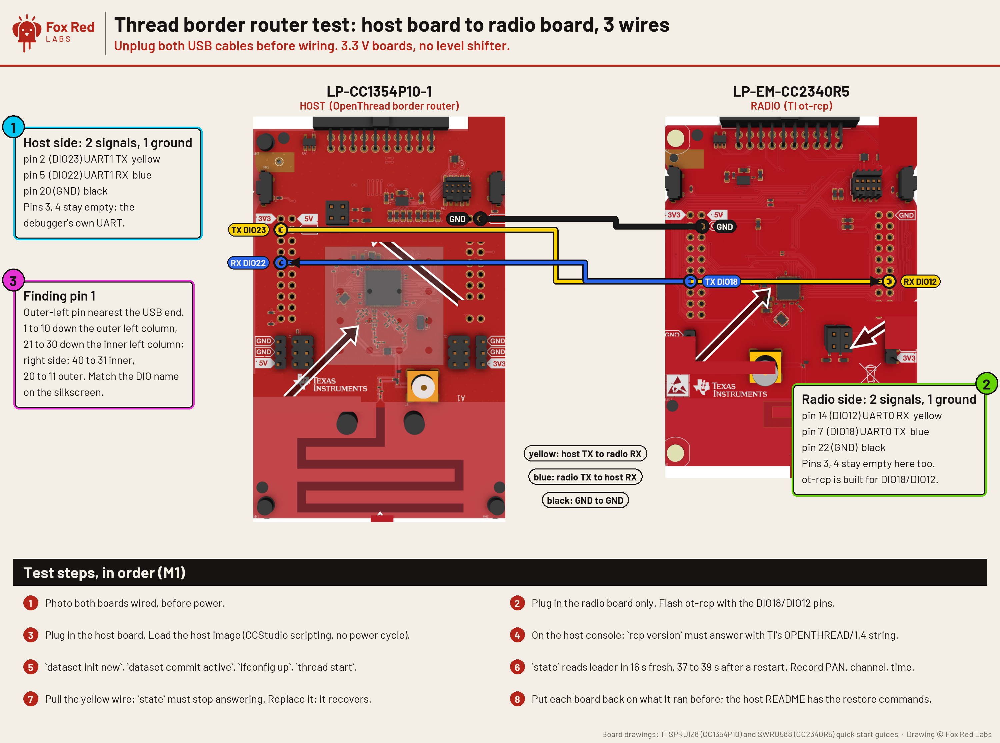

# Can a CC35X1 and a CC2755P10 or CC1354P10 make a Thread border router with no Linux?

The host half works: a CC1354P10 running OpenThread with a CC2340R5 as its radio over three wires formed a Thread network and became leader (2026-10-07). The Wi-Fi half (M2 on) has not run. Goal: Thread devices reach the home network and the internet through a border router made of two TI chips and no Linux computer. A Wi-Fi chip runs OpenThread as the host, with border routing; a Thread chip is its radio.

```text
 Thread devices  ~~802.15.4~~  [ RCP: CC2755P10 or CC1354P10 ]  --UART (spinel)--  [ Host: CC35X1, Cortex-M33 ]  ~~Wi-Fi 6~~  home router  --  internet
                                 TI ot-rcp image                                    OpenThread core + border routing
                                                                                     + lwIP (IPv6) on the Wi-Fi netif
```

What this is not: a Linux border router (OpenThread's `ot-br-posix` on a Raspberry Pi with a TI RCP: the documented path, already half proven in `cc1354p10/thread/`), and not a single chip (no TI part has both Wi-Fi and an 802.15.4 radio).

Terms: [docs/vocab.md](../docs/vocab.md). **RCP** is a radio co-processor: the chip does the radio, the host does the Thread logic. **Spinel** is OpenThread's host-to-radio protocol. **Border router** joins a Thread network to the home network. Public sources only: TI's public SDKs and `ot-ti`, OpenThread (BSD-3), Espressif's open-source border router (Apache-2.0) as a reference design. No TI internal material.

## What is here, and what is not

In this folder: `host/` and `host-cc1354/` (the host-side build and notes), `rcp-cc2340r5-hostpins.syscfg`, `WIRING.md` (every wire between the two chips, both ends), `img/`. Not here: TI's SDKs, the OpenThread and ot-ti sources (you fetch the pinned versions the README names), built images, and the raw join logs, which print the test network's name and keys; the numbers they gave are in this page. This is a plan with milestones, not a finished product: the milestones table says which have run. Take it alone with `git sparse-checkout add border-router cc1354p10 board-to-board tools data` (the Thread demo it builds on is in `cc1354p10/thread/`).

## What is already proven (2026-10-06)

Sizes: 1 kB = 1,024 bytes.

**The wiring for M1 is in place and tested** (it also survived flashing and restoring the radio board twice on 2026-10-06 while wired; with the wired pins left unconfigured the host saw only harmless input glitches): see [`WIRING.md`](WIRING.md) and the picture below. The check drove each wire from one chip and read it on the other through the two debuggers (no reflash), with a wire-less control pin as the negative control.



| Piece | Status | Where |
|---|---|---|
| TI RCP on the CC1354P10, driven by an OpenThread host over spinel at 921600 baud | **Works** (Mac host formed a network and became leader) | `cc1354p10/thread/README.md` |
| TI RCP on the **CC2340R5** (the border router's radio) driven by an OpenThread host, joining a CC1354 leader over the air | **Works**: router on the mesh, pings 42 to 44 ms median, 20 of 20 | `board-to-board/thread-two-radios-2026-10-06/` |
| OpenThread full Thread device on the CC1354P10 | **Works** (leader of its own network) | same |
| **The host side on a TI MCU (M1)**: OpenThread on the CC1354P10 with the CC2340R5 as its RCP over the three wires; the image that ran uses 456.7 kB of flash (code plus initialized data) and 125.9 kB of RAM with console logging compiled in; leader in 16 s on a fresh dataset and 37 to 39 s after a restart | **Works** (2026-10-07) | `host-cc1354/README.md` |
| CC35xx SDK has what a host needs | **Checked by reading the SDK** (Wi-Fi SDK 10.20.00.39): Cortex-M33 application core, 512 kB of application RAM in the default linker file, FreeRTOS, lwIP with IPv6, neighbor discovery and autoconfiguration on in the Wi-Fi port (`lwip-port/osi/include/lwipopts.h`), mbedTLS, UART and SPI drivers | `/Applications/ti/simplelink_wifi_sdk_10_20_00_39` |
| CC2755P10 as RCP | Not run as an RCP here; TI's `ot-ti` release notes list RCP for it | `ot-ti/docs/ti-openthread-release-notes.md` |

## M0 result (2026-10-06): the host builds for the Cortex-M33 and fits on paper

OpenThread (commit `c9c19aa`, the one TI's `ot-ti` pins, so host and RCP speak the same spinel version) built for the Cortex-M33 with hard float (the CC35xx's flags: `-mcpu=cortex-m33 -mfloat-abi=hard -mfpu=fpv5-sp-d16`), GCC 12.2, with border routing, SRP server, DNS-SD server, OpenThread's own mDNS, NAT64 (border routing and translator), border agent, network-data publisher, the CLI, and the host side of the radio link (`openthread-radio-spinel`, `openthread-hdlc`). Project config: `host/openthread-core-cc35xx-config.h`; build command in `host/build.sh`.

A trial link of a small program that starts all of these (dead code removed, platform functions not written left unresolved) gives **276 kB of code and 145 kB of RAM** (`text` and `bss` of the linked program). The CC35X1's default linker file gives the application 512 kB of RAM. Not included: the radio-over-spinel glue and the CC35xx platform layer (tens of kB), and Wi-Fi plus lwIP, which share the same RAM. RAM with Wi-Fi running is the number M2 has to settle.

Build traps found: OpenThread renamed `OPENTHREAD_CONFIG_PLATFORM_RADIO_SPINEL_RX_FRAME_BUFFER_SIZE` to `OPENTHREAD_LIB_SPINEL_RX_FRAME_BUFFER_SIZE`; SRP needs `TMF_NETDATA_SERVICE`, `ECDSA` and `DETERMINISTIC_ECDSA` switched on too; and the generated `openthread-mbedtls-config.h` is made once from the project config and not regenerated when the config changes (delete it, or start a fresh build folder, after editing the config).

## The work, in milestones

Each milestone ends in something measured on the bench.

| # | Milestone | Needs | Proof |
|---|---|---|---|
| M0 | **Done (compile and size)**: OpenThread host (core + radio spinel + border routing) compiles for the CC35xx's Cortex-M33 with the Wi-Fi SDK's FreeRTOS and lwIP; platform layer stubbed where hardware is needed | Nothing new | Links; size against the 512 kB budget |
| M1 | **Done (2026-10-07)**: the CC1354P10 runs OpenThread as a full Thread device with the CC2340R5 as its radio over the wired UART, forms a network and becomes leader (16 s on a fresh dataset, 37 to 39 s after a restart; 61 frames sent, no errors). `host-cc1354/README.md` | Wired and proven 2026-10-06 (`tools/wirecheck.sh`) | `state` = leader, from the host board: **seen**, EUI64 is the CC2340R5's |
| M2 | Wi-Fi up on the same image; OpenThread's infrastructure interface (`otPlatInfraIf`) on lwIP's Wi-Fi netif; router advertisements for the Thread prefix on the home Wi-Fi | M1 | Mac on the home Wi-Fi sees the Thread route (`netstat -rn -f inet6`) |
| M3 | A second Thread device (CC2755P10, or the CC1354P10 as FTD with the CC2755P10 as RCP) joins; ping it from the Mac over Wi-Fi; then SRP and mDNS so it is discoverable | M2, second Thread board | `ping6` from the Mac, round trip recorded |
| M4 | NAT64 so Thread devices reach the IPv4 internet; Matter-over-Thread commissioning through this border router | M3 | Matter device added in Home Assistant |

## How it is ported

OpenThread's border routing lives in its core (`src/core/border_router`) and is platform independent. A host needs:

1. **Radio over spinel**: OpenThread's `RadioSpinel` and HDLC framing over a UART, as on Linux but on FreeRTOS. Espressif runs the same code on an ESP32-S3 (`esp-idf` `components/openthread`).
2. **Platform layer**: alarms, entropy (the CC35xx has a TRNG), settings in flash, logging, the task loop.
3. **Infrastructure interface**: `otPlatInfraIf*` (send and receive ICMPv6 router and neighbor messages on the Wi-Fi netif), plus moving IPv6 packets between the Thread netif and lwIP. Espressif's port does this on lwIP; it is the model to follow.
4. **mDNS and SRP server, NAT64**: OpenThread has these in its core for embedded border routers; they need the lwIP glue above.

Risks to check early: whether the CC35xx application core can open raw IPv6 sockets or hooks on the Wi-Fi netif through the SDK's lwIP port (M2); RAM once Wi-Fi, lwIP and OpenThread run together (M0 gives the first number); the UART speed the CC35xx and RCP agree on (921600 in TI's RCP).
