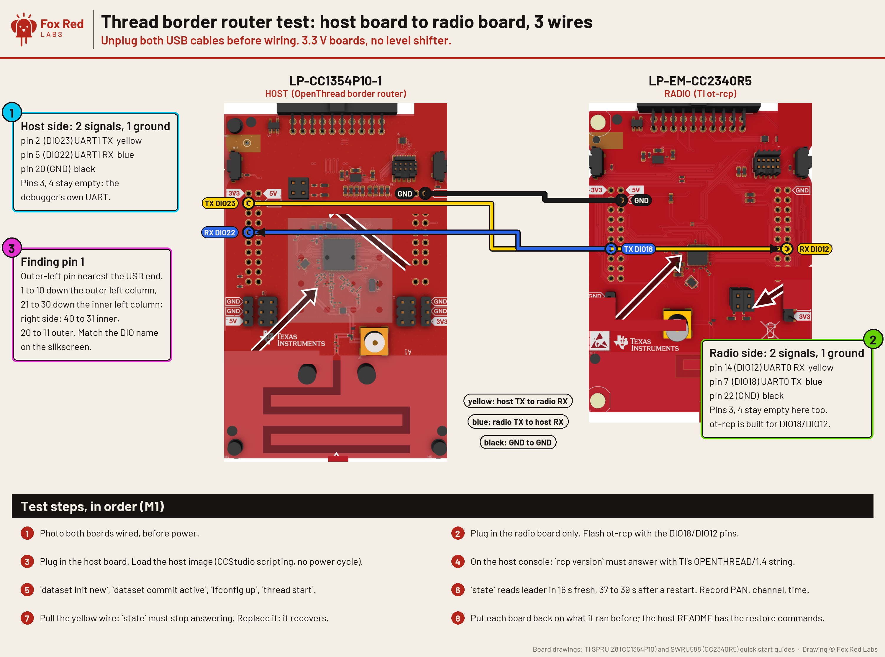

# How do you wire a LP-CC1354P10-1 host to a LP-EM-CC2340R5 radio for the Thread border router test (M1)?

Three jumper wires: host UART1 TX (DIO23) to radio DIO12, host RX (DIO22) from radio DIO18, and ground. Terms: [docs/vocab.md](../docs/vocab.md). **RCP** is a radio co-processor. **DIO** is a chip's numbered I/O pin.



Drawn over TI's own top-down board drawings (quick start guides SPRUIZ8 for the CC1354P10 and SWRU588 for the CC2340R5, page 2, rendered at 600 dpi; TI's annotation arrows masked near the headers). All 40 header pin positions on each drawing were checked with a numbered overlay before any wire was placed. Pin numbers, DIO names and header geometry come from TI's board `.syscfg.json` files. One caveat: TI's drawing is the LP-EM-CC1354P10-1 (no onboard probe); the LP-CC1354P10-1 has an XDS110 section, so the header is the same but the board outline differs. Wired 2026-10-06 and **verified from the chips**: a script that drives each pin from one chip and reads it on the other through the two debuggers (`tools/wirecheck.sh`) drove DIO23 high and low on the host and read it on the radio's DIO12, then DIO18 on the radio read on the host's DIO22, four transitions each, all matched; a wire-less control pin (DIO24 on both) did not move. Both programs were halted during the test and resumed after.

Host: LP-CC1354P10-1 (stands in for the CC35X1 until it arrives). Radio (RCP): LP-EM-CC2340R5. Three jumper wires. No level shifter: both boards run 3.3 V I/O.

Pin numbers below are the BoosterPack header pins, read from TI's own board files (`LP_EM_CC2340R5.syscfg.json`, `LP_EM_CC1354P10_1.syscfg.json`) and the CC2340R5 pin-mux table in SysConfig 1.26.3. Each board keeps its own XDS110 debugger UART untouched, so the Mac can still see both consoles.

```text
            LP-CC1354P10-1  (HOST)                          LP-EM-CC2340R5  (RCP)
            BoosterPack header                              BoosterPack header

   pin 2   DIO23  UART1 TX  o---------------------------->o  pin 14  DIO12  UART0 RX
   pin 5   DIO22  UART1 RX  o<----------------------------o  pin 7   DIO18  UART0 TX
   pin 20  GND              o-----------------------------o  pin 22  GND  (pin 20 is GND too)

   pin 3   DIO12  (XDS110 UART RX, leave alone)              pin 3   DIO22  (XDS110 UART RX, leave alone)
   pin 4   DIO13  (XDS110 UART TX, leave alone)              pin 4   DIO20  (XDS110 UART TX, leave alone)
```

TX on one board goes to RX on the other, and GND to GND. That is all.

## Finding the pins on the boards

From TI's board files (`dimensions.columns`, identical for both LaunchPad development kits): the 40-pin BoosterPack header is four columns of 10. Pin 1 is the outer-left pin nearest the USB end. Pins 1 to 10 run down the outer left column and 21 to 30 down the inner left column; on the right side, 40 down to 31 is the inner column and 20 down to 11 the outer. Every pin is silkscreened with its DIO name on these LP-EM boards, so match the name rather than counting.

- CC1354P10 host: DIO23 (pin 2) and DIO22 (pin 5) in the outer left column near the USB end; GND is pin 20, top of the outer right column.
- CC2340R5 radio: DIO12 (pin 14) and DIO18 (pin 7) in the outer right and outer left columns; GND pin 22, top of the inner left column (pin 20, top of the outer right column, is also GND).

Photograph each board after wiring and before power, so you can compare it with the picture above.

## Why these pins

- The XDS110 debugger of each LaunchPad development kit is hard-wired to the pins the SDK calls `XDS110UART` (CC2340R5: DIO20 TX, DIO22 RX; CC1354P10: DIO13 TX, DIO12 RX). TI's RCP image and every TI example use those by default. Tying the two boards together on them would put three drivers on one wire. So both UARTs move to free header pins.
- The CC2340R5's UART0 is not fully muxable. From the SysConfig pin-mux table, UART0 TX can land on DIO4, DIO6, DIO13, DIO17, DIO18 or DIO20, and UART0 RX on DIO12, DIO15, DIO16, DIO20 or DIO22. DIO18 and DIO12 are both free on the header and are not debugger pins.
- The CC1354P10 (CC13x4) muxes any UART onto any DIO. UART1 on DIO23/DIO22 keeps UART0 for the debugger console.

## Settings that match the wiring

RCP (`ot-ti`, in `src/cc23xx_cc27xx/openthread.syscfg`, the `UART` instance): replace the `$hardware = XDS110UART` line with explicit pins, the same `$assign` form ot-ti already uses for its log UART:

```text
UART.uart.txPin.$assign = "boosterpack.7";    /* DIO18 */
UART.uart.rxPin.$assign = "boosterpack.14";   /* DIO12 */
```

Host (CC1354P10, this repo's `border-router/host` project): a second `UART2` instance on UART1 with `txPin.$assign = "boosterpack.2"` (DIO23) and `rxPin.$assign = "boosterpack.5"` (DIO22), at 921600 baud to match TI's RCP (`ot-ti/src/uart.c`). The RCP image with these pins is built: `rcp-cc2340r5-hostpins.syscfg` in this folder is the full SysConfig file (drop it over `ot-ti/src/cc23xx_cc27xx/openthread.syscfg` and run `./script/build LP_EM_CC2340R5`); the generated `ti_drivers_config.h` reads `CONFIG_GPIO_UART2_0_TX 18` and `CONFIG_GPIO_UART2_0_RX 12`, matching the diagram. The host side is in [host-cc1354](host-cc1354/README.md).

## Speed check before Thread

At 921600 baud on 20 cm jumper wires: fine. TI's own release note (TIOP-1438) says sleepy devices "may not function properly" at 921600 on the CC1354/CC2674; that is about SSED timing on the device, not the RCP link, and the RCP link runs at 921600 by TI's default. If the spinel link shows CRC errors, drop both ends to 460800 first.
