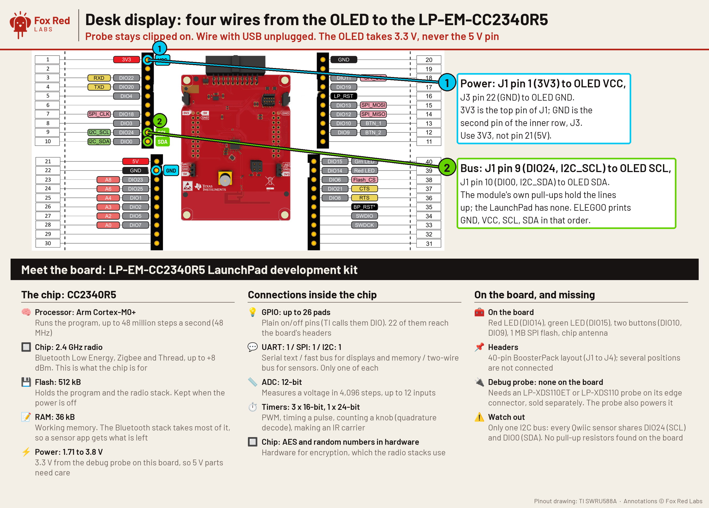

# Bluetooth desk display (LP-EM-CC2340R5 + SSD1306 OLED)

Status: firmware flashed and booting; Bluetooth echo and display not yet run. Evidence: [experiment page](../../docs/experiments/2026-10-30-cc2340r5-desk-display.md).



| Wire | LaunchPad end | OLED end |
|---|---|---|
| Power | J1 pin 1 (3V3) | VCC |
| Ground | J3 pin 22 (GND) | GND |
| Clock | J1 pin 9 (DIO24, I2C_SCL) | SCL |
| Data | J1 pin 10 (DIO0, I2C_SDA) | SDA |

Run, after wiring and with USB plugged in (one venv once: `python3 -m venv ~/.venvs/ble && ~/.venvs/ble/bin/pip install bleak`):

```bash
DESK_LAT=<lat> DESK_LON=<lon> cc2340r5/desk-display/run.sh clock    # time, date, weather on the OLED
cc2340r5/desk-display/run.sh page                                    # browser page at http://localhost:8000/ (stop the clock first: one link at a time)
cc2340r5/desk-display/run.sh test                                    # three lines, echo check, no display needed
```

Rebuild and flash: `cc2340r5/desk-display/build.sh`, then DSLite with `cc2340r5/CC2340R5.ccxml -e -f -u out/frl_desk_cc2340r5.hex`. Back up first (cc2340r5/AGENTS.md). Restore is the same page's restore recipe.

If the Mac's Bluetooth stops answering after a connect: turn Bluetooth off and on in Control Center (cc2340r5/AGENTS.md).
