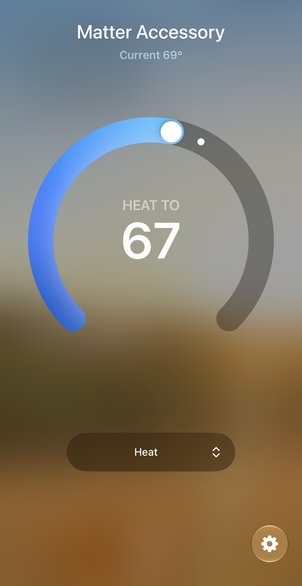

# How do you build a Matter light for the LP-EM-CC35X1 and control it from Apple Home?

TI’s lighting example paired with Apple Home on 2026-10-09, and both the phone tile and the board buttons controlled the red LED. The clean build took 11 minutes 13 seconds in an Ubuntu 22.04 container and produced a 1,800,524-byte signed image.

Start with the [complete light recipe](../../docs/builds/matter-device.md), or follow the [phone steps](#phone-steps) below. Google Home, Alexa and Home Assistant have not been tested. The thermostat variant below has working Apple Home setpoint control, but its temperature and occupancy are placeholders.

Board setup: [CC35X1 guide](../README.md). Troubleshooting: [CC35X1 FAQ](../FAQ.md). Terms: [vocabulary](../../docs/vocab.md).

Jump to: [build](#build-it-one-command), [program](#program-the-board), [phone steps](#phone-steps), [thermostat experiment](#thermostat-image-built-2026-10-10-running-and-paired-into-apple-home-2026-10-11), or [Mac commissioning record](#commissioning-from-a-mac-with-matterjs-tried-2026-10-09-did-not-get-past-bluetooth).

## What TI publishes (read 2026-10-09)

| Item | Value | Source |
|---|---|---|
| Repository and tag | `TexasInstruments/matter`, tag `matter-v1.5-ti-1.2-ea.2`, commit `33a45a1ba707418ee9f764723a5b98f2718e8abd` (published 2026-09-30) | github.com/TexasInstruments/matter/releases/tag/matter-v1.5-ti-1.2-ea.2 |
| Status for this chip | CC3551E, Matter over Wi-Fi: "Production Ready". Thread devices in the same release are "Evaluation Only" | release notes in the same release |
| Example | One only: `examples/lighting-app/ti/cc35xx` (the OnOff cluster; the red LED is the light, SW1 turns it on, SW2 off, green LED blinks during Identify) | the example's README |
| Pinned tools | Wi-Fi SDK 10.20.00.39 (a git submodule), SysConfig 1.28.0, Toolbox 4.3.23, Arm GNU 12.3.rel1, CMake 3.21.3 | release notes, "Dependencies" |
| Host | Ubuntu 22.04 only | release notes, "Operating System Support" |
| Known issue | MATTER-456: a Wi-Fi disconnect event shows on every boot after commissioning, before the connection succeeds | release notes |
| Limits | Plug in both USB-C cables (the debugger's and the board's) or the debugger can brown out during Matter transmissions. No over-the-air update of the Wi-Fi firmware or bootloader containers | release notes |
| Getting-started guide | `docs/platforms/ti/cc35xx_matter_v1.5_getting_started.md` in the repository (its text names the older tag `matter-v1.5-ti-1.1-ea.2`; the release notes name 1.2-ea.2 as current) | repository |

## Identity of the device, and what the apps will say

The example ships with test values from the Matter project: vendor ID `0xFFF1`, product ID `0x8001`, setup passcode `20202021`, discriminator `3840` (0xF00), and the project's example attestation credentials (the `TI_ATTESTATION_CREDENTIALS` build option is off by default). A device like that is not certified. So:

- **Apple Home** shows "Uncertified Accessory" and lets you continue with "Add Anyway".
- **Google Home** does not take a test vendor ID from a normal user. Google's rule ([Get started with Matter](https://developers.home.google.com/matter/get-started), read 2026-10-09): for development, a project and Matter integration with the same vendor and product ID must exist in the Google Home Developer Console, and the person commissioning must belong to that project. Test IDs `0xFFF1` to `0xFFF4` are allowed for basic commissioning and control. This setup has not been tested here; see the [compatibility plan](COMPATIBILITY.md).

Setup code for this build (made by `payload.py`; both strings match the Matter project's published test values for passcode 20202021 and discriminator 3840):

- QR text: `MT:-24J0GSY00KA0648G00` (the board's own log prints this one). An earlier version of `payload.py` gave `MT:-24J042C00KA0648G00`: the two differ only in the rendezvous field, 2 (Bluetooth only) against 6 (Bluetooth and on the home network), which is what the firmware advertises. The phone finds the board either way; use the board's.
- Manual pairing code: `3497-011-2332`
- QR picture: [setup-qr.png](setup-qr.png)

The QR code carries "Bluetooth LE" as the way to find the device, which is how a Wi-Fi Matter device is set up: the phone talks to it over Bluetooth, hands it the Wi-Fi name and password, and the device then joins Wi-Fi.

## Build it (one command)

On a Linux or Docker host with about 6 GB free:

```bash
./build.sh /path/to/work
```

`build.sh` runs `ubuntu:22.04` as `linux/amd64` with `--rm`, builds in a Docker volume (`frl-matter-build`; the source tree needs a case-sensitive disk, and macOS bind mounts are not), downloads the four tools, checks each against a vendor-published SHA-256, fetches TI's repository at the pinned commit, and leaves the images in `/path/to/work/out/debug`. Afterwards: `docker volume rm frl-matter-build`.

Downloads and checksums (all four matched; each hash comes from the vendor's own page, read 2026-10-09):

| File | SHA-256 | Where the hash is published |
|---|---|---|
| cmake-3.21.3-linux-x86_64.tar.gz | a19aa9fc...7518696 | Kitware `cmake-3.21.3-SHA-256.txt` |
| arm-gnu-toolchain-12.3.rel1-x86_64-arm-none-eabi.tar.xz | 12a28156...56332b309 | Arm `.sha256asc` file beside the download |
| sysconfig-1.28.1_4785-setup.run | b913ca84...3e7ee0e9f55b | ti.com/tool/SYSCONFIG |
| simplelink_wifi_toolbox_lin_4_3_23.run | 111b6a0d...29ff87cf0e | ti.com/tool/SIMPLELINK-WIFI-TOOLBOX |

Three deviations from TI's text, all needed to make the build run:

1. **SysConfig 1.28.1 instead of 1.28.0.** TI no longer serves the 1.28.0 Linux installer at any address found; 1.28.1 build 4785 was available when this build was recorded on 2026-10-09. The build passed with it. The pinned version stays 1.28.0 in TI's notes.
2. **Bootstrap with `-p ti`, and one line removed from `scripts/tests/requirements.txt`.** Plain `bootstrap.sh` fails: it asks pip for `bluezoo>=1.0.2`, which pip cannot find. That package is a Linux Bluetooth test helper, not part of the firmware. The build script deletes that one line.
3. **Emulation:** an Apple silicon host runs the container as amd64 under emulation (OrbStack). That is why it takes 11 minutes and not less.

### Build record (Mac mini, OrbStack, `linux/amd64` container, 2026-10-09)

| Step | Seconds |
|---|---|
| Install system packages | 74 |
| Download, check, unpack the four tools | 20 |
| Fetch TI's repository at the commit | 9 |
| Fetch submodules (`--platform cc35xx linux`) | 118 |
| Bootstrap the Matter build environment | 175 |
| Build the Wi-Fi SDK libraries | 69 |
| Build the lighting app (579 build steps) and sign it | 208 |
| **Total, clean container** | **673** (11 min 13 s) |

### Image sizes

| File | Bytes | Meaning |
|---|---|---|
| `chip-LP_EM_CC35X1-lighting-example.out` (ELF, with symbols) | 57,893,044 | for debugging; kept gzipped |
| `chip-LP_EM_CC35X1-lighting-example.bin` | 1,794,868 | the application |
| `toolbox/primary_vendor_image.sign.bin` | 1,800,524 | the application signed for the board (what gets programmed) |
| `chip-LP_EM_CC35X1-lighting-example.ota` | 1,800,610 | over-the-air update file |
| `toolbox/primary_ti_wireless_fw_image.bin` | 175,616 | TI's Wi-Fi radio firmware |
| `toolbox/primary_tbl_image.bin` | 140,904 | TI's boot loader image |

`arm-none-eabi-size` on the ELF: code and constants 1,720.9 kB, initialized data 31.2 kB, zero-initialized data 547.6 kB. Flash use is about 1.8 MB of the 8 MB flash chip. RAM use is about 593 kB (data plus zero-initialized data; this does not count heap or stacks the linker sets aside) of the chip's 1.1 MB.

The benchmark suite has no Matter test (`data/benchmark-suite.json` lists Matter only as a stack variant), so these numbers live here and not in `data/results/cc35x1.csv`.

The images are in the build’s `out/debug` directory. Copy its `toolbox` folder to the Mac, then rewrite its Linux paths for that local copy. From the repository root:

```bash
TB="/absolute/path/to/copied/toolbox"
cc35x1/matter/mac_paths.sh "$TB"
```

## Program the board

Follow the [light recipe](../../docs/builds/matter-device.md) for the activation check, cables and recovery steps. Activation cannot be undone; an unrelated connection error is not a reason to activate the chip. Once setup is complete, run from the Toolbox folder:

```bash
cd /Applications/ti/simplelink_wifi_toolbox_macos_4_3_23
./simplelink-wifi-toolbox programmer -i XDS110 -param1 <probe serial> programming --tool_settings "$TB/tool_settings.mac.json" --verbose
```

TI's text uses `-param1 auto` and `sudo` on Linux. Open the board's application UART at 115200 8N1 to see the log; with no network stored it advertises over Bluetooth and prints a line when commissioning completes ("Commissioning completed successfully").

## Phone steps

Before you start: the board is programmed, both USB-C cables are in, the iPhone is within a few meters of the board, Bluetooth is on, and the iPhone is on the home Wi-Fi. The Apple TV is the Home hub. Nothing else needs to run.

### A. Apple Home (do this one first)

Tested 2026-10-09: tile and button toggles confirmed at 19:41.

1. Open the **Home** app on the iPhone.
2. Tap **+** (top right), then **Add Accessory**.
3. Scan the QR picture on the Mac screen (`setup-qr.png`). If the scan fails, tap **More options...**, then enter the code **3497-011-2332**.
4. When the phone says **Uncertified Accessory**, tap **Add Anyway**.
5. If asked, choose the room and a name (for example "CC35 light"), then **Done**.
6. Tap the new tile to turn the light on and off. The red LED on the board follows. Press SW1 and SW2 on the board and watch the tile change.
7. Expect one oddity: the board's log shows a Wi-Fi disconnect on each boot (TI's MATTER-456). It still joins.

### Other home platforms: not tested

Google Home, Alexa and Home Assistant remain validation work. The light’s Apple Home result does not establish compatibility with those controllers. The [compatibility plan](COMPATIBILITY.md) records the separate checks; verify each platform’s current setup instructions before trying it. No additional home service is required for the demonstrated Apple Home light.

Out of scope on this chip: Matter over Thread (the CC3551E has no 802.15.4 radio).

## Thermostat image (built 2026-10-10; running and paired into Apple Home 2026-10-11)

**TI's Matter fork has no thermostat example for the CC35xx, so the thermostat is TI's lighting example with its data model and application code swapped; it builds in about 5 minutes on a warm container and comes out 10.4 kB smaller than the light.** The image has a Thermostat on endpoint 1 and an Occupancy Sensing sensor on endpoint 2. Test plan for Apple Home, Google Home, Alexa and Home Assistant: [COMPATIBILITY.md](COMPATIBILITY.md).

What TI ships (checked 2026-10-10 at commit `33a45a1b`): `examples/thermostat/` has folders for asr, genio, infineon, linux, nxp, qpg, realtek, telink and a shared `thermostat-common`; none is for TI. The only TI Matter example is `examples/lighting-app/ti/cc35xx`.

Changes (all generated by `thermostat/make_example.py`, run inside the build; nothing in TI's tree is edited by hand):

- Data model: the lighting `.zap` file with its light endpoint replaced by TI-neutral Matter thermostat settings (heating and cooling, no presets, no schedules) and a new Occupancy Sensing endpoint. `scripts/tools/zap/generate.py` makes the `.matter` file from it.
- Application: `LightingManager` is replaced by `ThermostatManager` (`thermostat/src/`). A task reads `T,seq,presence,zones,setpoint,temp` lines from UART2 instance 1 (115,200 baud, RX on LaunchPad header P1 pin 3, GPIO18; format in `thermostat-system/PROTOCOL.md`) and writes local temperature, the heating setpoint and occupancy. A controller write to a setpoint or the system mode is logged as `CONTROLLER_WRITE t=<ms> ...` and sent back on P1 pin 4 as `M,<heat tenths>,<cool tenths>,<mode>` (a proposal made here; not in PROTOCOL.md).
- No line for 5 seconds (or none ever): the temperature stays 20.8 C and SW1 and SW2 step the heating setpoint by 0.5 C, so the device works on the bench with no wires. The chip has no temperature sensor readable through TI's drivers, so the fallback is a fixed value, not a measurement.
- SysConfig: a copy of TI's platform file with the second UART added (`chip_thermostat.syscfg`). The red LED shows occupancy.
- The red LED, factory reset (hold SW1 for 1 s as in TI's example), Bluetooth advertising and the 300-second commissioning window are TI's code unchanged. The window is 300 s on this image (a scan 40 minutes after start-up hung on "Connecting"). Whether pressing S1 or holding SW1 reopens it was not run on the thermostat image.

Build: `build-thermostat.sh /path/to/work` on a Docker host; run on a Docker host (the Mac had 3.5 GB free; the build volume is about 6 GB). Same pins as the light. The container keeps its tools and source in the volume `frl-matter-build`, so the first run takes longer.

| Step (Mac mini, OrbStack, linux/amd64) | Seconds |
|---|---|
| Cold container up to the start of the app step (packages 75, tools 23, source 10, submodules 132, bootstrap 188, Wi-Fi SDK libraries 72) | 500 |
| App step, last try (generate data model, `gn`, ninja; most objects cached from two earlier tries that stopped on compile errors in this repo's files) | 165 |
| Same script on a warm volume, whole run | 301 |

No uninterrupted cold build was timed. TI's light needed 208 s for its clean app step, so a cold thermostat build is about 12 minutes.

| Size | Thermostat | Light (same tag) |
|---|---|---|
| Application image (`.bin`) | 1,742.4 kB | 1,752.8 kB |
| Signed for the board (`primary_vendor_image.sign.bin`) | 1,747.9 kB | 1,758.3 kB |
| Code and constants plus initialized data (flash, from the ELF) | 1,741.6 kB | 1,752.1 kB |
| Initialized plus zero-initialized data (RAM, heap and stacks not counted) | 579.3 kB | 578.9 kB |

Results rows: `host_fit` `matter-thermostat-flash` and `matter-thermostat-ram` in `data/results/cc35x1.csv`. `toolbox/tool_settings.mac.json` in your copied build has the paths for the Toolbox programmer. SHA-256 of the signed image: `6ef1ee43...cd8e90e`.

**It runs and Apple Home controls it (2026-10-11).** Apple Home added it as a thermostat ("Matter Accessory", current 69 F from the 20.8 C fallback) and the heating setpoint changed from the phone (screenshot below, 20:25). At idle before pairing the heartbeat reported 149.7 kB of heap free, lowest 146.8 kB.



Put it on the board in this order (from the Toolbox folder, both USB-C cables in, probe serial for `<probe serial>`):

```bash
./simplelink-wifi-toolbox programmer -i XDS110 -param1 <probe serial> full_flash_erase --flash_type AUTO_DETECT --activation_type sdk_example_key
./simplelink-wifi-toolbox programmer -i XDS110 -param1 <probe serial> programming --tool_settings "$TB/tool_settings.mac.json"
```

1. The erase comes first whenever a different image was on the board before, above all TI's Wi-Fi CSI presence image: without it, every image programmed after the CSI image (TI's own light included) stayed silent. The erase takes about 16 s; the programming about 60 s.
2. After programming onto an erased flash the image starts by itself (no J12 replug): the boot line and the Matter log appear within 2 s, Bluetooth advertising within 5 s.
3. Pair within 5 minutes of that start (TI's commissioning window is 300 s): Home app, +, Add Accessory, scan `setup-qr.png` (QR text `MT:-24J0GSY00KA0648G00`, manual code 3497-011-2332), accept the uncertified-accessory warning. A scan after the window closes finds the device and hangs on "Connecting"; erase and program again for a new window.
4. The log UART (115200, 0x1C200 in `cc35xxLogInit`) reads cleanly until Bluetooth starts, then turns to a stream of 0x00 and 0x80 bytes at every host rate tried; the heartbeat comes through only in fragments. Cause not found; pairing and control are not affected.

The Apple Home pairing for the light is lost when the image is replaced.

## Files

- `build.sh`: the container build.
- `build-thermostat.sh`, `thermostat/`: the thermostat build (`make_example.py` builds the example from TI's lighting example; `src/` holds this repo's application files).
- `COMPATIBILITY.md`: the four-platform test plan.
- `payload.py`: prints the QR text and manual code for any passcode, discriminator, vendor and product ID.
- `setup-qr.png`: QR for this build (TI public test values).

## Commissioning from a Mac with matter.js (tried 2026-10-09, did not get past Bluetooth)

The open-source matter.js shell (`@matter/nodejs-shell` 0.17.9 with `@matter/nodejs-ble` 0.17.9, which uses `@stoprocent/noble` 2.8.0, Node 26.4; 151 MB of packages) installs and starts on macOS 15.7 with `--ble-enable`, and the Mac's Bluetooth radio reaches the board: the board logs `BLE: GAP connected`. Then matter.js drops the link three times in 1.2 seconds with `The specified UUID is not allowed for this operation`, and the board logs `BLE: GAP disconnected (con 2 reason 0x13)` each time. That message comes from macOS's Bluetooth layer, not from the board; the pairing never reaches the secure-session step. Same command, `commission pair 1 --setupPinCode 20202021 -d 3840 -b`, with the board freshly reset so its commissioning window was open. Not fixed. Phones are not affected by this. Until it is fixed, commission with the iPhone as in the phone steps above, or from a Linux machine with Bluetooth.

A reset (press S1, or `xds110reset -s <probe serial>`) restarts the board and with it TI's commissioning code. The window length was timed only on the thermostat image, where it closed at 300 s (the code is TI's, unchanged from the light); Matter's own default is 15 minutes, which was not seen on the board. Scan within 5 minutes. S1 on the thermostat image: not run.

## Commissioned over the network from a Mac (2026-10-09)

Bluetooth is not needed if the board is already on Wi-Fi when you commission it. The home network was put into a test build of the Wi-Fi driver, which was compiled in a throwaway container, flashed, and deleted along with the build tree and container straight after. The change is eleven lines in `NetworkCommissioningWiFiDriver.cpp`: when no network is stored, it uses a built-in one and adds the Wi-Fi profile. The build script and the credentials stay out of the repo. With the board on Wi-Fi (joined 8 seconds after reset on a 5 GHz channel) and its commissioning window open, the matter.js shell on the Mac found it over mDNS (`_matterc._udp`) and commissioned it with no Bluetooth: `commission pair 1 --setupPinCode 20202021 -d 3840`.

| Step | Board log time | Seconds from first message |
|---|---|--:|
| PBKDF parameter request (PASE starts) | 10:45:38.04 | 0 |
| PASE session established | 10:45:39.61 | 1.6 |
| Fabric added | 10:45:41.80 | 3.8 |
| CASE Sigma1 received | 10:45:42.28 | 4.2 |
| CommissioningComplete received | 10:45:42.78 | 4.7 |
| `Commissioning completed successfully` | 10:45:43.02 | 5.0 |

Ten OnOff toggles from the shell took a median of 250 ms each (fastest 152 ms, slowest 830 ms), command sent to reply printed, over the home Wi-Fi. A second commissioning window (enhanced, 15 minutes) opened afterwards with its own code, which is what Apple Home, Google Home or Home Assistant would use over Wi-Fi with no Bluetooth. Software versions: `@matter/nodejs-shell` 0.17.9, Node 26.4, TI Matter release `matter-v1.5-ti-1.2-ea.2`.

**That October 9 test build contained home-network credentials.** This is a historical record, not the current board inventory. Before sharing a board, verify its current image and remove stored network and Matter credentials.
