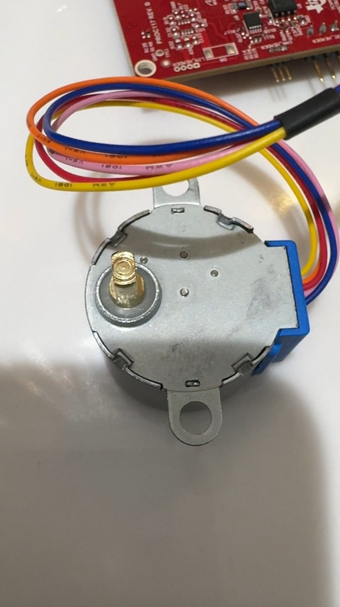

<!-- experiment
id: E145
board: LP-AM13E230
date: 2026-10-09
status: works
reached: verified
line: The Freenove kit's 28BYJ-48 stepper turned a full turn each way. It ran from four plain output pins and the board's 5 V, through the kit's ULN2003 driver board, with no soldering and no breadboard. Build and flash took 7 s.
stop: none
-->
# Can the TI LP-AM13E230 spin a hobby-kit motor with no soldering?

**Short answer.** Yes. The kit's 28BYJ-48 stepper turned one full turn each way, repeating, from four plain output pins on J4 and the board's 5 V on J3, through the kit's ULN2003 driver board. Six jumper wires, no breadboard, no soldering. The program is `am13e230/stepper-uln2003/`.

Terms: [vocab](../vocab.md), [LP-AM13E230 FAQ](../../am13e230/FAQ.md). MCPWM is the chip's motor PWM (pulse width modulation) block. ULN2003 is a chip of seven switches that carries the motor current so the board's pins do not. A half-step is one move in an 8-state coil sequence; 4,096 of them turn the output shaft once. eQEP is the chip's quadrature encoder input, which reads a rotary knob. XDS110 is the programmer built into the LaunchPad. Tools: TI Arm Clang 5.1.1.LTS, SysConfig 1.28.0, macOS, checked 2026-10-09. 1 kB = 1,024 bytes. Board page: [LP-AM13E230 README](../../am13e230/README.md). Wiring picture: [am13e230-stepper-uln2003.png](../../am13e230/stepper-uln2003/am13e230-stepper-uln2003.png).

**Question.** Which hobby-kit motor can this board spin with the parts in the box, and what does the board need to do it?

**Vendor position.** TI's motor examples for this board, in `solutions/motor_control/ufoc_lp_bxl/`, all need a BOOSTXL-DRV8323RH or DRV8329A BoosterPack and a three-phase motor. The SDK has no example for a stepper or a brushed DC motor. The user guide (SLVUDH9, read 2026-10-09) gives 5 V on J3 pin 21 and the MCPWM4 outputs on J4 pins 35 to 40.

**What was on the desk.** Three ways to spin something, none needing a motor BoosterPack:

| Motor | Driver | Soldering | Board pins |
|---|---|---|---|
| 28BYJ-48 stepper (kit) | ULN2003 board (kit, headers fitted) | none | 4 outputs, 5 V, GND |
| DC motor (kit) | L293D chip (kit, in the breadboard) | none | 2 PWM outputs, 5 V, GND |
| DC motor (kit) | DRV8833 carrier (TI chip) | headers first | 2 PWM outputs, 5 V, GND |

**What was tried.** The stepper through the ULN2003 board: four outputs on port B (PB3, PB1, PB2, PB7 on J4 pins 40, 38, 36, 34), the 8-state half-step sequence, 1.2 ms a step, 4,096 half-steps a turn, one turn each way with a 1 s pause, LED4 on while stepping, all coils off between turns. A first program drove a DC motor through the L293D on MCPWM4 outputs 1A and 2A (PB3 and PB1, J4 pins 40 and 38) at 20 kHz; it built and flashed in 8 s, and the DC-motor program is in `am13e230/motor-l293d/`.

**How far it got.** Verified: the shaft turned both ways on the first flash, seen on a video of the bench. The frame above is the saved record. The wiring takes about five minutes from the picture. The driver board's four LEDs chase with the coils.

| What | Value |
|---|---|
| Build, flash | 3.1 s, 4.2 s |
| Flash used | 8.0 kB |
| Step time, steps a turn | 1.2 ms, 4,096 half-steps (about 5 s a turn) |

**The line.** None found: this is four output pins and a 5 V rail, well inside what the board offers. Not measured: the real turn time against the 4,096-step assumption (the gearbox ratio on these motors is close to, not exactly, 64), the coil current, and the fastest step the motor holds from 5 V.

**Ask.** What gearbox ratio do these 28BYJ-48 motors really have (63.68:1 or 64:1), so the turn count can be checked against a mark on the shaft?

**What to take from it.** A motor-control chip does not need its motor BoosterPack to move something. The kit's stepper board is the no-solder, no-breadboard way in: four outputs and a sequence table.

**To try it.** Wire it yourself with [the program's README](../../am13e230/stepper-uln2003/README.md): build and flash take about 7 s. If it does not turn, see its "If you see" list, which carries the same fixes as the FAQ.
