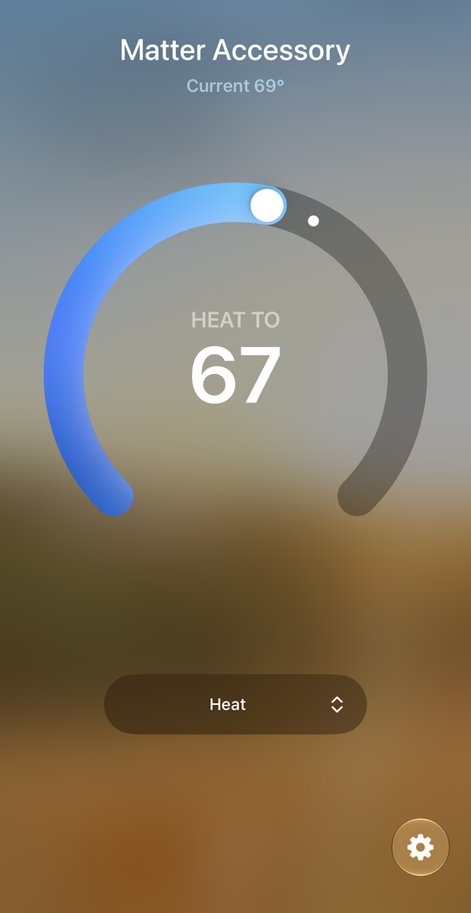

<!-- experiment
id: E169
board: LP-EM-CC35X1
date: 2026-10-10
status: waiting
reached: verified
line: The Matter thermostat on the LP-EM-CC35X1 (TI's lighting example with a Thermostat and an Occupancy Sensing data model, 1.7 MB, 579 kB of RAM) runs, pairs into Apple Home and takes setpoint changes from the phone (2026-10-11). It never booted before because TI's Wi-Fi CSI image had left the flash laid out differently; a full flash erase before programming fixed it. Google Home, Alexa and Home Assistant are not run.
stop: none
-->
# Can one Matter thermostat on the LP-EM-CC35X1 work in Apple Home, Google Home, Alexa and Home Assistant?

**Short answer.** Yes for Apple Home. The image (a Matter Thermostat with heating and cooling setpoints and local temperature, plus an Occupancy Sensing sensor; 1,742.4 kB of application, 579 kB of RAM) runs on the CC3551E, Apple Home adds it as a thermostat, and the heating setpoint changes from the phone. TI ships no thermostat for this chip, so it is TI's lighting example with the data model and application swapped. After TI's Wi-Fi CSI presence image, every image programmed stayed silent, TI's own light included, until a full flash erase. Google Home, Alexa and Home Assistant are not run.

Terms: [vocab](../vocab.md). Build and sizes: [cc35x1/matter/README.md](../../cc35x1/matter/README.md), section "Thermostat image". Test plan: [COMPATIBILITY.md](../../cc35x1/matter/COMPATIBILITY.md). Wire format: [PROTOCOL.md](../../thermostat-system/PROTOCOL.md).

**Question.** Can one Matter-over-Wi-Fi device on the CC3551E be a thermostat that Apple Home, Google Home, Alexa and Home Assistant all take, with the radar's presence line as an occupancy sensor?

**Vendor position.** TI's release `matter-v1.5-ti-1.2-ea.2` lists Matter over Wi-Fi on the CC3551E as "Production Ready" and ships one example for it, the lighting app. Apple (Support 102135, 2026-05-07) lists thermostats and motion sensors among Home app Matter types. Google lists Thermostat and Occupancy Sensor as supported device types (developers.home.google.com/matter/supported-devices, read 2026-10-10) and needs a developer project for a test vendor ID. Amazon lists thermostats and sensors (developer.amazon.com Alexa Matter categories, read 2026-10-10). Home Assistant's controller is the Matter Server app (home-assistant.io/integrations/matter, read 2026-10-10).

**What was tried.**

- Looked for a TI thermostat target: `examples/thermostat/` in TI's fork has ten vendor folders and no TI one.
- Copied the lighting example, replaced its `.zap` endpoint with a thermostat (features heating and cooling, no presets or schedules) and added an Occupancy Sensing endpoint; replaced the light code with a task that reads `T,...` lines on a second UART and writes the clusters; added the second UART to a copy of TI's SysConfig file. Fallback with no line: 20.8 C and SW1 or SW2 step the setpoint by 0.5 C.
- Built in a throwaway linux/amd64 container. `generate.py -m` wants its output file to exist before it runs.

**How far it got.**

| Step | Result |
|---|---|
| Configure, compile, link, sign | Yes. 1,742.4 kB application, 1,747.9 kB signed, 1,741.6 kB flash, 579.3 kB RAM from `arm-none-eabi-size`; the light on the same tag is 1,752.1 kB and 578.9 kB |
| Flash | Yes, twice (2026-10-10): v1, then v2 with a boot line and a heartbeat every 5 s on the log UART. The programmer reported success each time |
| Boot, 2026-10-10 | Not seen, twice. The board had run TI's Wi-Fi CSI image the day before |
| Boot, 2026-10-11, programmed over the CSI image | Not seen: 0 bytes on both console ports through a probe reset and a J12 replug |
| Control: TI's own light image, programmed over it | Not seen either: 0 bytes after programming, after a replug of both cables, and after a second programming. So the fault was not this repo's image |
| Full flash erase, then the thermostat | Booted by itself as programming ended: this repo's boot line, Wi-Fi start, Matter server, "THERMO ready: UART2_1 115200, endpoint 1 thermostat, endpoint 2 occupancy", Bluetooth advertising 2.7 s after the boot line. Heap free at idle 149.7 kB, lowest 146.8 kB |
| Setup in Apple Home | Works (2026-10-11, an iPhone): added as "Matter Accessory", a thermostat, right after a fresh erase and program. One earlier scan hung on "Connecting" because the 300-second commissioning window had closed |
| Setpoint from Apple Home | Works: heat to 67 F set from the phone. Latency not timed |
| Google Home, Alexa, Home Assistant | Not run. Plan with vendor steps and hub hardware in COMPATIBILITY.md |
| Presence latency, offline control, four controllers at once, setup after a reflash | Not run: rows waiting in `data/results/cc35x1.csv`. The occupancy endpoint has no radar line wired |
| Log UART after Bluetooth starts | Turns to a stream of 0x00 and 0x80 bytes, the same at every host rate tried (1,200 to 115,200); fragments of the heartbeat come through. Cause not found |

**The line.** Not reached for Apple Home: it adds the thermostat and sets it. **Tool or docs**: the silence that blocked it for a day was the flash left behind by TI's CSI image, cleared by the Toolbox's `full_flash_erase`; the Toolbox guide does not say an erase is needed between images with different flash maps. The Thermostat cluster started with no delegate (no presets or schedules in the data model) and the second UART opened, both confirmed by the boot log. Writing the Occupancy attribute from the radar line is still untested.

**No TI example for this chip.** TI ships Matter over Wi-Fi on the CC3551E with one example, the light; Matter's own thermostat examples have ten vendor folders and none for TI. This is the first Matter thermostat on a CC35xx known to this repo. TI's lighting example became a thermostat by changing the data model and one application file, and Apple Home took it on the first scan inside the commissioning window.

What to watch for:

| Symptom | Cause | Fix |
|---|---|---|
| Every image is silent after TI's CSI image, TI's light included | **Tool or docs**: the CSI bundle lays the flash out differently, and programming another bundle over it does not fix that | `full_flash_erase` before programming |
| A pairing scan hangs on "Connecting" | **Setup or handling**: TI's commissioning window is 300 s | Erase and program right before pairing |
| Only one tool can hold the debug probe | **Setup or handling**: a second programmer on the same probe gives -615 debug errors and lost images | One tool per probe at a time |
| The log UART turns to 0x00 and 0x80 bytes after Bluetooth starts | **Unknown** | Open; debug visibility only |

Build time was about 5 minutes on a warm container.

**Left open.** The radar's presence line into the occupancy endpoint (the 4-wire visit), then Google Home, Alexa and Home Assistant from COMPATIBILITY.md, and the setpoint latency.

**Ask.** Has anyone seen Alexa or Google Home take a Matter device with the test vendor ID 0xFFF1 without a developer project?
