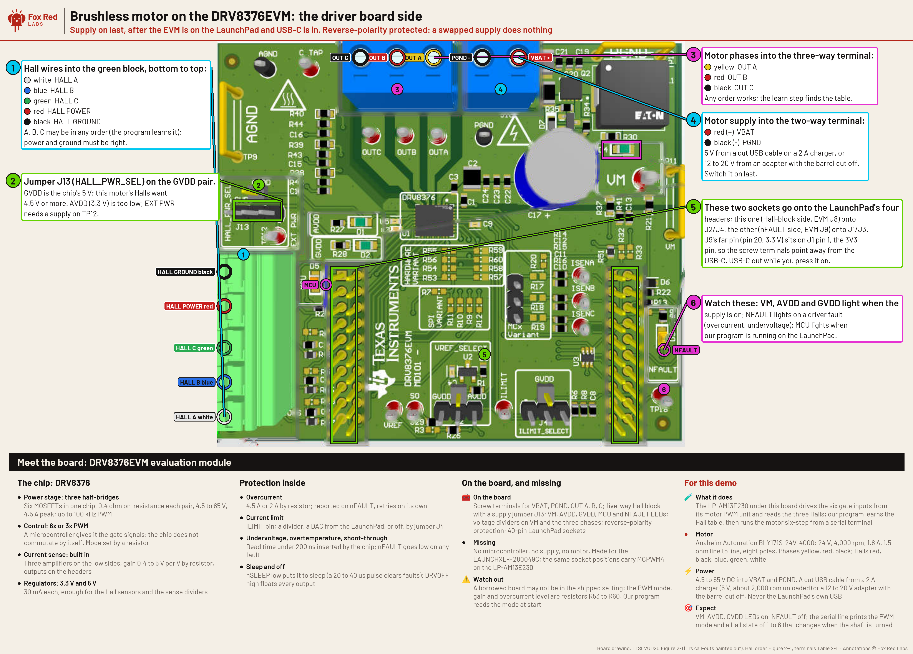
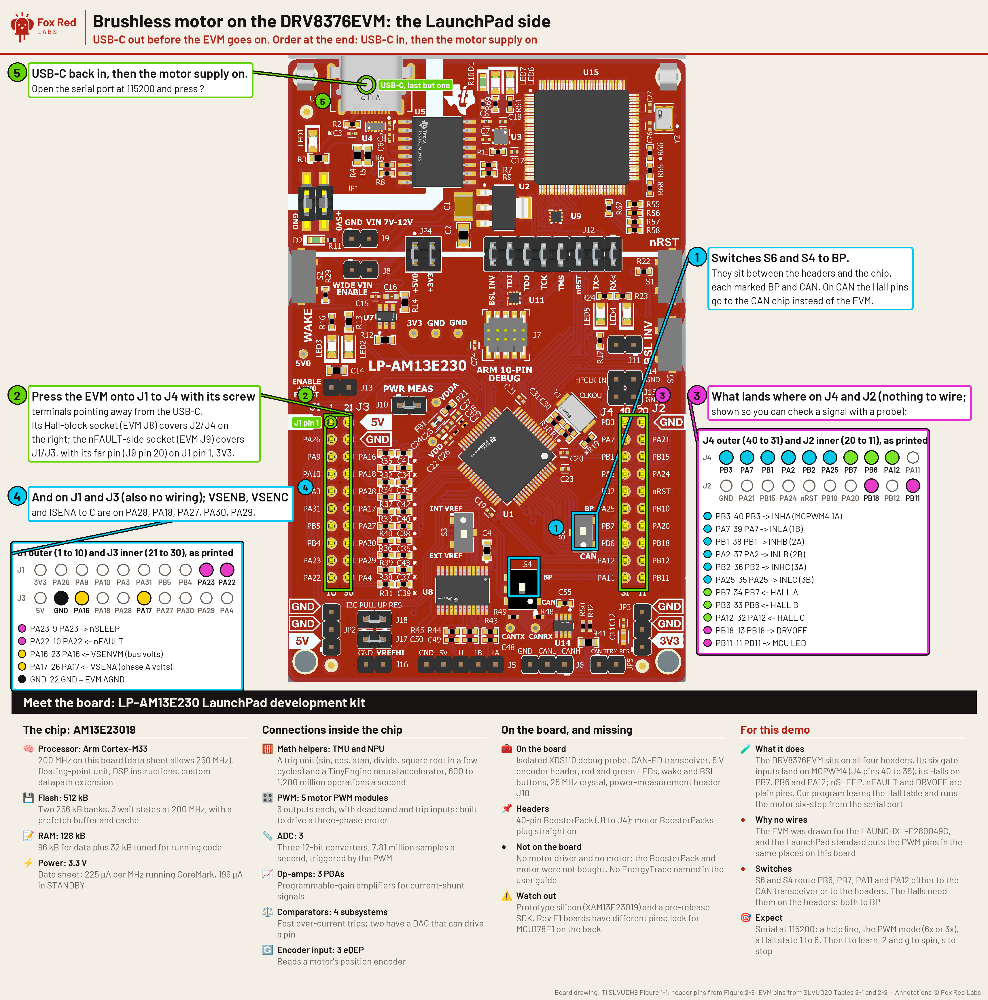

<!-- experiment
id: E196
board: LP-AM13E230
date: 2026-10-15
status: works
reached: verified
line: The DRV8376EVM plugs straight onto the LP-AM13E230 and a 350-line six-step program spun an Anaheim BLY171S-24V-4000 at 924, 2,312 and 3,632 rpm (medians of three runs) at 20, 40 and 60 percent duty on a 12.4 V bus, both directions, with the Hall table learned by the program itself. From the question to the first clean spin took about four hours of work and two hours hands-on: a missing Hall jumper, Hall lines flickering on sector boundaries, and an EVM voltage read-back that could not tell the PWM mode.
stop: none; open loop in duty, unloaded
-->
# Can the LP-AM13E230 spin a Hall-sensor brushless motor through TI's DRV8376EVM, with no motor BoosterPack and no C2000?

**Short answer.** Yes. A six-step program on the LP-AM13E230 spun the motor through the DRV8376EVM with no motor BoosterPack and no C2000. Numbers and the method are on the [program page](../../am13e230/bldc-drv8376/README.md); rows `bldc_rpm` in `data/results/am13e230.csv`.

Terms: [vocab](../vocab.md), [LP-AM13E230 FAQ](../../am13e230/FAQ.md). Six-step is the simplest brushless drive, two phases on at a time, switched by the three Hall sensors; FOC is the smooth version TI's SDK solutions use. Board page: [LP-AM13E230 README](../../am13e230/README.md). Program page: [bldc-drv8376 README](../../am13e230/bldc-drv8376/README.md).

**Question.** The EVM was made for the LAUNCHXL-F280049C with TI's GUI firmware. The AM13 SDK's four motor solutions all want a BOOSTXL-DRV8323RH or DRV8329A. Can the EVM run from the LP-AM13E230 at all, and how much code does a first run take?

**Vendor position.** The DRV8376 "implements a 6x or 3x PWM control scheme for sensored or sensorless field-oriented, sinusoidal, or trapezoidal control using an external microcontroller" (product page, read 2026-10-15). The EVM guide lists the F280049C as the controller and gives no other LaunchPad. The mode, slew, gain and overcurrent settings are resistors on the EVM (guide section 2.6); the design files are Altium only, so which resistors are fitted is read from the board, or by the program at start.

**What was tried.** Board LP-AM13E230 Rev E2, AM13 SDK 26.01.00.03, TI Arm Clang 5.1.1. The DRV8376EVM is a BoosterPack: TI's pin table for it (user's guide SLVUD20, tables 2-1 and 2-2) maps onto the headers of the LaunchPad development kit so the six gate inputs land on the six MCPWM4 outputs, checked against the F280049C LaunchPad pin map SPRUII7 and the LP-AM13E230 silkscreen. The motor is an Anaheim Automation BLY171S-24V-4000 (label: 24 V, 4,000 rpm, 1.8 A, 1.5 ohm and 2.1 mH line to line, 2.45 V per krpm, delta, eight poles, Halls at 120 electrical degrees). The EVM's mode, slew, gain and overcurrent settings are resistors on the board (guide section 2.6) and the design files are Altium only, so the program reads the PWM mode at start. The code is `am13e230/bldc-drv8376/` (six-step from the Halls, serial commands, a learn routine for the Hall table), about 350 lines, built to 32 kB. Power was a 12 V 0.5 A adapter.

**How far it got.** Verified. Configured, compiled, linked, flashed, booted, ran and measured. The program learned the Hall table hands free in about 25 s and spun the motor from standstill.

**The line.** It spins, open loop in duty, unloaded. Measured (medians of three runs, `data/results/am13e230.csv`): 924, 2,312, 3,632 rpm forward at 20, 40, 60 percent duty; 891, 2,091, 3,442 reverse at 20, 40, 60; bus 12.4 to 12.5 V; no driver fault. Three wrong turns, each with its cause, are written up on the program page under "What went wrong first": a missing Hall-power jumper made every Hall line read high; holding a line vector parked the rotor on a Hall boundary so the state flickered; and the EVM's phase-voltage read-back could not tell the PWM mode, so the program forces 6x. The EVM's shipped settings were found to be 6x PWM by behavior, not by its voltage sense. No TI example targets this board and driver pairing, so the method was worked out here.

**Ask.** Which LaunchPad development kits besides the F280049C are supported for the DRV8376EVM? Which config resistors ship fitted (the design files are Altium only)? Is there a current-sense reference path that works without hand-fitting the VREF jumper?
