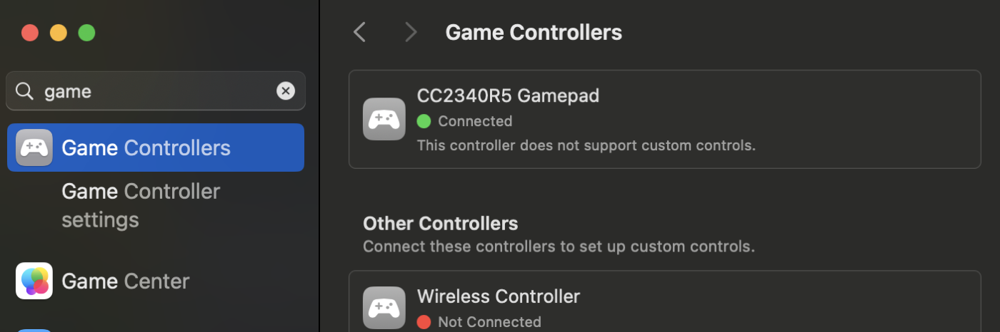

<!-- experiment
id: E230
board: ESP32-C6-DevKitC-1, LP-MSPM0G3519, NUCLEO-U083RC, LAUNCHXL-F2800137, LP-EM-CC2340R5
date: 2026-10-19
status: works
reached: verified
line: The report core of ESP32-BLE-Gamepad gives the same descriptor and report bytes on the ESP32-C6, the LP-MSPM0G3519, the NUCLEO-U083RC, the LAUNCHXL-F2800137 and the LP-EM-CC2340R5 (5 of 5 lines each); on the CC2340R5 (189.4 kB flash, 33.8 kB of 36.0 kB RAM) the gamepad advertises and its Device Information matches the C6, and the Mac's connect takes 31.3 s because no pairing was accepted
stop: none
-->
# Does a popular ESP32 Bluetooth gamepad library carry over to TI, ST and C2000 boards, and on which boards does it give the same bytes?

Same bytes on five boards. On the LP-EM-CC2340R5 the Bluetooth gamepad runs as far as advertising and Device Information; a Mac received the live build's button presses as HID reports, 15 of 15. The port is in [`ports/esp32-ble-gamepad/`](../../ports/esp32-ble-gamepad/README.md).

Terms: [docs/vocab.md](../vocab.md). 1 kB = 1,024 bytes. Measured 2026-10-19 and 2026-10-20 on an Intel Mac, macOS 15.7.9.

**Question.** [ESP32-BLE-Gamepad](https://github.com/lemmingDev/ESP32-BLE-Gamepad) (lemmingDev, MIT, 1,602 stars, 25 open issues, last push 2026-09-21) is a Bluetooth LE gamepad library for Arduino-ESP32. Its README lists CI builds for four Espressif chips including the ESP32-C6. Which of its parts run on other boards, and does a fresh AI assistant, started from this repo's `llms.txt` and `PORTING.md`, get there?

**Vendor position.** Espressif's Arduino core and NimBLE-Arduino carry the project; the library states that it "depends only on NimBLE-Arduino and has no chip-specific code". TI ships no HID-over-GATT example for the CC2340R5 (`ports/ble-hid-remote/README.md`). TI's CCStudio 21.0.1 ships a migration skill, `ti-ccstudio-migrate-to-ti`, for non-TI sources.

**What was tried.**

- Expectation, written before any build: the C6 builds the library as shipped; the report is 20 bytes (the job text said start and select are on by default); the ST and TI cores match the C6 bytes; the C28x differs because it has no 8-bit type; the CC2340R5 run exceeds its time budget on the HID service.
- Original: the unmodified library, NimBLE-Arduino 2.5.1, Arduino-ESP32 3.3.12 (arduino-cli), plus a check sketch that prints the descriptor and four reports. The ESP32-C6 was board A; its backup was read first and written back at the end.
- Targets: one fresh Sonnet 5.5 run per board from a script with a job text: the repository and commit, the board and probe, "start from llms.txt and PORTING.md". Three runs on the LP-EM-CC2340R5: two with this repo's docs, one told to use TI's migration skill. The three CC2340R5 runs were build-only, because the debug link was down at that point; run 1's image was flashed afterwards, once a probe reseat restored the link.
- The check after each run: `check/gp_serial.py` reads the console and compares MAP and RPT1 to RPT4 with the C6 golden file.

**How far it got.**

| Board | Reached | Result | Run time |
|---|---|---|---|
| ESP32-C6 | verified | library: 5 of 5 lines are the reference; Mac scan and 12 connects (3 windows of 4) pass | n/a |
| ESP32-C6, G3519's core | verified | 5 of 5 lines same: the code a fresh run wrote for another chip agrees with the library on the original chip | n/a |
| LP-MSPM0G3519 | verified | 5 of 5 lines same; 9.9 kB flash, 2.0 kB RAM | 15.3 min, 48 turns |
| NUCLEO-U083RC | verified | 5 of 5 lines same; 3.6 kB flash, 880 B RAM | 5.3 min, 28 turns |
| LAUNCHXL-F2800137 | verified | 5 of 5 lines same; 8.1 kB of code, run from RAM | 9.9 min, 41 turns |
| LP-EM-CC2340R5, docs, run 1 | verified | host proof same; image 189.4 kB flash, 33.8 kB RAM; flashed: 5 of 5 lines same on the UART, advertises, Device Information equal to the C6's | 7.7 min, 31 turns |
| LP-EM-CC2340R5, docs, run 2 | link | host proof same; image 188.5 kB flash, 33.9 kB RAM | 6.9 min, 29 turns |
| LP-EM-CC2340R5, TI migration skill | link | host proof same; image 189.4 kB flash, 33.4 kB RAM | 8.3 min, 45 turns |
| Restore, CC2340R5 | done | the tag image written back from the two equal reads; CCFG identical; 140 bytes differ in the last flash sector (0x7F000 to 0x7FFFF, settings the firmware rewrites after boot) | |
| LP-EM-CC35X1 | not run | no backup of its out-of-box image is possible, so nothing was written | |

Measured against the original (rows in `data/results/<board>.csv`): report pack 1 us for the shared core on the C6, 17 us on the G3519 at 32 MHz, 41 us on the U083 at 16 MHz (a different core), 5.64 us on the F2800137 at 120 MHz. The library on the C6 takes 14 to 131 us across six boots, because the timed call includes NimBLE's value copy and the Bluetooth host task runs during the loop. The Mac sees 4.1 advertisement callbacks per second (4.0 to 9.5 across three windows; macOS merges and repeats them, so this is not the interval) and connects in a median of 11 ms. On the CC2340R5: pack 17 us and descriptor 207 us at 48 MHz on a 10 us kernel tick, 1.6 to 3.2 callbacks per second, and a connect that returns after a median of 31.3 s (see The line).

**The line.**

Live input, 2026-10-20: a second build (`LIVE=1 bash ports/esp32-ble-gamepad/boards/cc2340r5/build.sh`) names the board "CC2340R5 Gamepad", reads the LaunchPad kit's BTN-1 and BTN-2 every 20 ms and sends gamepad buttons 1 and 2 on each change. macOS paired it from Bluetooth settings and listed it under Game Controllers with no driver or app. Fifteen button changes (each button alone, then both) arrived as input reports on the Mac's HID interface (`03 01`, `03 02`, `03 03`, `03 00`), 15 of 15, none missed. Pairing has to be accepted once: without it macOS waits out a 30 s timeout and receives no input. macOS Game Controllers only lists a controller; it shows no live input, so read the reports with a HID reader or a browser gamepad tester.

- The expectation of a 20-byte report did not hold. `BleGamepadConfiguration.cpp` sets all special buttons (start, select) false by default, so the report is 19 bytes and the descriptor 96 bytes. All six assistant runs read the code, reported the difference from the job text and followed the code; the C6's output confirmed it.
- LP-EM-CC2340R5, radio side: the debug link failed on every connect (`The target failed to see a correctly formatted SWD header`, error -615) while the board ran the Zephyr telemetry tag; `xds110reset` toggle and assert did not help, and nothing was written without a backup. If you see this, reseat the probe. After a reseat the flash was read twice (equal), run 1's image was written, the UART block matched 5 of 5 lines, and the Mac found "ESP32 BLE Gamepad" with service 0x1812 in three 30 s windows. The image leaves 2.2 kB of RAM free.
- The HID service needs an encrypted link on macOS. Every connect (12 of 12) returned after 31.2 to 31.4 s, the 30 s pairing timeout plus a second, and Device Information (manufacturer, model, serial, firmware, software, hardware, PnP ID) and Battery 100 then read the same as on the C6. No pairing box was accepted, so input reports were not seen by a host. The earlier HID remote on this chip paired once and then dropped the link (`ports/ble-hid-remote/README.md`).
- LAUNCHXL-F2800137: the C28x has no 8-bit type, and the check still passed because the port stores every byte masked with `0xFF` in a 16-bit char and prints the low 8 bits. A real Bluetooth report would need the same packing before it reaches a byte-oriented radio driver.
- The library on the C6 did not advertise again after the Mac disconnected until the board was reset.

What the tools did:

| Where | What happened | Cause tag | Fix |
|---|---|---|---|
| `arduino-cli core install esp32:esp32` | Downloaded about 3.6 GB of toolchains for every chip and filled the disk | Tool or docs | Installed the core zip, the RISC-V toolchain, the C6 libraries and `esptool` by hand (2.6 GB on disk in the end) |
| First compile of the library | 42 errors inside NimBLE's C files (`MYNEWT_VAL` missing) while the board package was half installed | Setup or handling | The same command built after the package finished (3 to 4 min cold) |
| The restore script, G3519 | Writing the data flash after main flash failed to restore: DSLite's erase wiped main, so the board was blank and the compare said DIFFERENT | Tool or docs | Write the data flash first, then the head of main (13.0 kB); both then read back identical |
| OpenOCD after a DSLite flash on the G3519 | `Could not find MEM-AP to control the core` | Unknown | `xds110reset -a toggle -d 200 -s <serial>` then read |
| TI's migration skill, CC2340R5 run | The Skill tool did not list it for a run outside the repository, so the run read `SKILL.md` and dispatched the first two sub-prompts by hand. The target resolver found the CC2340R5 and its SDK. The source analyzer matched the Espressif manifest, called it a weak match (an Arduino and PlatformIO library has no `CMakeLists.txt`, `sdkconfig` or linker script), listed only `.h` files to copy, and the manifest's `build-systems/` folder is absent from the installed CCStudio. The planner and later steps were not run. The code was written by hand from the library and `ports/ble-hid-remote` | Tool or docs | None tried; the Espressif manifests list CC35xx as the only TI destination in the analyzer's notes, which is a reading by the run, not checked |

How the repository's own material helped, read from the run transcripts: every run read `llms.txt` and `PORTING.md`; the G3519 run used `TRAPS.md`, `mspm0g3507/mcu-bench/sdk-common/sdkmake.sh` and `bench_timer.h`; the F2800137 run used `c2000-launchpad/AGENTS.md`, `bench/build.sh` and `bench_ram.cmd`; the U083 run used the OpenOCD route in `nucleo-u083rc/AGENTS.md`; both CC2340R5 docs runs reused the `ports/ble-hid-remote` patch and report-map approach. `PORTING.md` has no row for ESP-IDF or Arduino-ESP32 code: its table says "ESP-IDF code: not run here".

- Accept the pairing box on the Mac, then watch the example's press and release loop in a game controller tester; time the connect with a bonded host.
- Run the LP-EM-CC35X1 build, which needs a way to restore its image first.
- Time the packer with the same core and the same timed region on the U083 and F2800137; the rows here come from three different cores.
- Port SInput and XInput modes (the XInput report is a fixed 16-byte struct).
- Run the upstream test suite from `docs/hil` against a ported radio image.

**Ask.** If you have the library on another chip (nRF52, RP2350, STM32WB), the check files in `ports/esp32-ble-gamepad/check/` give you the golden lines to compare.
