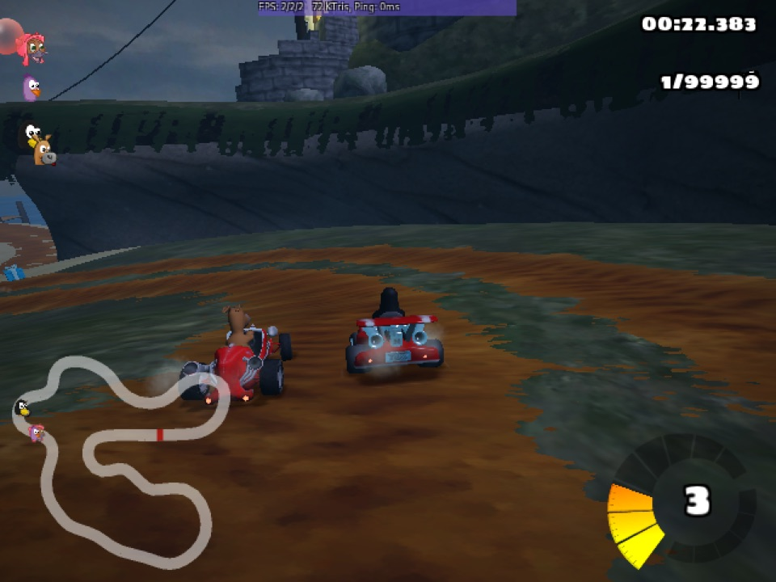

<!-- experiment
id: E288
board: TMDS62LEVM (AM62L evaluation module)
date: 2026-10-25
status: line found
reached: run
line: On the AM62L's own HDMI output, with no GPU, a looping showcase runs five things in turn: Doom straight to the framebuffer, TI's LVGL demo, Android 12 (Redroid) through scrcpy, SuperTuxKart and a RetroArch Game Boy core. 2D software paths are smooth (Doom 186 to 193 fps, RetroArch 48 fps at a 640x480 HDMI mode); anything that goes through software 3D or a video round trip is a slide show (SuperTuxKart 2 fps, Android about 1 frame a second on screen).
stop: none for the showcase; Android and SuperTuxKart run but are not usable at these frame rates
-->
# What can the AM62L show on its HDMI screen besides Doom?

**Short answer.** Five things, one after another, from one loop script (`am62l-evm/showcase/run.sh`): Doom drawn straight into the framebuffer, TI's LVGL demo, Android 12 in a Redroid container mirrored by scrcpy, SuperTuxKart 1.5 (native arm64) and RetroArch with a homebrew Game Boy game on the PS4 pad. The chip has no GPU, so the split is clear: software 2D runs at full speed, software 3D does not.



Terms: [vocab](../vocab.md). **Redroid** is Android in a Docker container; it needs the binder driver from the [E285 kernel](2026-10-25-am62l-kvm-binder-kernel.md). **scrcpy** mirrors an Android screen over adb as an H.264 stream. **llvmpipe** is Mesa's software OpenGL. **modesetting** is the generic Xorg driver for a KMS display. Scripts: `am62l-evm/showcase/`; rows in `data/results/am62l-evm.csv`.

**Expectation (before the runs).** From the Doom framebuffer test (E275) and the open-games test (E286): LVGL and Doom smooth; SuperTuxKart about 4.5 fps at 640x480 (offscreen number); Android a few frames a second because every frame is rendered in software, encoded to H.264 and decoded again; a Game Boy core at full speed.

## Results

| Item | How it reaches the screen | Result |
|---|---|---|
| Doom (shareware, `doom_fb`) | writes `/dev/fb0` directly | 186 to 193 fps timedemo (E275); smooth |
| TI LVGL demo (`ti-lvgl-demo`, `lvglsim`) | fbdev | Runs; 118 MB resident, about 15 percent of one core on the home screen; frame rate not measured |
| Android 12 (Redroid, software GLES) | Xorg, scrcpy 5.0.1 full screen | 1.1 frames a second shown while Settings scrolls (0 to 2; 1 to 5 more decoded and dropped); the app renders a frame in 450 ms (median); boot to `sys.boot_completed` 70 s |
| SuperTuxKart 1.5 arm64 | Xorg, HDMI mode 640x480, full screen | 2 fps (STK counter min/avg/max 2/2/2); the race starts about 7 min after launch |
| RetroArch 1.20 + Gambatte, Tobu Tobu Girl | Xorg, HDMI mode 640x480, gl driver | 48 fps on RetroArch's counter (full speed is 59.7); PS4 pad configured automatically |
| Same, HDMI mode left at 1920x1080 | Xorg | 10.4 fps |

Every new number is one run.

## Games you can play on this board

Measured on this board with no GPU, best first. "Playable" means 25 fps or more.

| Game | Path | fps | Playable |
|---|---|--:|---|
| Doom, shareware (`doom_fb`) | straight to the framebuffer, 1280x1000 | 186 to 193 (timedemo, E275) | Yes |
| Tobu Tobu Girl, homebrew Game Boy (RetroArch, Gambatte) | Xorg, 640x480 HDMI mode, PS4 pad | 48 | Yes |
| Doom, shareware (dsda-doom 0.29) | Xorg, OpenGL on llvmpipe, 640x480 | 27.2 (timedemo, E286, offscreen) | Yes |
| Doom, shareware (dsda-doom 0.29) | same, 1280x720 | 10.5 (E286, offscreen) | No |
| Chocolate Doom 3.1 | Weston, llvmpipe scaler | 6.5 (E276) | No |
| SuperTuxKart 1.5 arm64 | Xorg, 640x480 HDMI mode | 2 on the panel, 4.5 offscreen (E286) | No |

The loop in `run.sh` plays the games first: SuperTuxKart, dsda-doom, RetroArch, then Android, Doom on the framebuffer and the LVGL demo.

## What it shows and what it does not

It shows the display paths that work without a GPU: direct framebuffer writes and a CPU-drawn X screen at a low HDMI mode, where the monitor does the scaling for free. Switching the HDMI mode to 640x480 took RetroArch from 10.4 to 48 fps, because llvmpipe no longer scales every frame to 1080p. It does not show sound, input latency, or why SuperTuxKart draws 2 fps on the panel against 4.5 fps offscreen in E286 (Xorg's shadow framebuffer copy is one suspect, not tested). Android's rate is set by its software renderer (450 ms a frame) before scrcpy's encode and decode add their share.

## Run it

```sh
# board, kernel 6.18.38-ti-kvm (binder for Redroid)
sh /root/frl/showcase/setup.sh                             # frl-show container: Xorg, RetroArch, adb, build tools
docker exec frl-show sh /root/frl/showcase/build_scrcpy.sh # scrcpy client against the v5.0.1 server
nohup sh /root/frl/showcase/run.sh 120 > /root/frl/showcase/out/loop.log 2>&1 &
sh /root/frl/showcase/run.sh stop                          # back to Doom alone
```

## If you try it

If the Android picture sits in the top-left corner instead of filling the screen, start a window manager (`openbox`) before scrcpy, and set Redroid to landscape with `wm size 1280x720`. If scrcpy prints `XDG_RUNTIME_DIR is invalid`, set it to any private directory; the warning is harmless. If a game draws below 15 fps on llvmpipe at 1080p, switch the HDMI mode with `xrandr --output HDMI-1 --mode 640x480` and let the monitor scale. If scrcpy has no package for arm64 Debian trixie, build the client from source with meson against the prebuilt server (`build_scrcpy.sh`).

**Restore.** `run.sh stop` stops the loop, X, scrcpy, the games and the LVGL service, pauses Redroid and starts the framebuffer Doom demo again. The `frl-show` container stays on the board (about 900 MB of packages).
