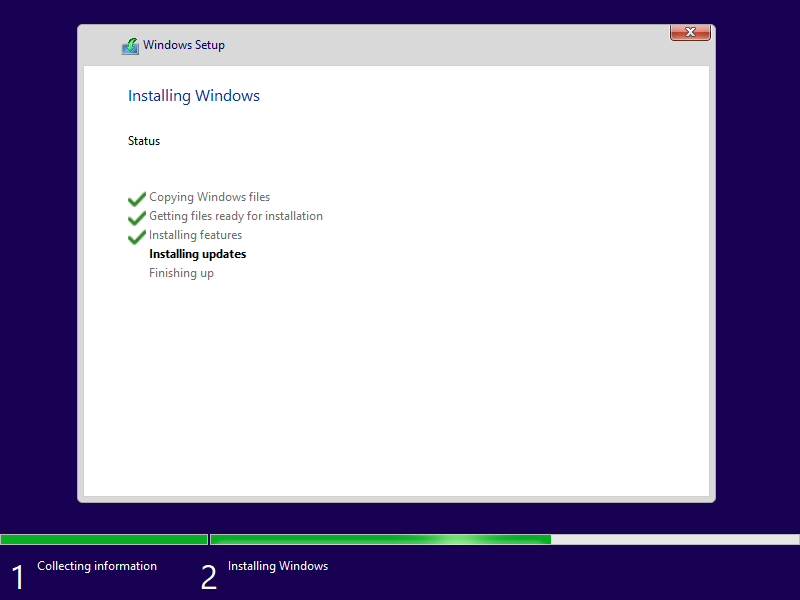

<!-- experiment
id: E287
board: TMDS62LEVM (AM62L evaluation module)
date: 2026-10-25
status: line found
reached: run
line: Windows 11 22H2 (build 22621.1, arm64) installs as a KVM guest on the AM62L's two Cortex-A53 cores with 1.6 GB of guest RAM: firmware, boot manager, WinPE and an unattended Setup all run, and the installed system boots from its own disk twice. It stops in the out-of-box experience at 7,231 s with "Why did my PC restart?", which asks for a network to fetch an update.
stop: out-of-box experience, "Why did my PC restart?" at 7,231 s; no desktop
-->
# Does Windows on Arm run on the AM62L in a virtual machine?

**Short answer.** Almost. Windows 11 Pro 22H2 (build 22621.1, arm64) boots and installs under KVM on the A53 cores, which lack the ARMv8.1 atomics that Windows 11 24H2 needs. Setup runs unattended, applies the image, restarts, and the installed Windows boots from its NVMe disk twice. The out-of-box experience (OOBE) then stops on "Why did my PC restart?" at 7,231 s after start and asks for a network so it can fetch an update. The VM had no network, so there is no desktop.

Terms: [vocab](../vocab.md). **KVM** is Linux's hypervisor (here in nVHE mode, from the [E285 kernel](2026-10-25-am62l-kvm-binder-kernel.md)). **UUP** is the set of files Windows Update serves; **UUP dump** lists them and a converter turns them into an install ISO. **WinPE** is the small Windows that runs Setup. **OOBE** is the first-start setup screens. **LabConfig** is the Setup registry key whose `Bypass*Check` values skip the TPM, RAM, Secure Boot and CPU checks. Scripts: `am62l-evm/kvm/windows/`; rows in `data/results/am62l-evm.csv`.

**Expectation (before the run).** Low odds of reaching any Windows login screen. Expected stops, in order of likelihood: Setup refusing the 1.6 GB of RAM or the missing TPM; a boot crash on ARMv8.0; a stall from lack of memory.

## Image and license

- **Image.** Windows 11, version 23H2 (22631.7652) arm64, Professional, en-US, listed by the UUP dump API (`api.uupdump.net/get.php?id=b6d92a4f-e58e-4b43-8d9d-ac7ca9d3bbf1&lang=en-us&edition=professional`, plain GET, no account). Every file comes from Microsoft's own download servers with a SHA-1 that `aria2c` checks. The Linux converter cannot add the cumulative update or the 23H2 enablement package, so `uup_list.py` leaves them out and the result is the base build **22621.1 (22H2)**. That is fine for this test: 22H2 predates the ARMv8.1 requirement.
- **License terms relied on.** No product key was entered and nothing was activated; Setup took an empty key in `autounattend.xml`. No Microsoft account or any online account was entered or created; the only account is the guest's built-in Administrator, enabled by the answer file. Microsoft's Windows 11 license terms, section 5 (Authorized Software and Activation), authorize use only when the software is licensed and activated. This run is a boot test that stopped before any use: the guest disk was deleted at the end. To go further, install with a Windows 11 Pro license.
- **Not used.** Microsoft's arm64 Insider VHDX needs a Microsoft account. The only arm64 evaluation image found on Microsoft's Evaluation Center is Windows 11 IoT Enterprise LTSC, which is 24H2-based and needs ARMv8.1.

## Steps and results

Times are seconds from QEMU start, read from a screenshot every 20 s, so each is good to about 20 s.

| Step | Result |
|---|---|
| Build the ISO on the build host (Debian trixie container, `build_iso.sh`) | 3.0 GB downloaded in 62 s; converter 160 s; ISO 4.44 GB |
| Copy the ISO to the board's SD card over the LAN (HTTP) | 192 s, SHA-256 checked |
| First boot with the converter's ISO | Stops at "Press any key to boot from CD or DVD." Keys sent through the QEMU monitor do not reach it; one vCPU spins at 100 percent. Fix: rebuild with `efisys_noprompt.bin` |
| Rebuilt ISO with `efisys_noprompt.bin` and `autounattend.xml` in its root | Firmware loads the ISO's boot manager by 53 s |
| WinPE | Shell window at 80 s |
| Setup checks and product key | Passed unattended: LabConfig keys set, empty key accepted, disk 0 wiped and partitioned |
| Setup copying files | 0 percent at 270 s, done by 314 s |
| Getting files ready (apply the image) | 36 percent at 1,836 s, 66 percent at 3,086 s, 95 percent at 4,309 s |
| Installing features, installing updates | By 4,836 s |
| First restart | 5,073 s; `eject_on_reboot.sh` sees both vCPUs back in firmware and ejects the ISO, so Setup cannot start again from it |
| First boot from NVMe | Windows Boot Manager from the new EFI partition; "Getting ready" by 5,404 s |
| Second restart, then OOBE | "Just a moment..." at 6,302 s |
| Third restart (about 7,000 s), OOBE again | **Stop.** The screen says there is a problem getting the PC ready and that an update will help. It asks for Wi-Fi or a cable. Still on this page at 8,344 s |

Memory: QEMU peaked at 1,587 MB resident for the 1,600 MB guest; the host's available memory fell to 98 MB and up to 548 MB of the swap file was used. Disk: 11.5 GB written to the qcow2 between 293 s and 4,836 s, 2.5 MB/s on average. QEMU used about 0.7 of a core on average over that span, so the SD card and the swap, not the CPU, set the pace.

## What it shows and what it does not

It shows that the A53's ARMv8.0 cores run the Windows 11 22H2 arm64 kernel under KVM with the GICv2 interface, ramfb display, USB input and NVMe storage, through WinPE, Setup and two boots of the installed system. It does not show a desktop, a login, any app, or what caused the OOBE error. The likely causes, none tested: the 22621.1 RTM build without its cumulative update (the screen asks for exactly that update); the answer file's `HideLocalAccountScreen` with no local account defined; or a timeout under memory pressure.

## What would get further

1. A network in the guest so OOBE can fetch its update: a USB network device (`-device usb-net`, an RNDIS device; whether Windows on Arm has a driver for it is untested), or the virtio-win network driver on a second ISO.
2. An ISO with the cumulative update and the 23H2 enablement package integrated (build 22631), made with the converter on a Windows host, which can run DISM.
3. A local account in `autounattend.xml` (`LocalAccounts`) instead of the built-in Administrator (the answer file already sets `BypassNRO`).
4. More memory headroom: stop every other service on the board, or a faster swap device than the SD card.

## If you try it

If Windows Setup stays at "Press any key to boot from CD or DVD", rebuild the ISO with `efisys_noprompt.bin` (`build_iso.sh`). If you cannot extract the converter's ISO with `xorriso`, use `7z`: the image has only a UDF tree. Run `eject_on_reboot.sh` beside the VM, or remove the ISO after the first restart, because the answer file wipes disk 0 if Setup starts again. Give the board a swap file before a 1.6 GB guest; without one the host has about 1.5 GB available.

**Restore.** The board kernel was not changed. The run added `qemu-efi-aarch64`, `swtpm`, `qemu-utils` and `socat` inside the `frl-kvm` container and a 2 GB `/swapfile-win`; the swap file, the ISO and the guest disk were removed afterwards, and the Doom framebuffer demo was started again on HDMI. The Steam container stays stopped.
