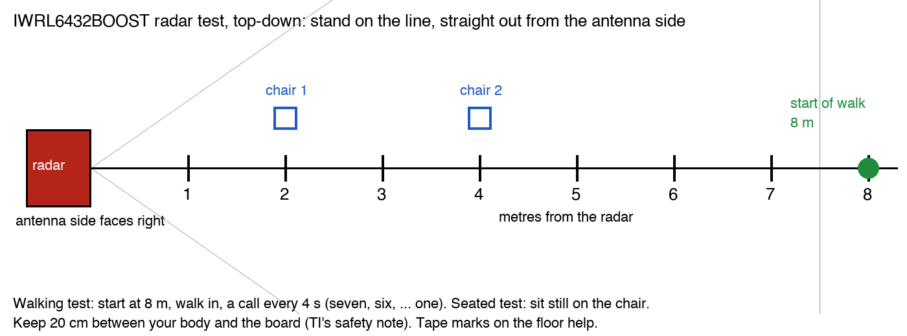

# How do I tell whether a TI 60 GHz presence radar (IWRL6432) would work in my conference room, how many people it would see, and at what range?

**Measured for 2x2 and 2x3, one pass each; 1x1 is refused by the demo.** With 2 transmit by 2 receive and with all antennas (2 by 3), an empty room for 60 s gave 0 flags in 240 frames, and a person sitting still at 2 m and at 4 m was held in 100 percent of frames. The radar flagged the person 3.9 to 6.7 s after the cue and cleared 10.7 to 14.1 s after they left, which is the demo's own hold time. A walk-in from behind the door was first flagged at about 6.5 m on 2x3. The 1x1 setting is refused with the shipped lines (error -40107). Single passes give no spread, so a difference of a second or two between 2x2 and 2x3 is inside the person's own timing. Nothing past 4 m seated or 7 m walking was tested. The demo also gives no head count: it reports four floor zones as occupied or not. The method: run the same short test with one, two and all three receive antennas on, record what the radar reports, and read five numbers: how far away a walking person is first seen (up to the 7 m edge of the zone boxes), how far away a person sitting still is still seen, how long it takes to notice an arrival and a departure, and how often it alarms in an empty room. Those say whether the radar would work in a room that size. A head count needs TI's people-tracking configuration, which has not been run here. Every cell below says whether it is measured, arithmetic, or not measured.

Terms: [docs/vocab.md](../vocab.md). Also used here: **FMCW radar**, a radar that sends a rising-frequency chirp and reads range from the frequency difference of the echo; **TX and RX**, transmit and receive antennas; **virtual antenna**, one transmit and receive pair treated as one antenna element (2 TX by 3 RX gives 6); **SNR**, signal-to-noise ratio, how far an echo stands above the noise; **TLV**, a typed block inside the radar's data frame; **zone**, one of the floor boxes the demo reports on or off; **range profile and bin**, the echo strength at each distance step (a bin is one step, 0.121 m here); **azimuth and elevation**, the angle across the room and the angle up and down; **FoV**, field of view; **FFT**, the calculation that turns samples into distance, speed or angle; **WCSP and AOP**, two package types of the same chip family (antenna in the package for AOP); **NRST**, the board's reset button; **E2E**, TI's support forum; **`channelCfg`, `sigProcChainCfg`, `aoaFovCfg`**, lines of the radar's configuration file (antenna masks, processing chain, angle limits); **clutter removal**, discarding echoes that do not move, such as walls and furniture; **minor motion**, small movement such as breathing or typing. Run on the IWRL6432BOOST with TI's Motion and Presence 2D demo from Radar Toolbox 4.00.00.05, macOS 15.7, results files dated 2026-10-10. TI documents read 2026-10-10 unless a date is given. Related: [the experiment page](../experiments/2026-10-10-radar-antenna-eval.md), [the results page](../../site/radar-eval.html), [the board's folder](../../iwrl6432boost/README.md).

Contents: [the answer](#what-does-the-evaluation-tell-me-and-what-can-it-not) · [the experiment](#what-is-the-experiment) · [the data](#what-data-is-recorded-and-what-is-worked-out-from-it) · [what to look for](#what-should-i-look-for-in-the-data) · [the conference room](#would-it-work-in-a-6-m-by-4-m-conference-room) · [questions to ask first](#what-should-i-ask-before-choosing-a-radar) · [run it yourself](#how-do-i-run-it-myself) · [limits](#limits-what-is-not-measured)

## What does the evaluation tell me, and what can it not?

It tells you, for one room layout and one radar chip with 1, 2 or 3 receive antennas:

- the farthest distance at which a person walking toward the radar is first flagged, up to 7 m: presence comes from the zone boxes, which end at 7 m, so a walk that starts at 8 m cannot show anything farther,
- the farthest distance at which a person sitting still is held as present, which is the harder case,
- the delay to flag an arrival and to clear after a departure,
- how many false alarms an empty room gives in an hour,
- which of the four floor zones fire, which is a rough "where".

It cannot tell you:

- **How many people are in the room.** The demo reports four zones on or off. Two people in one zone read as one.
- **Power.** The demo does not report it on this board and the board's USB path hides the chip's rails. TI's data sheet figure is below; there is no measurement.
- **Your room.** Glass, metal shelving, a ceiling-mounted air vent or a fan all change the result. One room, one afternoon, one pass per setting: there is no spread.
- **The accuracy of position.** The demo gives zones and a range profile, not a distance for each person.

## What is the experiment?

One radar chip, three antenna settings, the same people doing the same passes for each setting, so the only change between runs is how many antennas are on.

**The radar.** The IWRL6432BOOST evaluation module. The chip has 2 transmit and 3 receive channels, works at 57 to 64 GHz with up to 7 GHz of sweep, and has a hardware accelerator for the FFT and detection steps (data sheet SWRS298B, board guide SWRU596, December 2022). Every other part in the family has the same 2 by 3 count: IWRL6432 WCSP (SWRS311), IWRL6432AOP (SWRS323B, one transmitter at a time), and IWRL1432 (SWRS313A, 76 to 81 GHz). **No TI part in this family has one transmitter and one receiver, so 1x1 here is a cost proxy: this chip with most of its antennas switched off, not a cheaper part.**

**The settings.** One line of the radar's configuration, `channelCfg <receive mask> <transmit mask> 0`.

| Setting | Line | Antennas on | Virtual antennas |
|---|---|---|---|
| 1x1 | `channelCfg 1 1 0` | 1 transmit, 1 receive | 1 |
| 2x2 | `channelCfg 3 3 0` | 2 transmit, 2 receive | 4 |
| 2x3 | `channelCfg 7 3 0` | 2 transmit, 3 receive (the shipped setting) | 6 |

**The placement.** Board on a stand at about 1.5 m, antenna side toward the room, nothing moving behind it, a tape line straight out from the board marked every metre to 8 m, and two chairs at 2 m and 4 m, as in the picture. The room has four zone boxes in the shipped configuration: left and right of the board's line (the split is at x = 0), near (0 to 3.5 m out) and far (3.51 to 7 m out), each up to 3 m high (`mpdBoundaryBox` lines in `PresenceDetect.cfg`). The boxes are 3.5 m wide each side, wider than the 4 m room, so a room that narrow splits as described below. The configured angle limits (`aoaFovCfg -70 70`) are wider than TI's 120 degree figure; the reason was not checked.



**The passes.** Each setting gets the same four, with a voice cue so every setting is timed from the same signal.

| Pass | What the person does | What it is for |
|---|---|---|
| Walk in | Starts at 8 m, walks toward the radar at an even pace, one metre every 4 s, stops at 1 m, then leaves | The farthest distance a moving person is first seen; the clear delay after leaving |
| Seated at 2 m | Out of view, then on the cue sits still on the chair at 2 m for 45 s, phone down, then leaves | Whether a person who barely moves is held as present, and how fast they are noticed |
| Seated at 4 m | Same, chair at 4 m | The same at a longer range, where the echo is weaker |
| Empty room | Nobody in the room for a fixed window (300 s by default) | The false alarm rate |

The pace is 0.25 m a second, slow on purpose, so the distance at first detection is easy to read from the cue. A normal walking pace would give a coarser reading. The chairs are at 2 m and 4 m only; the tool accepts any other distance (see [run it yourself](#how-do-i-run-it-myself)).

## What data is recorded, and what is worked out from it?

Every frame the radar sends is one row in a CSV file per setting (`<date>-<setting>.csv`, written by the tool). Cue events are extra rows between frames.

| Field | What it is |
|---|---|
| `config`, `pass`, `round` | Which setting, which pass, which repeat |
| `t` | Time the Mac received the frame, in seconds |
| `frame` | The radar's own frame counter; a jump means lost frames |
| `pres` | 1 if any zone is on, from the presence block (TLV 315) |
| `z1` to `z4` | Each zone's state, from TLV 315. Zones 1 and 3 are the near boxes, 2 and 4 the far boxes |
| `peak_bin`, `peak_val` | The strongest bin of the range profile (TLV 303) and its value, searched between 0.25 and 7.5 m. A bin is 0.121 m: 256 samples at 12.5 Msps with a 60.5 MHz per microsecond slope is a sweep of 1,239 MHz, and c divided by twice that is 12.1 cm. Derived from the settings, not checked against a measured distance |
| `event` | `cue_enter`, `cue_leave`, `cue_go`, `mark_<metres>m` for the cue moments |

The frame rate is also recorded: the 2x3 evaluation setting (the shipped lines with `lowPowerCfg 0`) streamed 3.85 frames a second (231 frames in 59.7 s, no gaps, saved), against a configured period of 250 ms. The shipped image as found streamed 4.00 a second (384 bytes a frame, two TLVs). The 4 percent gap is unexplained. About 608 bytes a frame and TLVs 303, 306 and 315 were seen in the same run and not saved. That sets how finely times can be read: one frame is about 0.26 s.

**The numbers worked out from the rows** (`analyse_*` in `radar_eval.py`):

| Number | Definition |
|---|---|
| Detect latency | Seconds from the "enter" cue to the first two frames in a row with presence on |
| Clear latency | Seconds from the "leave" cue to the first frame with presence off that stays off for the next 3 s |
| Hold while seated | Share of frames with presence on, from 15 s after the enter cue to the leave cue. "Held at a distance" means at least 4 frames in 5 |
| Farthest distance held | The largest tested seated distance that was held |
| Walking detection range | The person's distance, interpolated between the called marks, at the first two frames in a row with presence on |
| Far-zone share | Share of seated frames where a far zone fired. A person at 2 m should mostly light the near zones |
| Median peak distance | Median `peak_bin` while seated, times 0.121 m. It should land near the chair's mark |
| False alarms per hour | Runs of presence-on frames in an empty room (runs less than 2 s apart merge), divided by the window, times 3,600. If there are none, the 95 percent upper bound is 3 divided by the window: 36 an hour for 300 s, 6 an hour for 30 min |

**Detect and clear latency include the person.** They are measured from this repo's voice cue, so they include the person's reaction and walking time. The same cue is used for every setting, so compare settings with each other; do not quote them as a sensor's delay. The two-frames-in-a-row rule ignores a one-frame blip, and times are read to one frame, about 0.26 s.

## What should I look for in the data?

Read each finding below against the rows, not against the summary alone.

### Why would more receivers give more range?

Each receiver hears the same echo plus its own noise. Adding the receivers up in phase makes the echo grow faster than the noise, which is about 10 times the base-10 log of the receiver count in decibels: 3 receivers against 1 is up to 4.8 dB, 2 against 1 is 3 dB. TI's range equation has an antenna gain term, `G_Rx` and `G_Tx`, and the range it gives grows as the fourth root of everything in the numerator (SWRA553A, February 2020, equation 2). So 4.8 dB, a factor of 3 in power, stretches the maximum range by 3 to the power of one quarter, about 1.32 times, 3 receivers over 1. If the demo also combines the transmit slots (6 virtual antennas), the factor is 6 to the power of one quarter, about 1.57. Which it does is not checked. Counting receivers only, 2 against 3 is about 10 percent shorter and 1 against 3 about 24 percent shorter; counting virtual antennas, 1x1 would be about 36 percent shorter than 2x3. This is arithmetic, not a measurement. TI's equation takes one antenna gain; a TI answer on the E2E forum ("AWR1843BOOST: Calculating Max range", date not captured) says the receiver count in the range formula is the number of virtual antennas. Combining that is not in any document that was read. If the demo adds the receivers without matching their phases, the gain is smaller. **Two transmitters add transmit power only if they transmit together:** in time-shared mode only one transmits at a time, and TI quotes an SNR gain of 10 times the log of the transmitter count only when they transmit together (SWRA554A, July 2018, section 4.2). Which mode the demo uses is not checked. The two transmitters add virtual antennas, so they sharpen angle; whether they also add range in the demo is not checked.

**Look for:** the farthest seated distance and the walking range falling as receivers come off, by about the arithmetic above. A much bigger drop means the demo's detector depends on the angle step; a smaller drop means the radar's range is limited by something else (the 7 m edge of the zone boxes, or the room).

### Why do more antennas separate more people?

The radar finds the direction of an echo from the small phase difference between antennas. More antennas in a row make the direction estimate sharper: for N antennas half a wavelength apart, the angle resolution is about 2 divided by N radians (SWRA554A, July 2018, equation 4), which is 114.6 degrees divided by N. Two people at the same distance from the radar and closer together sideways than that angle merge into one echo.

TI quotes the full 2 by 3 array on this board as 6 virtual antennas with 29 degrees of resolution across the room (azimuth) and 58 degrees up and down (elevation), 120 degrees by 80 degrees of view (the board's tool page, SWRU596 section 6 and the demo guide for SDK 05.05.00.02, read 2026-10-09). By the formula, 29 degrees is what 4 elements across the room give (2 divided by 4 radians) and 58 degrees is what 2 elements up and down give. How the 6 virtual antennas split into 4 and 2 follows the transmitter offsets on the board; the geometry file was not read.

| Setting | Azimuth resolution | Two people side by side at 2 m must be apart by | at 4 m | at 6 m |
|---|---|---|---|---|
| 2x3 | 29 degrees (TI) | 1.0 m | 2.0 m | 3.0 m |
| 2x2 | coarser than 29 degrees; about 57 degrees if two elements span the room (arithmetic, geometry not checked) | about 2 m | about 4 m | about 6 m |
| 1x1 | none: one antenna has no angle | not separable by angle | not separable by angle | not separable by angle |

The separation is range times the angle in radians, at the middle of the field of view; it is worse toward the edge (TI's own figure 12 in SPYY005A, July 2020, shows angle estimates getting less accurate away from straight ahead). **People at different distances are separated by range, not angle:** the range bin is 0.12 m, so two people in a line from the radar, a body-width apart or more, are different echoes. The trouble case is people side by side at the same distance, such as a row of seats facing a screen.

**Why 1x1 means presence only.** With one antenna there is no phase difference to read, so there is no direction. The radar can say something is there and roughly how far, not left or right. In this demo the left and right zones then cannot be told apart by angle.

**What was seen for 1x1 on 2026-10-10:** the demo answered the setting line and then refused to start. `sensorStart 0 0 0 0` returned `Error in setting up range profile:-40107`, and no frames came out. Suspected: the shipped processing lines (`sigProcChainCfg`, `aoaFovCfg`) assume more than one receiver; they were not changed to find out. The same demo may accept 1x1 with those lines changed, so "the demo refuses 1x1" is a statement about the shipped configuration, not about the chip.

### Why does a seated person disappear?

The configuration turns on `clutterRemoval 1`, which throws away echoes that do not move: walls, chairs, a monitor. A person sitting still is then seen only by small movement, such as breathing, a hand on a keyboard or a shifted foot. TI's file for this case says so in its header: it is "optimized to detect any kind of motion, including fine movements (even small movements that are present while sitting still, such as, movement caused by typing, breathing, etc.)" and reports no velocity (`PresenceDetect.cfg`, Radar Toolbox 4.00.00.05). The separate `minorStateCfg` line sets the thresholds for that small-motion state. A person who sits very still for long enough can fade out, and a person at a longer range has a weaker breathing echo, so a seated person is lost at a shorter range than a walking one. That gap is the number to read.

**Look for:** the hold share dropping with distance and with fewer receivers, and the far-zone share and median peak distance matching the chair. A person held in the wrong zone, or a peak far from the chair, points to a reflection off a wall.

### What does it cost in frame rate and power?

TI's data sheet gives about 1.2 mW average for presence detection at one update a second with 1 transmit and 1 receive channel, in the power-optimized supply layout for major-motion presence, which is not the seated case this guide tests; 7.8 mW in the lower-cost layout (SWRS298B; table numbers from notes of the Rev. A text, Rev. B not re-checked). That is the 1x1 setting, so the full 2x3 at the shipped 4 updates a second draws more, by an amount that was not measured. Slower frames should save power and lengthen every delay, since a frame is the smallest step of time; a slower period was not run. The shipped period is 250 ms. **Not measured:** the power of any setting. The board's 5 V USB path adds the probe and LEDs, so a USB meter reads hundreds of milliwatts and is not comparable to the data sheet.

## Would it work in a 6 m by 4 m conference room?

Take a room 6 m deep and 4 m wide, the radar on the middle of a short wall at 1.5 m, antennas facing the length of the room. Geometry first: TI's 120 degree view means the corners next to the radar's own wall are outside the view for the first 1.2 m out (at 1.2 m deep the view is 4 m wide, 2 m each side). The far corner is 6.3 m away on the diagonal. The shipped zones are left and right of the center line (x = 0) and near (0 to 3.5 m) and far (3.51 to 7 m), so the room splits into four areas: about 2 m by 3.5 m near and 2 m by 2.5 m far.

| | 1x1 | 2x2 | 2x3 (all antennas) |
|---|---|---|---|
| Demo accepts the setting | **No** with the shipped lines: `Error in setting up range profile:-40107` (measured 2026-10-10) | Yes: 25 of 25 lines Done, 4.0 frames a second, 768 bytes a frame (measured 2026-10-10). Started second in a boot it gave no frames | Yes when it is the first start in a boot: 3.85 frames a second with `lowPowerCfg 0` (measured). Started second in a boot it gave no frames |
| Walking person first seen at | Not measured | Not separable: the person stood in view at 8 m, so at least 8 m | About 6.5 m (first flagged 6.7 s after the cue, from behind the door, by the 4 s a metre pace; one pass). This test cannot read past 7 m. TI's anchors, which these passes cannot test: chip "typically up to 25 m" (SWRS298B); the IWRL6432WMOD module "human presence detection range typically 15 m at 0 degrees, 8 m at edge of FoV" (SWRS350B, a different antenna) |
| Seated person held to | Not measured | Held in 100 percent of frames at 2 m and at 4 m; flagged in 5.6 s and 3.9 s, cleared 10.7 s and 11.5 s after leaving (one pass each) | Held in 100 percent of frames at 2 m and at 4 m; flagged in 6.2 s and 4.3 s, cleared 12.3 s and 14.1 s after leaving (one pass each). Nothing beyond 4 m was tested. The guess before testing, not a TI figure, was 2 to 5 m. **The 6 m back row is outside what the passes test (2 m and 4 m)** |
| Expected range against 2x3, from SNR arithmetic | 24 to 36 percent shorter | about 10 percent shorter, or more | reference |
| Sees left against right | No (no angle) | Probably coarsely, not checked | Yes, to about 29 degrees |
| What it reports | Presence, no position | Presence and zones, probably coarse | Presence and four zones |
| People side by side that it could separate at 4 m | None by angle | About 4 m apart, if two elements span the room | About 2 m apart |

**How many people can the demo report?** Four zone flags, not a count. In the four areas above it can say which of the left-near, right-near, left-far and right-far areas have someone in them. Two people in one area read as one. Eight people around a table all fall in one or two zones. A count needs one of TI's tracking configurations, which output moving points and follow them.

**What does TI ship for the IWRL6432?** From the Radar Toolbox 4.00.00.05 listing (published 2026-03-01, unpacked and read 2026-10-10, nothing run):

- The Motion and Presence Detection demo, prebuilt as a 2D image (the one in this repo's results) and a 3D image that clusters in height as well, for sit against stand or pet against human. Configuration folders for it: `motion_and_presence` (this repo's file), `doors_and_gates`, `height_based_detection`, `overhead_lighting` (ceiling mount) and `classification`.
- **A `people_tracking` folder with `wall_mount` and `ceiling_mount` configuration files for the IWRL6432BOOST.** The wall-mount file is `IWRL6432BOOST_Tracking_3Persons_7m_wall_mount.cfg`: `sensorPosition 0 0 2.5 0 15` (2.5 m up, a 15 degree tilt by the usual field order, not checked), with tracking lines (`trackingCfg`, `gatingParam`, `allocationParam`, `boundaryBox -7 7 0 7.5 -0.5 3`). The names say 3 people to 7 m. It has not been run, and the tracker's documentation was not read, so the 3-person limit is the file name's claim. Which of the two prebuilt images it needs is not checked.
- An Out of Box demo image (`out_of_box_L6432`) and an mmWave Demo image for the same chip. The Out of Box user guide in the toolbox lists the EVMs it supports and does not name the xWRL6432 in that list, though the image and source are in the package.

TI's older people-counting demos are for the IWR6843 class, which has more antennas (4 receive by 3 transmit). That is not this part.

## What should I ask before choosing a radar?

- **Ceiling or wall?** A wall unit at 1.5 m (this repo's test) sees people from the side. TI ships separate ceiling configurations for the IWRL6432 (`overhead_lighting`, `people_tracking/ceiling_mount`); a ceiling unit looks down and the zone map changes. Evaluate in the mount you will use; the passes in this repo do not transfer.
- **Glass and walls.** Radar reflects off metal, and some of it passes through many wall materials. Whether it sees people in the next room through your wall is a test, not an assumption: a person next door that shows up is a false alarm. Test with the door open and closed.
- **HVAC and fans.** A moving blade or a hanging curtain is motion. The empty-room pass is the check: run it with the air handler on, for at least 30 min per setting.
- **How fast must it react?** The delay numbers here include the person. Add the frame period (about 0.26 s here) to what you measure.
- **Seated or standing?** A room that is mostly people sitting still at a table is the hard case. Ask for the seated number at the farthest seat, not the walking range.
- **Power budget.** TI's 1.2 mW is for 1 transmit, 1 receive, 1 update a second. Decide your update rate and antenna count, then measure on your board's chip rails.
- **Do you need a count or only occupied-or-not?** Occupied-or-not is the demo that was measured. A count means the tracking configuration, a different test.

## How do I run it myself?

You need the IWRL6432BOOST, the stock Motion and Presence 2D demo running, a Mac with Python 3 and `pyserial`, and a person to walk (the tool talks to the board over its serial port and speaks cues out loud). From the repository root:

```bash
python3 iwrl6432boost/eval/radar_eval.py accept
```

Applies each setting, prints the board's answer to every line, and checks the stream.

```bash
python3 iwrl6432boost/eval/radar_eval.py empty --seconds 1800
```

The empty-room window for each setting. Leave the room.

```bash
python3 iwrl6432boost/eval/radar_eval.py run --passes walk,sit2,sit4
```

Each pass waits until the person says they are in place. The tool as written takes Enter in the terminal as the confirmation; it speaks cues with macOS `say`; and `radar_link.py` has the serial port name and configuration path written in (`PORT` and `CFG`), so edit those two lines for your machine. Add `--rounds 3` to repeat; the setting order rotates each round, so a slow drift in the room does not favour one setting.

```bash
python3 iwrl6432boost/eval/radar_eval.py restore
```

Puts the shipped configuration back.

```bash
python3 iwrl6432boost/eval/render_eval.py
```

Rebuilds the results page [`site/radar-eval.html`](../../site/radar-eval.html) from the summary files the tool writes.

**One reset first.** The shipped demo runs with `lowPowerCfg 1` and then ignores its command line, so the first change after power-up needs one press of the board's reset button (NRST, S2). The tool's configurations use `lowPowerCfg 0` so the demo stops and restarts between settings, and `restore` puts the shipped line back. Source: `motion_detect.c`, "Sensor Stop command is honoured only when Low Power Cfg is disabled". Keep 20 cm between the board and a person while it transmits (SWRU596).

## Limits: what is not measured

- Every cell of the room table marked "not measured", and a second pass of every measured cell (all are single passes).
- A longer empty-room run for false alarms per hour.
- A seated pass at 6 m, the back row of the room. Put a chair at 6 m, and run `--passes sit6` (the tool accepts `sit` followed by any distance in metres).
- Repeats. One pass per cell gives no spread. Run `--rounds 3` or more and report the median and the range.
- A reference target (a corner reflector at a fixed range), to check the 0.121 m bin against a measured distance.
- Power per setting, with a meter on the chip's supply rail.
- A point-cloud or tracking run, to get a distance and a count for each person. This needs a flash of TI's other demo image, which moves one switch on this board.
- Whether the 1x1 setting starts once its processing lines are changed. A working 1 transmit, 1 receive presence configuration for an IWRL6432 or IWRL1432 would answer it; report the lines you changed.

To add a result: run the passes above, then `python3 iwrl6432boost/eval/radar_eval.py summarize` and `python3 iwrl6432boost/eval/render_eval.py`. The page and the room table here then take their numbers from the new files.
