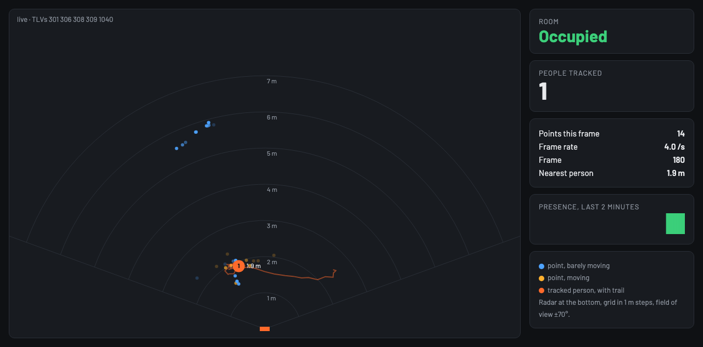

# People tracking and counting on the IWRL6432BOOST, live in a browser

**One person walking, sitting and waving was counted right in 89.5 percent of the frames while in view, with no frame showing a second person, on the radar's shipped image and a config file alone.** `radar_live.py` resets the radar, sends the config, decodes each frame and serves a top-down room view at `http://127.0.0.1:8765/`. Keep 20 cm between the board and a person while it transmits.



Terms: [vocab](../../docs/vocab.md). Board: [IWRL6432BOOST](../README.md).

## Run it

```bash
python3 -m venv .venv && .venv/bin/pip install pyserial
.venv/bin/python iwrl6432boost/live/radar_live.py --probe <serial of the radar's XDS110>
```

It prints the port it found, `CONFIG_OK` and the address. Options: `--probe` (the XDS110 serial: the port is found from it on macOS or Linux, and it is used for the reset, default `RI32`), `--port` (set the UART yourself), `--bind <LAN address>` (also serve the page to the local network), `--cfg`, `--no-config` (radar already running), `--record file.bin`, `--replay file.bin` with `--skip N` to start N frames in. `--selftest` needs no board.

The page shows the point cloud (blue barely moving, amber moving), one orange dot and trail per tracked person, Occupied or Empty, the people count, the nearest person's distance and a two-minute presence strip.

## Set up a room by voice

`calibrate.py` runs a spoken setup for one person, about two minutes. Each step waits until it sees the person do it and repeats itself if not.

1. Step behind the radar for 30 s. Anything that moves with nobody in view (a fan, a curtain) is marked as interference.
2. Walk slowly along the walls. The path becomes the room outline and the tracking area.
3. Stand still in the doorway. That spot is the entrance, where tracks may start and end quickly.
4. Sit where people sit. That spot is the seat; a still track there is held.

It writes `cfg/calibrated.cfg` and `room.json`, then restarts the radar with the room. `radar_live.py --cfg cfg/calibrated.cfg` draws the outline, door, seat and interference cells, counts who came in and left at the door, and times the seat.

## Run it from Chrome with no install

Open the page, press **Connect radar** and pick the XDS110 port. Chrome or Edge on a computer reads the radar over Web Serial, sends the settings, and runs the same spoken setup with the browser's voice (**Run setup**). After setup the page sends the room's settings to the radar itself. **Save settings** downloads them as a config file. If a start fails the browser cannot reset the radar: press its reset button (S2) and connect again.

## Leave it in a room

```bash
.venv/bin/python iwrl6432boost/live/radar_live.py --room iwrl6432boost/live/room-learned.json --log <folder> --learn-every 900 [--ha]
```

- `--log` writes one line a frame (`frames-<day>.jsonl`, about 100 bytes) and the room's events (`events-<day>.jsonl`: in, out, occupied, empty, seat on and off).
- `--learn-every 900` reruns `learn_room.py` every 15 minutes. It learns where people walk, where they come and go (the doors), where they sit, and what moves with nobody there, with no walk. On the 2026-11-03 recordings it found both doors of the room; the room it learned counted 2 entries and 2 exits on a check run where the walked room counted 4 entries.
- The room stays occupied when a track vanishes away from every door (a still, seated person) and goes empty after an exit at a door.
- `/review` shows the day: occupied time, entries and exits by door and hour, seat time, people per 5 minutes, the learned map, and a CSV export of the events. `/occupancy` returns the current state as JSON for any building system or dashboard.
- `--ha` posts `binary_sensor.radar_room_occupied`, `sensor.radar_room_people`, `sensor.radar_room_entries`, `sensor.radar_room_exits` and `binary_sensor.radar_room_seat` to Home Assistant on every change and every 30 s.
- Home Assistant URL and token come from `HA_URL` and `HA_TOKEN` (a long-lived access token from the HA profile page).
- Limit: a person already sitting still when the radar starts is not seen until they move.
- Limit: counting two or more people has only been checked on overlaid one-person recordings.

## Run it on a Linux host (BeagleY-AI, Raspberry Pi, any PC)

`host/` packs the radar and the Wi-Fi presence board for a small Linux computer that stays in the room, as two systemd services with the all-day log, the review page and Home Assistant.

```bash
iwrl6432boost/live/host/pack.sh room-host.tgz          # on the Mac: 37 files, about 200 kB
scp room-host.tgz root@<host>:                          # then on the host:
tar xzf room-host.tgz && sudo iwrl6432boost/live/host/install.sh
sudo nano /etc/room-sensors.env                         # probe serials, LAN address, HA_URL and HA_TOKEN, Wi-Fi name and password
sudo systemctl enable --now radar-room                  # and wifi-room for the CC35X1 board
```

Code goes to `/opt/room-sensors`, logs to `/var/lib/room-sensors/radar` and `/wifi`, settings to `/etc/room-sensors.env` (root only). With `HA_URL` empty the services log locally only; with `LAN_ADDR` set the pages open from a phone at `http://<LAN address>:8765/` and `:8820/`.

- Checked 2026-11-03 in a Debian 12 arm64 container (the BeagleY-AI's CPU): the install, both self-tests, and the Wi-Fi service on its simulated stream writing its log. Not yet run on the BeagleY-AI with a radar or the CC35X1 plugged in.
- The probe reset tool (`xds110reset`) comes with Code Composer Studio, which this host does not have. Without it a stopped stream is recovered by sending the config again; a hung chip needs a USB replug. `XDS110RESET` points the server at a copy if you have one.
- A new room starts with no learned doors or seats: run the voice setup once from a laptop, or let `--learn-every` find them from a day of walking.

## Evaluate it in your own room

1. **Place it.** Wall: 2 m up, tilted 10 to 15 degrees down, facing into the room (`cfg/wall-2m-tilt15.cfg`). Desk: flat, about 1 m up (`cfg/people-count-250ms.cfg`). Ceiling, experimental: 2.7 m up, facing the floor (`cfg/ceiling-2.7m.cfg`); TI states this board has no ceiling profile and its elevation view is coarse on this image. Measure the height and tilt.
2. **Set it up by voice:** `calibrate.py --mount wall --height 2.0 --tilt 15`. About two minutes: step out of view, walk the room, walk out each door and back, sit.
3. **Leave it running:** `radar_live.py --cfg cfg/calibrated.cfg --room room-learned.json --log <folder> --learn-every 900`. It keeps learning doors and seats from real trips.
4. **Watch and adjust** at `http://127.0.0.1:8765/`: Adjust doors and seats drags them into place. Hand-placed ones stay put; learning adds trips to their counts.
5. **Review** at `/review`: occupied time, use of the 08:00 to 18:00 window, entries and exits per door and hour, seats, people per 5 minutes, CSV export.

### What it counts, and how

- People = tracked people plus people held still. A track that vanishes away from every door is a still person, held at that spot until the tracker finds them again or 10 minutes pass with no small motion within 1 m.
- An exit is a track that came within 1.5 m of a door and was still moving, or stopped within 1 m of it. It waits 3 s: a new track starting there in that time is the same person with a new id.
- An entry is a new track within 1.5 m of a door, or any new track once the room has been seen empty (picked up late).
- If the radar stops sending for 3 s the page and Home Assistant say so, and the server resets the radar through its probe and sends the config again (16 s from a stopped stream to frames, 2026-11-03).

### Door counts on recordings (2026-11-03)

| Recording | Truth (spoken cues) | Counted |
|---|---|---|
| Check run 2, learned room | 2 in, 2 out | 2 in, 2 out |
| Check run 2, walked room | 2 in, 2 out | 4 in, 2 out (its hallway door sat 0.9 m from the desk seat) |
| Two check runs overlaid as two people | 4 in, 4 out | 2 in, 4 out (two late pickups while the other person was in the room) |

The overlay is two real one-person recordings played together, not two people at once. Rows: `radar_door_count` in `data/results/iwrl6432boost.csv`.

## The image on this board

This board answered `version` with `Presence_Demo`, mmWave SDK 05.04.00.01, RFS 07.01.00.04 (2026-11-03). It sends nothing until it gets a config and a `sensorStart`. It takes new settings without a reset when `sensorStop 0` comes first (checked 2026-11-03: no errors, 4 frames a second after). After a failed start the command line hangs; `radar_live.py` resets through the probe with `xds110reset -s <serial>` before it configures.

## What was measured (2026-11-03, one person, one run each)

| Config | Exact count while in view | Frames showing two people | After leaving |
|---|---|---|---|
| TI tracking chirp, 250 ms frames, TI tracker lines with the split fix (`runs/2026-11-03-walk-v1.cfg`) | 25.2 percent (59 of 234) | 175 | a track stayed at the far wall to the end |
| Same, static box ending at 4.5 m, shorter static holds, more acceleration allowed (`cfg/people-count-250ms.cfg`) | 89.5 percent (204 of 228) | 0 | cleared within about 2 s |

Method: `walk_test.py <cfg> <out>` speaks cues with the Mac's `say` (walk away to the far wall, walk back, side to side, sit still, wave, leave) and logs every frame with its time. The window runs from the first track to the leave cue. The 24 frames with no track in the second run are the re-acquire after turning at the far wall (5.2 m). Records: `runs/`. Rows: `radar_count_exact` in `data/results/iwrl6432boost.csv`.

## Limits

- One person, one room, the board flat on a desk about 1 m up (`sensorPosition 0 0 1.0 0 0`, not surveyed). Counting two or more people has not been tested.
- TI's own 100 ms frame hung this image after about 31 frames (frames stop, CLI dead; a probe reset recovers it). 250 ms runs 60 s with no stall at 4.0 frames a second.
- A track starts only once a person moves; someone already seated when the radar starts is not counted until they move.

## FAQ

### The old `PresenceDetect-*.cfg` files fail on this board

The 05.04 image takes 8 values for `sigProcChainCfg` and has no `rangeSNRCompensation`; `sensorStart` then fails with `DOA DPU config return error:-2801` and the CLI hangs. Use the files in `cfg/` here, after a reset.

### `trackingCfg` says `Invalid usage of the CLI command`

The help text lists 6 values; the image takes 7: enable, parameter set, maximum points, maximum tracks, maximum radial velocity (tenths of a m/s), radial velocity resolution (mm/s), frame period (ms). With 6 values `sensorStart` fails with `Tracker DPU config return error:-30902`.

### Points never arrive though tracks do

With `guiMonitor` point cloud set to 1 this image sends TLV 1 (four floats a point) and TLV 7 (SNR), not TLV 301. Set it to 2 for TLV 301. `radar_live.py` reads both.

### One person shows up as two

A track left at a spot where the person paused keeps living as a "static" person. Ending `staticBoundaryBox` before the far wall and shortening the static holds in `stateParam` removed it here (table above).

### The ceiling config says `DOA DPU config return error:-30207`

On this image `sigProcChainCfg` accepts only an elevation FFT size of 2; 8, 16 and 32 give this error and the command line hangs (checked 2026-11-03). Use `cfg/ceiling-2.7m.cfg`, which keeps 2, and reset the radar before sending it again.

### The radar stopped and the page says "Radar not responding"

The server noticed no frames for 3 s. It resets the radar through the probe and sends the room's config again after 8 s; frames came back 16 s after a stop on 2026-11-03. If it stays down, check the USB cable and that the probe serial in `--probe` matches `ls /dev/cu.usbmodem*`.
