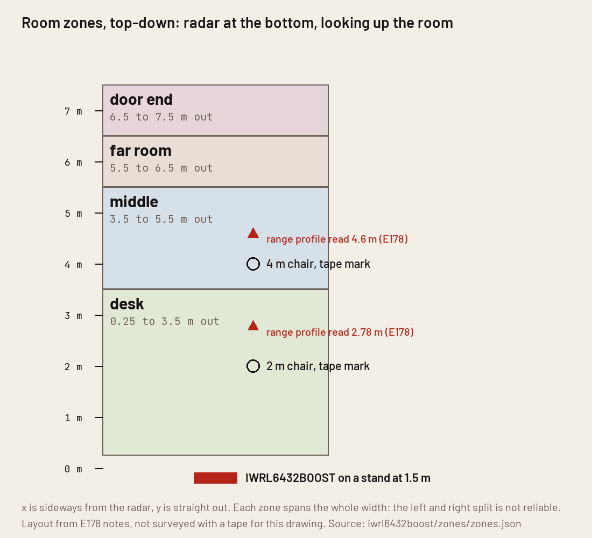

# Room zones on the TI IWRL6432BOOST radar with the shipped Motion and Presence demo

**Short answer.** The shipped demo can do zones with a configuration change alone, no reflash: its command line takes up to 12 floor-plan boxes and reports each box's state in every frame. This repo holds the four-zone configuration, the program that reads the zones, logs them and draws a live page, and the Home Assistant posting code. None of it could be run on the radar: the board has been silent on USB since 2026-10-12 and a probe reset and a USB power cycle did not bring it back. So there is no live zone measurement here. What exists is the program tested without the radar, and a replay of frames recorded on 2026-10-10 with the shipped four boxes. The replay shows that a still person at the 4 m chair lit both the near box and the far box in 70 percent of the seated time, on the full 2 by 3 antenna setting.

Contents: the zones, measured and expected, what each part does, what the shipped demo cannot do, FAQ, how to repeat.

Terms: [vocab](../../docs/vocab.md). Board: [IWRL6432BOOST](../README.md). Antenna evaluation this builds on: [what the antennas buy](../../docs/experiments/2026-10-10-radar-antenna-eval.md) and [how to evaluate a presence radar](../../docs/guides/evaluate-a-presence-radar.md). Experiment page for this work: [room zones](../../docs/experiments/2026-10-13-iwrl6432boost-room-zones.md). Checked 2026-10-13 on macOS 15.7 with the MMWAVE-L-SDK 05.05.04.02 source and Radar Toolbox 4.00.00.05.

## The zones

Four zones, each as wide as the room, stacked away from the radar: desk (0.25 to 3.5 m), middle (3.5 to 5.5 m), far room (5.5 to 6.5 m), door end (6.5 to 7.5 m). They are in `zones.json`, which makes `cfg/PresenceDetect-zones.cfg` (`python3 zones.py cfg`). The layout comes from the antenna evaluation's setup: the radar on a stand at about 1.5 m, a chair at 2 m and one at 4 m on the tape line, the door at the far end. It was not surveyed again for this page. The radar read those two chairs at 2.78 m and 4.6 m in its range profile, so the desk and middle edge at 3.5 m sits between them.

Why depth bands and not left and right: in the four recorded seated passes (one pass each, the person on the tape line straight out from the radar) the shipped left boxes were lit 73 to 92 percent of the seated window and the right boxes 0 to 38 percent. A split at x = 0 on that line put the person mostly on one side.

## Measured and expected

Expected values were set from the antenna evaluation before the radar was found silent. Only the frame rate, serial load and last row come from the 2026-10-10 recording; the rest was not run.

| What | Expected | Result |
|---|---|---|
| Configuration accepted | 4 boxes, every line Done | **Not run.** The radar does not answer. The file builds and the program's self test passes |
| Empty room, false zone events in 20 min | 0 | **Not run.** For scale only: the shipped four boxes gave 0 presence frames in 87,602 frames over 6.08 h, empty room, 2026-10-10 to 11. The short 2 by 3 empty pass in the replay had all four boxes lit for its first 14 s, which the antenna evaluation put down to the person leaving plus the 12-frame hold |
| Walk-through: door end, far room, middle, desk lit in that order | The person's zone lit, a neighbour sometimes | **Not run** (no person's walk-through was requested) |
| Frame rate | 4.0 a second | 4.003 a second, recorded 2026-10-10 on the 2 by 3 setting, not re-measured |
| Serial load | 704 B a frame, 2,818 B/s, 24.5 percent of the 11,520 B/s a 115,200 baud link carries | Computed from that recording |
| A still person lights one zone | Mostly one | **Wrong on the recording.** Seated at 4 m, near and far boxes both lit in 70 percent of the seated window (2 by 3) and 92 percent (2 by 2); at 2 m, 32 and 20 percent |

The recording used the demo's own four boxes (left and right of the center line, near 0 to 3.5 m, far 3.51 to 7 m), so it says how the demo's zone logic behaves, not how the four bands of this page would. Method: `python3 zones.py replay` on the frames saved from the 2026-10-10 recording (the frames are not in the reader copy).

## What each part does

- `zones.py run`: reads the radar's frames, prints and logs each zone turning on and off ("desk ON", "desk OFF occupied 31 s, peak major, 3.2 s after the last major motion"), keeps a count of zone changes in the last minute, and writes `live/index.html` once a second. Serve it with `python3 -m http.server --bind 127.0.0.1` from this folder and open `/live/index.html`. One box per zone, green when occupied.
- `zones.py apply`: resets the radar through its debug probe, sends the configuration over the command line, checks frames arrive. The demo takes one start per boot and numbers boxes in the order they are sent, so a second send without a reset adds boxes instead of replacing them.
- `zones.py walk`: the timed walk-through (door, desk, sit, out) with spoken cues and a log of the cue times; `zones.py check` then prints per-zone detect and clear times against those cues.
- Home Assistant: off by default. `--ha-rest URL` with the token in the `HA_TOKEN` environment variable posts `binary_sensor.iwrl6432_zone_desk`, `_middle`, `_far_room` and `_door_end` (occupancy) on every change and every 30 s. A mock server in the self test confirms the request shape. It has never talked to a real Home Assistant. `--mqtt HOST` publishes discovery messages through paho, which is not installed here, so that path is untested.

## What the shipped demo cannot do

- **Count people or follow them.** A zone says "something is in this box". Two people in one box are one occupied box. TI's people-tracking setup of the same Motion and Presence Detection demo gives each person a track; the tracking configuration file named in the earlier evaluation is not in the toolbox copy used here, so this is unverified. The prebuilt 2D and 3D images are in the Radar Toolbox. Loading one needs the board in flash mode: slide S1 position 1 to OFF, press S2, flash, slide it back, press S2. That is a person at the board, so it is not done here. The demo's help text lists `trackingCfg`, `boundaryBox` and `gatingParam`, so the shipped image may run the tracker if it is sent those lines.
- **Put a person in exactly one zone.** See the replay above. **Unknown (suspected: Chip limit).** Suspected: clusters from one body straddle the 3.5 m line (the range profile read the 2 m chair at 2.78 m and the 4 m chair at 4.6 m, 0.78 and 0.6 m long) and the 2 by 3 angle estimate is coarse. Not tested: more antennas, a different cluster radius, a taller mount.
- **Use the third dimension.** The 2D build ignores the z values of a box (read in the SDK's `mpdproc.c`). TI's user guide says the 3D image separates zones by height for sit against stand; it has not been run.

For scale, public figures only ([Aqara FP2 page](https://www.aqara.com/en/product/presence-sensor-fp2/), [Hi-Link LD2450 manual](https://en.hlktech.com/index.php?id=1157)): Aqara's FP2 says up to 30 zones and up to 5 people at once, with wall mounting required for zones. Hi-Link's HLK-LD2450 (24 GHz) reports x and y for up to 3 targets at 10 frames a second out to 6 m and has one region filter. Neither was tested.

## FAQ

Terms used below: `mpdBoundaryBox` is the demo's command that defines one floor-plan box; a cluster is a group of nearby radar points the demo treats as one body; frame type 315 is the frame section that carries each box's state.

### My still person shows two zones occupied

Expected with the demo's own boxes. In the recording, near and far boxes were both lit for 70 percent of a seated window at 4 m. Treat a lit zone as 'someone is in or next to this zone'. Source: `radar_zone_overlap` rows in `data/results/iwrl6432boost.csv`.

### Do I need to reflash to change zones?

No. Edit `zones.json`, run `python3 zones.py cfg`, reset the radar and send the file. A good send answers `Done` on every line.

### Does the Home Assistant posting work?

Untested against a real Home Assistant (no token here), and the MQTT route needs paho, which is not installed. Only the REST request shape was checked, against a local mock.

### The radar prints nothing on `/dev/cu.usbmodemRI32RI321`, and `xds110reset -s RI32RI32` changes nothing

Stop and say so; do not keep retrying. On 2026-10-13 the radar stayed silent through three probe resets and a power cycle of the probe's hub port. After the power cycle macOS listed the application port as `/dev/cu.usbmodem3` and left the old name behind as a dead node (reads end at once with `device reports readiness to read but returned no data`). The board had been silent since a wiring run the day before and no recovery is known. Check `ioreg -r -c IOSerialBSDClient | grep RI32` for the port's real name.

### A second `mpdBoundaryBox` send gave me eight zones

Reset the radar first. The demo adds a box for every `mpdBoundaryBox` line, ignores the zone number, and the count only resets at boot. Read in `mmw_cli.c`.

### Which number is which in the zone byte?

0 empty, 1 minor motion (a still person's breathing), 2 major motion (walking). TI's user guide does not list them; they are constants in `mpdproc.c`. Frame type 315 carries a count byte, then 2 bits per zone from the low bit.

## How to repeat

1. Close any other program reading the radar's port.
2. `python3 zones.py apply` (resets, sends the configuration, counts frames).
3. Empty room, 20 minutes: `python3 zones.py run --seconds 1200 --label empty`. The count of `on` events in the summary is the false events.
4. `python3 zones.py walk` speaks the cues; `python3 zones.py check results/zones-<stamp>-walk.csv --cues results/zones-<stamp>-walk.cues.json` prints the times.
5. To test without the radar: `python3 zones.py selftest`, and `python3 zones.py replay <saved frames>.csv`.

Each frame and each zone change is saved under `results/`.

## Mistakes to avoid

- **Our mistake.** Do not repeat a recovery step already known to fail on this board, such as a USB power cycle of the radar's probe. Check the board's latest recovery record first.
- Do not expect the range profile to give a clean person position. With nobody in the room its peak sits on a fixed reflector near 6.5 m, so the replay uses it only for seated passes.

## Limits

The radar stopped answering in both run and flash mode, and no way back is known.
