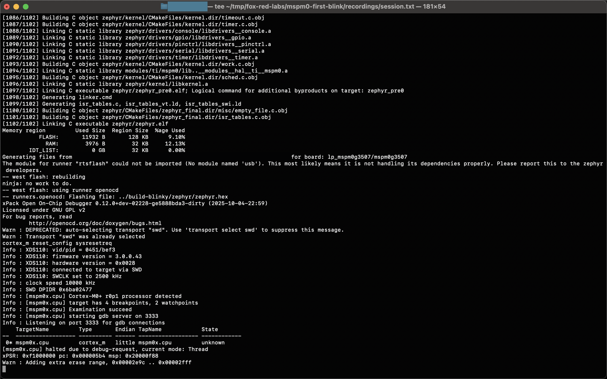
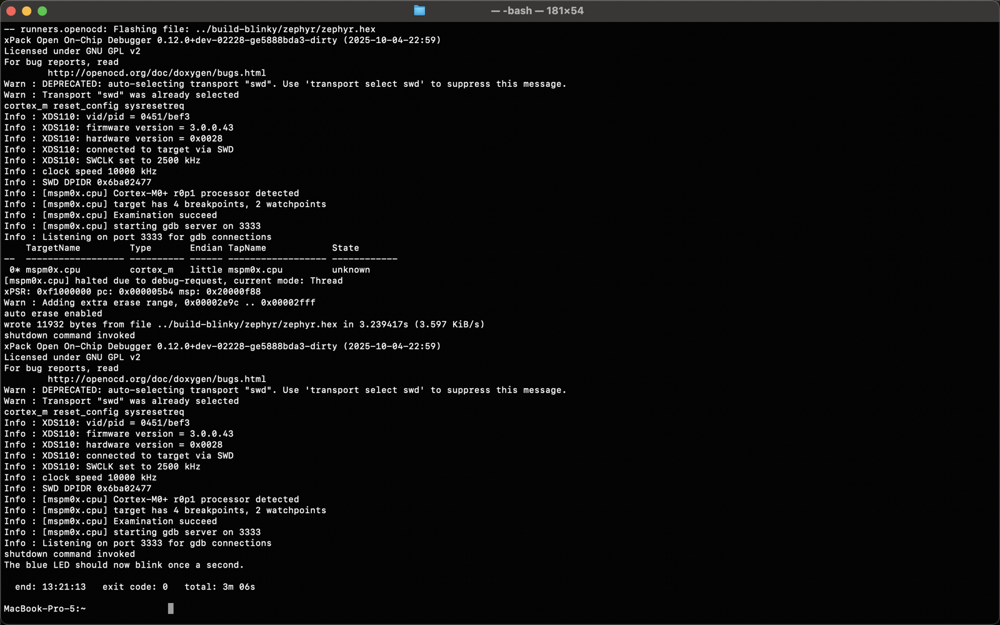

# Zephyr blinky on the LP-MSPM0G3507 from an Intel Mac

Zephyr 4.4.2 `samples/basic/blinky` ran on the LP-MSPM0G3507 and the blue LED blinked. Checked 2026-10-05. The first run took about 9.5 minutes of machine time from nothing installed, with no hands-on time. A script now does the same install in about 3 minutes.

Terms: [vocab](../../docs/vocab.md) and [FAQ](../FAQ.md). Sizes in kB, 1 kB = 1,024 bytes.



Build size from the memory report: 11.7 kB of flash, 3.9 kB of RAM. `west flash` found the probe, detected the chip and wrote 11.7 kB. The LED pin read back as toggling three times, a second apart.

## Official steps that did not work here

Four places where the official instructions failed on this Intel Mac. Each one is a step a newcomer would have to work out alone.

| # | The official way | What blocked it | What was done instead |
|---|------------------|-----------------|-----------------------|
| 1 | Install build tools with Homebrew | Homebrew builds from source on this Intel Mac | `pip install west cmake` in a Python 3.12 environment. `dtc` left out; the build does not need it. |
| 2 | `west sdk install` for the compiler | Zephyr SDK 1.0.1 has no Intel macOS build, and Zephyr 4.4.2 requires SDK 1.0. The command fails with an empty list. | Arm compiler from SDK 0.17.4 via `ZEPHYR_TOOLCHAIN_VARIANT=cross-compile`, plus the `picolibc` module. Works. Not an officially supported pairing. |
| 3 | Clone OpenOCD and build it from source | Needs a build toolchain this Mac does not have | Prebuilt xPack OpenOCD 0.12.0-7, which already supports the chip and the XDS110 probe. |
| 4 | `west flash`, then watch it blink | After a debugger soft reset the chip sat in Zephyr's NMI handler, no blink | One board-level reset command. The reset button does the same. |

Two safety checks to make before flashing a borrowed board, neither in any guide: confirm the fix for the December 2025 "bricked LaunchPad" bug (Zephyr PR 102668) is in the source, and confirm the image contains main flash addresses only.

Done differently by choice, to save time and disk: a pinned release (v4.4.2), shallow clones, and only four modules instead of a full `west update`.

## Repeat it

`./setup.sh` is the cross-platform version: macOS on Intel or Apple silicon and Linux on x86_64 or arm64, every download pinned and checksummed, Python 3.12 from uv when the machine has none, a free-disk check first. From nothing installed, build only: 2 min 48 s on this Intel MacBook inside a sandbox that hides every installed tool, 56 s on an M4 Mac, 93 s in an Ubuntu 24.04 arm64 container on that Mac (all 2026-10-18). Linux x86_64 is pinned but not run. The flash leg on Apple silicon and on Linux is untested.

`./setup-intel-mac.sh` is the exact sequence that worked on the Intel Mac, with checksums. It ran from clean twice on 2026-10-05, in a plain Terminal window: 3 minutes 00 seconds and 3 minutes 06 seconds, exit code 0 both times. The first run, while the workarounds were still being found, took 9.5 minutes.



## Red blink

`red-blink/` is a copy of the blinky sample that lives in this repo instead of the Zephyr tree. Two changes: `boards/lp_mspm0g3507.overlay` points `led0` at the red channel of the RGB LED (PB26) instead of blue (PB22), and `SLEEP_TIME_MS` is 500, so the LED is on half a second and off half a second.

Build and flash, with the environment from `setup-intel-mac.sh`:

```text
cd ~/zephyrproject/zephyr
west build -p always -b lp_mspm0g3507 <this repo>/zephyr/red-blink -d ../build-red-blink
west flash -d ../build-red-blink --openocd "$OCD/bin/openocd" --openocd-search "$OCD/openocd/scripts"
```

Then do the board-level reset from step 6 of the script. It took 85 seconds to build and 7 to flash and reset. CCStudio can stay open with no debug connection; it does not get in the way.
