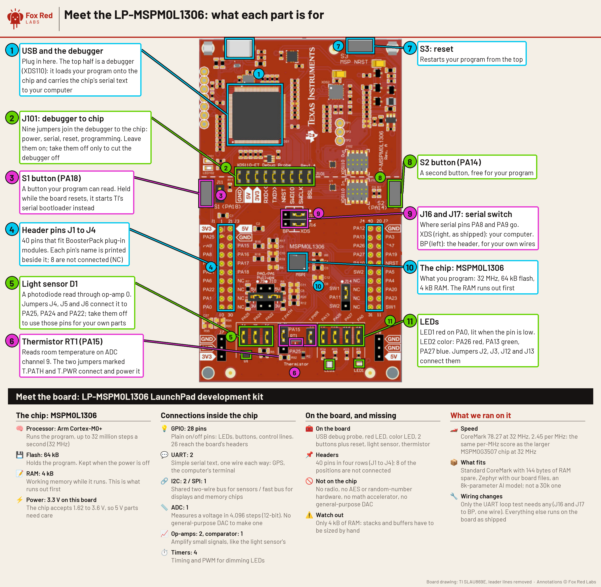

# TI LP-MSPM0L1306 LaunchPad: what runs in 4 kB of RAM

> Disclosure: Fox Red Labs is a lab run by a TI employee on personal time. Contributors' projects are their own. Not affiliated with, sponsored by, or endorsed by Texas Instruments or any other manufacturer.

**Short answer.** From a Mac terminal TI's blink example for the LP-MSPM0L1306 built in 3.3 seconds and flashed in 0.6, and the chip ran CoreMark at 78.27 per second at 32 MHz: per MHz, the same core speed as the MSPM0G3507. RAM is the limit on everything else: CoreMark fits with 144 bytes to spare, Zephyr's hello_world uses 94% of RAM (a trimmed Zephyr shell still fits, with 48 bytes left), 5 of 19 Embench benchmarks and the largest of four small neural nets do not fit.

Terms: [docs/vocab.md](../docs/vocab.md). Every problem found, with its cause and fix: [FAQ](FAQ.md). 1 kB = 1,024 bytes. **SysConfig** is TI's tool that writes a chip's setup code; **DriverLib** is TI's low-level C library for its peripherals; a **flash wait state** is an extra clock cycle the core waits for each read from flash at high clock speeds; **NONMAIN** is the chip's boot configuration area, which a bad write can lock for good; the **heap** is RAM handed out at run time by `malloc`; **MessagePack** is a compact binary form of JSON.

**First blink:** `./start.sh mspm0l1306 blink` from the top of a clone, once the four tools are installed ([One-command build](#one-command-build), [the tools](#where-these-facts-come-from)). Then: [what each part of the board is for](img/board-tour.png), the CoreMark and timing sources in `bench/coremark/` and `bench/timing/`, and [notes to copy into your own project for your AI assistant](AGENTS.md).

## What is in this folder

<!-- folder-contents -->
**In this folder:** this README; `AGENTS.md` (notes for an AI assistant, every line from a run); `FAQ.md` (every error hit, with its exact text and the fix). Folders: `bench/coremark/` and `bench/timing/` the CoreMark and timing sources, `color-player/` the color player, `freertos/` FreeRTOS builds, `img/` pictures, `third-party/` third-party benchmark code, `tools/` helper scripts for this board, `zephyr/` Zephyr builds. Results are rows in `data/results/mspm0l1306.csv` at the top of the repository, not in this folder.

**Not in this folder:** TI's SDK, CCStudio, SysConfig and the compilers (you install them; the versions are under "Where these facts come from"); built images (`.out`, `.hex`, `.bin`, `.elf`), which are not cleared for redistribution, so you build them with the command below.

**Taking this folder alone:** the one-command build runs from the top of a clone and the by-hand steps from inside this folder; both call `tools/` and `data/`, and the benchmarks also borrow sources from folders that several boards share. A sparse clone fetches only those, about 10 to 60 MB, instead of the whole repository (about 500 MB):

```bash
git clone --depth 1 --filter=blob:none --sparse https://github.com/Fox-Red-Labs/fox-red-labs.git
cd fox-red-labs
git sparse-checkout add mspm0l1306 tools data mspm0g3507/mcu-bench third-party/coremark
```

`docs/` is left out on purpose (236 MB, mostly pictures). Read a page a link points to there with `git show HEAD:docs/<file>`, for example `git show HEAD:docs/vocab.md`.


## The board

| Part | Fact | Read from |
|---|---|---|
| Chip | MSPM0L1306: Arm Cortex-M0+ at up to 32 MHz from an internal oscillator (no PLL, no crystal needed) | Data sheet |
| Memory | 64 kB flash, 4 kB RAM, reported by the chip itself; device ID `0x1BB8202F` | Read from the chip |
| On the chip | One 12-bit ADC, two op-amps, a general-purpose amplifier, a comparator with an 8-bit DAC, hardware CRC, 3 DMA channels, four 16-bit timers, two UARTs, two I2C, one SPI | Data sheet |
| Not on the chip | No FPU, no divide instruction, no math accelerator, no AES, no random number generator | Data sheet |
| LEDs and buttons | An RGB LED, a red LED, two buttons | `AGENTS.md` |
| Sensors | A light sensor (photodiode into op-amp 0) and a thermistor | `AGENTS.md` |
| Debugger | Onboard XDS110, probe serial <probe serial>, firmware 3.0.0.43; two serial ports, no driver to install | this page, Where these facts come from |



MSPM0L1306: Arm Cortex-M0+ at up to 32 MHz from an internal oscillator (no PLL, no crystal needed), 64 kB flash, 4 kB RAM, one 12-bit ADC, two op-amps, a general-purpose amplifier, a comparator with an 8-bit DAC, hardware CRC, 3 DMA channels, four 16-bit timers, two UARTs, two I2C, one SPI. No FPU, no divide instruction, no math accelerator, no AES, no random number generator. The LaunchPad adds an RGB LED, a red LED, two buttons, a light sensor (photodiode into op-amp 0) and a thermistor. Read from the chip: device ID `0x1BB8202F`, 64 kB flash and 4 kB RAM reported by the chip itself.

It came with TI's out-of-box demo in flash. It is silent until asked: send it a MessagePack command and it streams the light sensor (339 to 343 counts on this bench) or the thermistor (22.8 °C). How: [FAQ](FAQ.md#the-out-of-box-demo-is-silent-on-the-serial-port-is-it-broken). The original image was saved first and put back at the end: all 64 kB of flash read back identical, and the demo answered over serial.

## Ten-minute path

Quickest: `./start.sh mspm0l1306 blink` from the top of the clone does all of this in one command ([One-command build](#one-command-build)). The steps below do it by hand (measured: build 3.3 s, flash 0.6 s).

1. **Plug in the board (bench).** It shows up as an XDS110 probe with two serial ports; no driver to install. Find its serial from the top of the clone with `python3 tools/frl/frl.py detect`.
2. **Copy TI's example (terminal).** These steps run from inside this folder. With the tools in Where these facts come from installed (`/Applications/ti/` is where TI's installer puts SDK 2.11.00.07 by default; some installs use `~/ti/`, so change the path if yours differs):

   ```bash
   cd mspm0l1306
   cp -R /Applications/ti/mspm0_sdk_2_11_00_07/examples/nortos/LP_MSPM0L1306/driverlib/gpio_toggle_output .
   ```
3. **Build it (terminal, 3.3 s).**

   ```bash
   ../mspm0g3507/mcu-bench/sdk-common/sdkmake.sh gpio_toggle_output/ticlang
   ```
4. **Flash it with OpenOCD (terminal, 0.6 s).** `tools/ocd.sh` uses only the probe you name and refuses to run without one. Put your serial from step 1 in place of `<serial>`:

   ```bash
   PROBE=<serial> tools/ocd.sh "reset halt" "program gpio_toggle_output/ticlang/gpio_toggle_output.out verify" "reset run"
   ```
5. **Look at the board (bench).** The RGB LED cycles. OpenOCD prints `Error: checksum mismatch - attempting binary compare` before `** Verified OK **`; that is normal ([FAQ](FAQ.md#openocd-prints-error-checksum-mismatch---attempting-binary-compare-did-the-flash-fail)). TI's UniFlash command line also works, in 15.0 s, with a connection file for your probe serial.

## One-command build

From the top of the clone:

```bash
./start.sh mspm0l1306 blink
```

It backs up the board, builds TI's blink, flashes it and checks the LED pattern through the debugger, with no assistant (`docs/frl.md`). It took 1 min 15 s from the command to a confirmed blink once the tools were installed (`data/results/mspm0l1306.csv`, test `time_to_blink`, variant `oneline-terminal-start-sh`). If tools are missing it lists them with their sizes and stops. With several probes plugged in it stops with FRL-E002 and lists their serials; add `--probe <serial>`. It does not run the benchmarks does.

## What was measured

One LP-MSPM0L1306, run from a Mac terminal on 2026-10-06. Rows cite a test name in `data/results/mspm0l1306.csv` or a file.

| What | Number | Conditions | Level | Source |
|---|---|---|---|---|
| Chip | 32 MHz, 64 kB flash, 4 kB RAM, 1.68 Msps ADC | Data sheet values | claim | Data sheet |
| Flash and RAM size, device ID | 64 kB, 4 kB, `0x1BB8202F` | Reported by the chip itself | measured | Read from the chip, 2026-10-06 |
| Build of TI's blink | 3.3 s | 32 MHz host build, 1 run | measured | `data/results/mspm0l1306.csv`, test `blink_build` |
| Flash with OpenOCD | 0.6 s | 1 run | measured | `data/results/mspm0l1306.csv`, test `blink_flash` (openocd) |
| Flash with UniFlash command line | 15.0 s | 1 run, `MSPM0L1306_ML130001.ccxml` | measured | `data/results/mspm0l1306.csv`, test `blink_flash` (uniflash) |
| Command to confirmed blink, `start.sh` | 75 s | Pin read through the debugger | measured | `data/results/mspm0l1306.csv`, test `time_to_blink` (oneline-terminal-start-sh) |
| Out-of-box image restored | all 64 kB of flash read back identical; demo answered over serial | Original image saved before the first flash | measured | Readback compare, 2026-10-06 |
| CoreMark, TI Arm Clang -O3, no operating system | 78.27 per second, 2.446 per MHz (-Os 47.35, -Oz 41.63) | Bare metal, 32 MHz | measured | `data/results/mspm0l1306.csv`, test `coremark` (ticlang-bare-o3, -os, -oz) |
| CoreMark at 4 MHz (no flash wait state) | 2.631 per MHz; the one wait state at 32 MHz costs 7% | Bare metal, -O3 | measured | `data/results/mspm0l1306.csv`, test `coremark_per_mhz` (ticlang-bare-o3-4mhz) |
| CoreMark under Zephyr, GCC -O2 with unrolling | 59.70 per second, 1.87 per MHz | Zephyr 4.4.2, 32 MHz | measured | `data/results/mspm0l1306.csv`, test `coremark` (gcc-zephyr-o2unroll); `zephyr/README.md` |
| Interrupt latency, pend to handler | 25 to 28 cycles bare metal; 119 to 137 through Zephyr | Pend a spare interrupt line | measured | `data/results/mspm0l1306.csv`, test `irq_latency` (bare, zephyr) |
| GPIO, one register write | 1 cycle | Not checked on a scope | measured | `data/results/mspm0l1306.csv`, test `gpio_toggle` (register) |
| Internal oscillator | 32.16 MHz, 0.5% fast (data sheet ±1.2%) | Measured on this bench | measured | Measured 2026-10-06 |
| ADC top rate, TI's example with DMA | 1.45 million samples per second | TI's 8-cycle window | measured | `data/results/mspm0l1306.csv`, test `adc_max_rate` |
| Room-occupancy neural nets | 500, 2k and 8k parameter models: 20 of 20 test vectors each; the 8k model in 84 to 100 ms | -O3 and -Os builds | measured | `data/results/mspm0l1306.csv`, tests `ai_occ_latency`, `ai_occ_fit` (occ_cnn_8k) |
| P-256 signature (micro-ecc, assembly) | sign 0.50 s, verify 0.57 s | 32 MHz | measured | `third-party/README.md` |
| Dhrystone 2.1, rules followed | 0.73 DMIPS/MHz (23.4 DMIPS); 0.88 at 4 MHz | 32 MHz | measured | `data/results/mspm0l1306.csv`, test `dhrystone` |
| FFT, 256 points, q15, TI's CMSIS-DSP | 2.25 ms; 512 points 5.2 ms | 32 MHz | measured | `data/results/mspm0l1306.csv`, test `fft256` (q15) |
| FreeRTOS (TI's V11.2.0, no TI example for this chip) | runs; task switch 12 to 16 µs; 11 small tasks fit | Static allocation | measured | `data/results/mspm0l1306.csv`, tests `rtos_task_switch`, `rtos_max_tasks`; `freertos/README.md` |
| ADC speed against accuracy | 1.99 Msps possible, but a sensor reads 10% low at that speed; TI's default window reads 1.7% low | Thermistor, window of 2 cycles against 8 | measured | Measured 2026-10-06 |
| UART loop, one jumper wire | every byte right to 4.5 Mbaud and from 6.4 to 10.67 Mbaud; 5 to 6 Mbaud fails, the same dead band as the MSPM0G3507 | Bytes compared after the loop | measured | `data/results/mspm0l1306.csv`, test `uart_max_clean` |
| Hardware CRC-32 against a lookup table | 10.9 times faster | 1 kB buffer | measured | `data/results/mspm0l1306.csv`, test `crc_speedup`; `third-party/README.md` |
| TI's SDK examples | 156 of 170 build from a terminal; all 148 that do not write the boot configuration were flashed and run by a script, low-power ones included: none crashed, the debugger never lost the board | MSPM0 SDK 2.11.00.07 | measured | `data/results/mspm0l1306.csv`, tests `examples_built`, `examples_ran_clean` |
| G3507 and C1104 examples retargeted to this chip | 133 built and ran, none crashed; 17 of the G3507 ones toggled an LED | Device changed in SysConfig | measured | `data/results/mspm0l1306.csv`, test `port_build_rate` |

No current or energy figures were taken in this README's run: TI's EnergyTrace software has no macOS version, and no other meter was on the bench for it. The later EnergyTrace rows are in the CSV.


## What fits in 4 kB and what does not

| Program | RAM it needs | Fits? |
|---|--:|---|
| TI's blink example | 256 B | yes |
| Every TI SDK example that builds | up to 3.2 kB | yes |
| CoreMark (standard 2 kB data), bare metal | 3.9 kB | yes, 144 B spare; the stack reached 2.9 kB |
| Room-occupancy model, 8k parameters | 2.2 kB plus 548 B of stack | yes |
| Room-occupancy model, 30k parameters | over 4 kB for its buffers alone | no |
| FreeRTOS, one-task blink (static allocation) | 1.0 kB | yes, 3.0 kB spare |
| FreeRTOS with TI's own settings file for this board | 5.4 kB | no |
| Zephyr hello_world | 3.7 kB | yes, 264 B spare |
| Zephyr CoreMark (2 kB data) | 4.0 kB | yes, after turning off the C library heap |
| Zephyr synchronization, logger, shell, philosophers, as shipped | 6.1 to 17.0 kB | no |
| Zephyr shell (minimal), logger, synchronization, Thread-Metric, trimmed | up to 4.0 kB | yes, all ran; the shell has 48 B left |
| Embench: 14 of 19 fit and run, 13 pass | | yes |
| Embench: heatshrink, huffbench, matmult-int, qrduino, sglib-combined | 6.9 to 8.5 kB | no |
| Embench: wikisort | 4.1 kB of stack in one function | no: it links, then faults at run time |

Flash was never the limit; the largest image, the Zephyr benchmark at its O3 setting, used 54.9 kB of 64 kB (`zephyr/README.md`).

## Compared with the other TI boards on this bench

Measured means run on this board; data sheet means read, not run.

| LP-MSPM0G3507 | LP-EM-CC2340R5 | LP-CC1354P10-1 | LP-MSPM0L1306 |
|---|---|---|---|---|
| Core, clock | Cortex-M0+, 80 MHz | Cortex-M0+, 48 MHz | Cortex-M33 with FPU, 48 MHz (data sheet) | Cortex-M0+, 32 MHz |
| Flash, RAM | 128 kB, 32 kB | 512 kB, 36 kB | 1 MB, 256 kB (data sheet) | 64 kB, 4 kB |
| Extra hardware | math accelerator, AES, CRC, random numbers | AES (data sheet) | AES, random numbers (data sheet) | CRC, op-amps, comparator |
| Radio | none | Bluetooth LE, Zigbee; Thread only as a radio co-processor | Sub-1 GHz and 2.4 GHz | none |
| CoreMark, TI Clang -O3, bare metal | 183.61 (2.30 per MHz; 2.46 at 32 MHz) | 111.09 (2.31) | not measured | 78.27 (2.446) |
| CoreMark, Zephyr GCC -O2 with unrolling | 139.88 (1.75) | 84.07 (1.75) | no Zephyr support | 59.70 (1.87) |
| Interrupt latency, bare metal | 29 to 36 cycles | 28 to 29 | not measured | 25 to 28 |
| Hardware CRC-32 against a table | 13.5 times | not measured | not measured | 10.9 times |
| Zephyr board in upstream 4.4.2 | yes | yes, no radio | no | no; chip yes, the board file in this repo works |
| TI SDK examples | 270 (13 Edge AI, TI Drivers, FreeRTOS) | F3 SDK, TI Drivers, FreeRTOS | F2 SDK, not installed here | 170, DriverLib only; FreeRTOS runs with this repo's settings |

The three Cortex-M0+ parts have the same core speed per MHz with the same compiler. The L1306 even needs fewer cycles than the G3507 for the same code (CoreMark 1.87 against 1.75 per MHz under Zephyr; Embench 0.93 times the G3507's cycles), because at 32 MHz its flash adds one wait state and the G3507's adds two at 80 MHz. What separates them is clock, RAM and the extra hardware. The L1306 is the cheapest by far and the one where every program has to be sized for RAM first. Sources: the other boards' rows in `data/results/`, the CC1354P10 page `../cc1354p10/README.md`, and ti.com for prices.

## Moving code to and from it

- **Plain C moves.** CoreMark, Embench, micro-ecc, jsmn and the occupancy models built and ran with board code only (clock, UART pins, stack size). The prebuilt model libraries made for the G3507 ran unchanged and gave the same answers on all 20 test vectors; the Zephyr benchmark's neural-net checksums match the G3507's and the CC2340R5's.
- **TI's own examples move up easily and down badly.** Changing only the device in SysConfig: 101 of 170 L1306 examples build for the G3507, but only 22 of 270 G3507 examples build for the L1306. The single biggest blocker is one G-series SysConfig setting (`SYSCTL.forceDefaultClkConfig`) that the L1306 does not have; SysConfig's command line stops on it. Dropping every line SysConfig rejects gets 96 of 270 to build, and 13 of those silently lose a real setting, such as the ADC's DMA trigger. All 133 ported images that built ran on the board with no crash, but running is not the same as working. A C1104 blink moved this way still toggles the C1104 kit's LED pin, PA22, which on this board is wired to the light sensor; and dropped settings change behavior.
- **One TI example ported by hand.** The G3507's internal temperature example needs four SysConfig lines changed and no C changes. SysConfig picks the software IQmath library by itself.
- **Interrupt lines are a trap.** This chip's interrupt controller implements only the 13 lines that have a peripheral; pending any other line does nothing, silently. Code that borrows an unused line on the G3507 (the test used line 28) breaks here.

## Problems found

Each one is in the [FAQ](FAQ.md) with the fix.

- The internal temperature sensor reads -165 °C with this chip's factory calibration. A TI forum answer says early samples carry a wrong trim.
- CCStudio 21.0.1's notes for AI agents (`ai/boards/LP-MSPM0L1306/AGENTS.md`) list the package as LQFP-32, the BoosterPack header pins as differing from the LaunchPad user guide's figure, and ADC channels 7 and 8 on PA19 and PA18. The user guide (SLAU869E) and data sheet (SLASEX0D) give VQFN-32 (RHB) and PA18 and PA16. Take pin and channel numbers from the user guide's BoosterPack figure.
- The out-of-box demo's GUI needs a request to TI sales; the demo's serial protocol is only in its source.
- Zephyr: the GPIO driver does not compile for this chip (`'IOMUX_PINCM38' undeclared`) and there is no pin-mux file.
- Zephyr: every program that filled RAM stopped at `***** HARD FAULT *****` during boot, because the C library heap defaults to all RAM left over.
- The 30k-parameter model fails to link on RAM (`program will not fit into available memory`).
- 14 of 170 SDK examples do not build from a terminal: no makefile, a TI build-server path, or `symbol "interruptVectors" redefined`.
- Embench `st` fails its own check, as on the G3507.
- A SysConfig clock line is ignored without a warning when the clock tree is on.

## If you see this

- If you see `wrong # args: should be "error message ?stacktrace?"` after `mspm0_mass_erase`, ignore it and load an image with DSLite or OpenOCD: the script's reset helper throws after the erase has happened.
- If you see `DAP Connection Error. This could be caused by the device having gone to low power mode.`, the image entered SHUTDOWN right after boot. Hold S1 (PA18), press and release S3, keep S1 held 2 more seconds, then flash a non-sleeping image at once and replug USB.
- If you see `error: 'IOMUX_PINCM38' undeclared here (not in a function)` building Zephyr, build with the out-of-tree board in `zephyr/` (`-DBOARD_ROOT`): Zephyr 4.4.2's GPIO driver has the 80-pin MSPM0L222x pin table.

The rest, each with cause and fix, are in [FAQ.md](FAQ.md).

## Where these facts come from

Checked 2026-10-06 on an Intel Mac, macOS 15.7.9: MSPM0 SDK 2.11.00.07, TI Arm Clang 5.1.1.LTS (from CCStudio 21.0.1), SysConfig 1.26.3, xPack OpenOCD 0.12.0+dev, UniFlash 9.6.0, Zephyr 4.4.2 with GCC 12.2.0. One LP-MSPM0L1306, onboard XDS110 probe serial <probe serial>, firmware 3.0.0.43, powered and flashed over its USB cable. No jumper or wire was changed, except the one jumper wire of the UART loop test.

Files: `data/results/mspm0l1306.csv`, `AGENTS.md`, `FAQ.md`.
