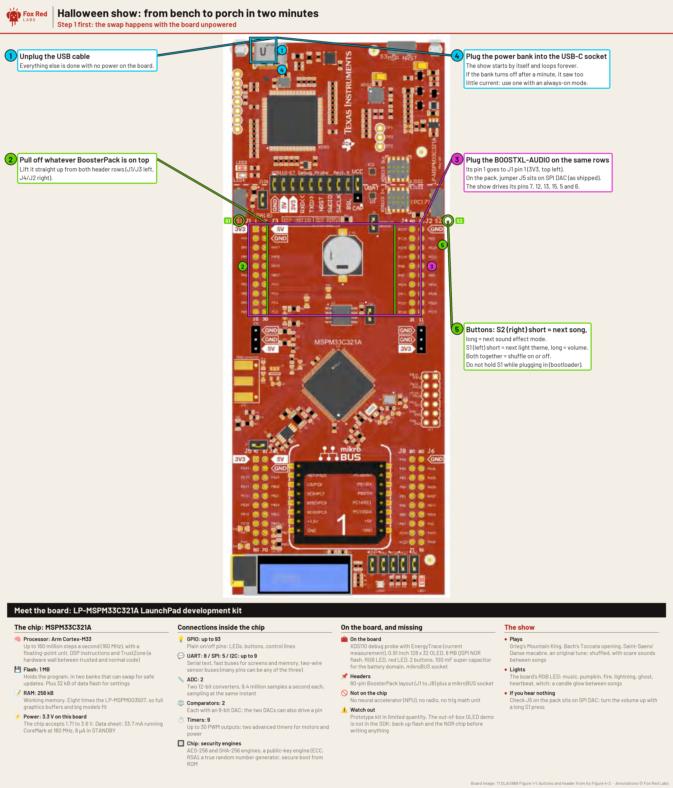

# Jack-o'-Lantern Jukebox: Halloween music and light from the LP-MSPM33C321A and BOOSTXL-AUDIO

A LaunchPad with the BOOSTXL-AUDIO plays five public-domain orchestra and organ recordings (Gounod's "Funeral March of a Marionette", Grieg's "In the Hall of the Mountain King", Mussorgsky's "Night on Bald Mountain", Saint-Saens' "Danse macabre" and Bach's Toccata in D minor) and four chiptune arrangements, shuffled and looped forever, with a scare sound between songs. The board's RGB LED follows the music. It starts from a USB power bank with no computer attached.

Status: LP-MSPM33C321A with the pack: **Works** (heard and filmed from a power bank). LP-AM13E230: **Works** (the chiptune show without recordings ran 720 s on a bare board; not heard with the pack). The listener is off on the LP-MSPM33C321A unless you add one jumper wire (see "Microphone").

Build and flash the board once from a Mac ("Build and flash once"), then it runs from a power bank alone.

Contents: [what you need](#what-you-need), [build and flash](#build-and-flash-once), [set it up](#set-it-up-two-minutes-no-computer), [controls](#control-card), [what it does](#what-it-does), [recordings](#the-recordings), [add your own music](#add-your-own-music), [what ran](#what-ran-on-the-boards-2026-10-25), [fixes](#if-you-hear-nothing-or-the-led-stays-dark).



Terms: [docs/vocab.md](../../../../docs/vocab.md). **DAC** is the pack's digital-to-analog converter (DAC8311). **ADPCM** stores sound in 4 bits a sample. **PWM** dims an LED by switching it fast. A **frame** is one 16-bit write to the DAC. 1 kB = 1,024 bytes. Fixes for everything below: [FAQ.md](FAQ.md); for an AI assistant: [AGENTS.md](AGENTS.md).

## What you need

| Part | Notes |
|---|---|
| LP-MSPM33C321A (main) or LP-AM13E230 (plan B) | The MSPM33C321A has 1 MB of flash for the recordings and an RGB LED; the AM13E230 plays the chiptunes only |
| BOOSTXL-AUDIO | Jumper J5 on SPI DAC, as shipped; volume slider on the pack to the top |
| USB power bank with a USB-C cable | See "Battery" |

## Build and flash once

You need a Mac with the MSPM33 SDK 1.04.00.00, TI Arm Clang 5.1.1.LTS and SysConfig 1.28.0 in the default `/Applications/ti` folders, and CCStudio 21.0.1 for its `DSLite` flasher (`mac-setup/README.md`). Copy `mspm33c321a/MSPM33C321A_M3010001.ccxml` and put your probe serial in place of `M3010001` (`xdsdfu -e` lists it). Plug in the LaunchPad with no BoosterPack, then:

```bash
OUT=build/halloween bash portability/boosterpacks/audio/boards/mspm33c321a/build.sh halloween
python3 tools/preflight_image.py mspm33c321a build/halloween/gpio_toggle_output/ticlang/gpio_toggle_output.out
/Applications/ti/ccs2101/ccs/ccs_base/DebugServer/bin/DSLite flash -c MSPM33C321A_<serial>.ccxml -e -f -v build/halloween/gpio_toggle_output/ticlang/gpio_toggle_output.out
```

The build ends with `built build/halloween/gpio_toggle_output/ticlang/gpio_toggle_output.out`, the check prints `SAFE` (the show never sleeps), and a serial terminal at 115200 shows `HALLOWEEN SHOW ... recorded tracks 5`. Back up the board's own program first if you want it back ("Restore the previous image").

The LP-AM13E230 build is `portability/boosterpacks/audio/boards/am13e230/build.sh halloween` (AM13E2x SDK 26.01.00.03, 8 kHz, no recordings).

| Board | Flash | RAM | Sample rate | Sample interrupt, worst |
|---|---|---|---|---|
| LP-MSPM33C321A | 913 kB of 1,024 kB | 19.3 kB | 16 kHz | 5.75k cycles of 10k |
| LP-AM13E230 | 70.7 kB | 24.4 kB | 8 kHz | 4.73k cycles of 25k |

Sizes are from the linker maps of a rebuild on 2026-10-25; the interrupt times are the worst `isr_max` the consoles printed.

## Set it up (two minutes, no computer)

1. Unplug the USB cable. The swap happens with the board unpowered.
2. Pull off whatever BoosterPack is on the LaunchPad.
3. Plug the BOOSTXL-AUDIO onto the same rows, its pin 1 on J1 pin 1 (3V3). Check jumper J5 sits on SPI DAC and push the pack's volume slider to the top.
4. Plug the power bank into the LaunchPad kit's USB-C socket. The Mountain King recording opens the show.

## Control card

| Press | LP-MSPM33C321A | LP-AM13E230 |
|---|---|---|
| Next song | S2 short | S2 (wake) short |
| Next light theme | S1 short | S5 short (needs jumper J11 fitted) |
| Next sound mode (clean, haunted, graveyard, mad lab) | S2 held 0.7 s | S2 held 0.7 s |
| Volume step (4, 6 ... 16, then 4) | S1 held 0.7 s | S5 held 0.7 s |
| Shuffle on or off | S1 and S2 together, let go after 0.3 to 2 s | S2 and S5 together |
| Speaker EQ on or off (to compare) | S1 and S2 held 2 to 5 s | (not fitted at 8 kHz) |
| Listening on or off | S1 and S2 held 5 s (needs the pin 8 to pin 5 wire) | S2 and S5 held 5 s |

Every action beeps, blinks the LED and prints on the serial console at 115200. Settings start fresh at every power-up; nothing is written to flash. Do not hold S1 (MSPM33C321A) or S5 (AM13E230) while plugging in: that line starts the chip's bootloader.

## What it does

- **Recorded tracks.** 30 to 40 s of each recording, filtered for the small speaker, at 10 kHz in IMA ADPCM, 849.6 kB together; played back at 16 kHz with a soft limiter. The lights follow the record by detecting sudden rises in loudness.
- **Chiptunes.** Four arrangements for the four-voice synth (two pulse voices, a triangle bass, noise drums) in [`../songs/`](https://github.com/Fox-Red-Labs/fox-red-labs/tree/main/portability/boosterpacks/audio/songs), written from public-domain scores; each file names its composer, work and score. Danse macabre, Toccata, Mountain King (speeding up from 120 to 200 beats a minute) and an original, Pumpkin Patrol. Each pass may move down 0 to 2 semitones, change tempo within 5 percent and swap the lead and harmony voices.
- **Between songs.** 6 s with a random scare sound: thunder, creaking door, heartbeat, witch cackle, ghost wail or wind.
- **Sound modes.** Clean; haunted (echo, vibrato and tremolo on the lead); graveyard (a wind bed under the music); mad lab (5-bit crush and a zap sweep every 4 s).
- **Light themes.** Pumpkin (the default: orange and purple swap on the beat), fire (orange flicker by loudness), lightning (dark, white strobes on drums and thunder), ghost (pale green fades with the melody), heartbeat (red double pulse on the kick), witch (green to purple), music (drum hits flash, the bass sets the color). Between songs: a warm candle glow. The RGB LED is dimmed by 32-level software PWM at 250 Hz and reaches full brightness.
- **Listener** (LP-AM13E230; on the LP-MSPM33C321A only with the wire in "Microphone"): between songs a clap, knock, whistle or shout at the pack's microphone sets off thunder, a creaking door, a ghost wail or a scream with a colored flash. Rules on energy, zero crossings and pitch, not a trained model: 30 of 30 synthetic test clips right on the Mac (`host/test_listen.c`); checked on synthetic clips only.

## The recordings

| Track | Performers | Cut | Source and license |
|---|---|---|---|
| Funeral March of a Marionette (Gounod) | San Francisco Symphony, Alfred Hertz, HMV D1286 | 8 to 42 s | [Wikimedia Commons](https://commons.wikimedia.org/wiki/File:PDP-CH_-_San_Francisco_Symphony_-_Alfred_Hertz_-_Funeral_March_of_a_Marionette_-_Charles_Gounod_-_Hmv-d1286-5-0602.flac), public domain (recording date not on the page) |
| In the Hall of the Mountain King (Grieg) | Musopen Symphony, 2012 | 114 to 154 s | [Wikimedia Commons](https://commons.wikimedia.org/wiki/File:Grieg_-_Peer_Gynt_Suite_No._1,_Op._46_-_IV._In_the_Hall_of_the_Mountain_King_(Musopen_Symphony).flac), public domain (Musopen) |
| Night on Bald Mountain (Mussorgsky) | Musopen recording | 3 to 33 s | [Wikimedia Commons](https://commons.wikimedia.org/wiki/File:Modest_Mussorgsky_-_night_on_bald_mountain.ogg), public domain (Musopen) |
| Danse macabre (Saint-Saens) | Philadelphia Orchestra, Leopold Stokowski, Victor 6505, 1925 | 2 to 42 s | [Wikimedia Commons](https://commons.wikimedia.org/wiki/File:PhiladelphiaSymphonyOrchestra-DanseMacabre.ogg), public domain |
| Toccata in D minor, BWV 565 (Bach) | Ashtar Moira, Tamburini organ, about 2006 | 0 to 30 s | [Wikimedia Commons](https://commons.wikimedia.org/wiki/File:Toccata_et_Fugue_BWV565.ogg), public domain (released by the performer) |

Each track's file in [`../tracks/`](https://github.com/Fox-Red-Labs/fox-red-labs/tree/main/portability/boosterpacks/audio/tracks) keeps its source page, license, cut, filter and the SHA-256 of the downloaded file.

## Add your own music

```bash
python3 portability/boosterpacks/audio/tools/add_track.py "<any audio file>" --start 30 --length 35 --title "My spooky song" --no-build
```

Install `ffmpeg` first (`brew install ffmpeg`). The tool cuts, filters and encodes the file into a track in a `halloween-tracks` folder under your home directory (the path is set at the top of `tools/add_track.py`); the build reads that folder beside `tracks/`. Then run the three lines in "Build and flash once" again, and the track joins the shuffle.

The five shipped recordings use 174 s (849.6 kB at 5 kB a second) and leave room for about 22 s more. To add a longer song, delete one of the shipped tracks (its `.ima` and `.json` in `tracks/`) first.

## Take it with you

Copy these into your own project, keeping their paths:

| Copy | What it is |
|---|---|
| `portability/boosterpacks/audio/` (the whole folder) | The DAC driver, synth, show, songs, tracks, board files and tools |
| `tools/frl/toolpaths.sh` | Finds the SDK and compiler for the build scripts |
| `tools/preflight_image.py` | Checks an image never puts the chip to sleep |
| `mspm33c321a/MSPM33C321A_M3010001.ccxml` | The DSLite target file; put your probe serial in it |
| This folder's [`AGENTS.md`](AGENTS.md) and [`FAQ.md`](FAQ.md) | What an assistant needs, and the fixes |

Build, check and flash with the three lines in "Build and flash once"; add tracks as in "Add your own music". Another LaunchPad supplies the functions in `app/board_audio.h` and `app/board_show.h` and its own pins; start from `boards/mspm33c321a/`.

## Hear and see it on a Mac first

```bash
portability/boosterpacks/audio/host/run_halloween.sh [output folder]
```

The output folder defaults to `host/out/`; the video needs `ffmpeg`. It builds the same player, synth, effects and light engine for the Mac with the recordings in `tracks/`, and writes `halloween-preview.wav` (the exact DAC codes at 16 kHz) and `halloween-preview.mp4` (165 s: three recordings, two chiptunes, all four sound modes, seven light themes, with the sound). It also runs the listener's clip test.

## What ran on the boards (2026-10-25)

| Check | LP-MSPM33C321A | LP-AM13E230 |
|---|---|---|
| Pack attached | Yes | No |
| Banner and the show after a reset, no serial input | Seen | Seen |
| DAC frames a second (firmware count against the cycle counter) | 15,999 to 16,000, 0 late ticks | 7,999 to 8,000 |
| Frames with a short SYNC (model of the DAC input fed by the same edges) | 0 | 0 in 5.76 million |
| Button logic, presses injected from the console | 6 of 6 | 6 of 6 |
| RGB LED | PWM duty read back per theme | (red and green LEDs) |
| Longest run with no fault | 480 s | 720 s, 11 songs, all four sound modes |

Rows are in `data/results/am13e230.csv` and `data/results/mspm33c321a.csv`.

## Microphone

On the LP-MSPM33C321A, BoosterPack pin 5 is not wired to the chip: the isolation resistor R21 between the header and PA21 is not fitted, and PA21 is the VREF- pin, tied to ground through R10 at the REF6033 (SLAU969 schematic). So the pack's microphone gets no power, and it read the same 1 to 1.5 codes of noise in silence and during a full-volume tone sweep. No jumper changes that. The show powers the microphone from pin 8 (PB30) instead: if you want the listener on this board, put one female-to-female jumper wire on the pack's top header from pin 8 to pin 5. On the LP-AM13E230 the pack's microphone works as is (pin 5 PA3, pin 6 PA31, measured 2026-10-20).

## Speaker EQ

The board's stepped tone sweep, heard by the MacBook's built-in microphone (taken as flat; its own response was not corrected), showed the speaker's response: a peak at 1 kHz, a dip at 1.4 to 2 kHz and a fall of 12 dB per octave below about 700 Hz. `tools/fit_eq.py` fits a 300 Hz high-pass, five peaking filters and a bass enhancer that turns the band below 300 Hz into its harmonics, which the ear hears as the missing bass. The measured spread from 500 Hz to 4 kHz is 15.5 dB; the fit predicts 6.4 dB with the EQ. It is on by default; hold S1 and S2 for 2 to 5 s to compare.

## Speaker and amplifier

The pack's TPA301 is a plain bridge-tied amplifier (250 mW into 8 ohms at 3.3 V, TPA301 data sheet) with a fixed gain and a shutdown pin; it has no speaker protection, no limiter and no smart-amplifier feedback. Loudness is set by the volume slider on the pack and by the show's volume step. Loudness stops rising above about step 10 of 16: a 1 kHz tone through the Mac's microphone rose 8.6 dB from step 4 to 10 and 0.7 dB from 10 to 16; whether the amplifier, the speaker or the microphone limits it was not separated. The show's soft limiter keeps the DAC codes inside the range: at step 16 it bent 7.1 percent of samples in the board's self-test (the `limited=` count in the board's self-test).

## If you hear nothing, or the LED stays dark

- If you hear nothing, check J5 on the pack sits on SPI DAC and the pack's volume slider is up, then hold S1 for a second to step the volume.
- If it only clicks, the pack is not seated on J1 to J4: press it down evenly.
- If the LED stays dark in the lightning theme, that is the theme: it waits for drums and thunder. Press S1 for the next theme.
- If nothing happens at all, the power bank may have switched off at low load. Use a bank with an always-on or low-current mode.

## Battery

Some power banks switch off after 30 s to a few minutes at low load (often quoted as under about 50 to 100 mA). The show never enters a low-power mode, so the load stays steady; the current itself has not been measured. If the bank shuts off, use one with an always-on mode.

## Other boards

The audio layer also builds for the LP-MSPM0G3519 (`boards/mspm0g3519/`); the show has not been built there. The AM13E230 image carries a boot check: before it drives pins 7, 13 and 15 it reads J3 pins 23 to 26 with pull-ups, and a DRV8376EVM's sense dividers (SLVUD20) pull them low, so the show stays silent if the motor board is stacked instead of the pack. The AM13E230 image also streams an 8-LED WS2812 ring on J1 pin 2 (PA26) by SPI and DMA; no ring has been wired.

## Restore the previous image

Both boards' previous flash was read twice before the first write and saved (identical reads):

```bash
DSLite flash -c mspm33c321a/MSPM33C321A_<serial>.ccxml -e -f -v -r 1 -u <backup>/main-a.bin,0x10000000
DSLite flash -c am13e230/AM13E23019_<serial>.ccxml -e -f -v -r 1 -u <backup>/main-a.bin,0x0
```

More fixes, each with its cause: [FAQ.md](FAQ.md).
