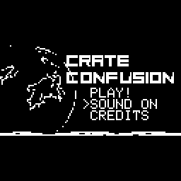
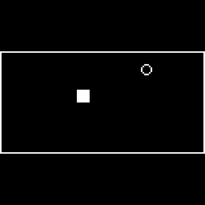
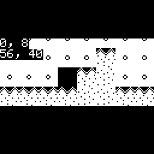

# Does an Arduboy2-compatible layer run open-source Arduboy games on MSPM0 and MSPM33 LaunchPad kits?

Yes on the Mac, and it links for the LP-MSPM0G3507, LP-MSPM0G3519, LP-MSPM0G5187 and LP-MSPM33C321A. Three open-source games (Snake, TileWorld, Crate Confusion) build unchanged against a reimplemented Arduboy2 API, boot on a headless host backend, and answer scripted joystick and button input. Each costs 5.5 to 9.6 kB of flash and 3.3 to 3.8 kB of RAM. No board has run them: the screen, stick and buzzer drivers (EDUMKII, Sharp) plug into the abstract interface next.

Terms: [vocab](../../docs/vocab.md). 1 kB = 1,024 bytes. **Arduboy** is a small game handheld with a 128 x 64 one-bit screen, six buttons and a buzzer; its **Arduboy2** library is what its games call. **EDUMKII** is the Education BoosterPack MKII (color screen, joystick, two buttons, buzzer). **Sharp** is the BOOSTXL-SHARP128 one-bit screen. Checked 2026-10-20 on macOS (Intel) with Apple clang for the host, TI Arm Clang 5.1.1.LTS for the boards.

  

## Reimplemented, not wrapped

The Arduboy2 library is BSD 3-clause (`LICENSE-Arduboy2.txt`), so copying or wrapping it would be allowed. It cannot be wrapped: it drives AVR registers for the screen (SPI), the buttons (ports), sound (timers) and storage (EEPROM), and none of that exists on an Arm chip. So this layer reimplements the subset real games use in about 700 lines of C++ and C headers, with the same class and function names, and copies one piece: the 5 x 8 font table (`src/font5x7.inc`, notice in the file and in `LICENSE-Arduboy2.txt`). Everything else is written fresh from the public API.

Implemented: `begin`, `setFrameRate`, `nextFrame`, `everyXFrames`, `clear`, `display`, `drawPixel`, `drawLine`, `drawRect`, `fillRect`, `drawCircle`, `fillCircle`, `drawFastHLine`, `drawFastVLine`, `drawBitmap`, `drawSlowXYBitmap`, `getBuffer`, text (`print`, `println`, `setCursor`, `setTextSize`, `setTextColor`, `setTextWrap`), buttons (`pollButtons`, `pressed`, `justPressed`, `justReleased`, `anyPressed`, `notPressed`), `Sprites` (all five draw modes), `BeepPin1` and `BeepPin2`, `Arduboy2Audio`, `EEPROM` (in RAM), `Rect`, `Point`, `collide`, `PROGMEM`, `F()`, `random`. Not implemented: rounded rectangles, triangles, the FX flash chip, ArduboyTones. `begin()` skips the boot logo.

## The abstract interface

`include/frl/abstract.h` is the only thing a board driver sees: a display that takes lines (`write_lines`), an input that returns a two-axis stick and two buttons, a `tone(hz, ms)` call, a clock and a delay. The layer turns the 128 x 64 buffer into a 128 x 128 picture a few lines at a time, so no driver needs a 32 kB frame buffer (a 128 x 128 RGB565 frame is the whole RAM of an MSPM0G3507). Two placements: centered (64 rows in the middle, black bars) or doubled vertically. Output is RGB565 (EDUMKII) or 1 bit per pixel, leftmost pixel in bit 0 (Sharp). The stick becomes UP, DOWN, LEFT and RIGHT with a dead band and hysteresis, and its center is learned from the first samples because the EDUMKII stick rests off center. The two buttons are A and B.

## Run it on the Mac

```bash
bash prove_host.sh          # builds all three games, runs scripted input, writes PNG frames to out/frames
```

Each game has a scripted-input file in `scripts/`: a line is a frame number and the keys held from then on. Each run presents frames on a virtual clock and checks that the screen differs after input:

| Game | Check | Result |
|---|---|---|
| Snake | menu, start with A, steer DOWN then LEFT, one beep after B pressed twice | 3 frame checks and the tone event passed (`prove_host.sh`) |
| Crate Confusion | menu cursor moves with DOWN and UP, A starts, UP+RIGHT thrusts, 4 tones | 4 frame checks and the tone check passed |
| TileWorld | RIGHT scrolls the map, A jumps | 2 frame checks and a lit-screen check passed |
| Snake on a 1-bit panel with the doubled placement | same script | frame lit |

A passing frame check means pixels changed in the expected direction, and the PNGs in `proof/` were looked at by eye.

## Build for a board

```bash
bash build_target.sh snake mspm0g3519        # game: snake | tileworld | crate-confusion; board: mspm0g3507 | mspm0g3519 | mspm0g5187 | mspm33c321a
bash fit_all.sh                              # every game on every board; rewrites RESULTS-ROWS.csv
```

The board build uses the chip's own startup file and linker script from the SDK and a null display, so the sizes are the real memory map with the layer and game only. Sizes per game and board:

| Game | Flash | RAM |
|---|---|---|
| TileWorld | 5.5 to 5.8 kB | 3.3 kB |
| Snake | 7.7 to 8.2 kB | 3.8 kB |
| Crate Confusion | 9.4 to 9.6 kB | 3.4 kB |

The larger flash figure is the LP-MSPM33C321A; the three MSPM0 boards match. RAM is `.data` plus `.bss`; the stack comes on top. Per-cell rows are in `RESULTS-ROWS.csv`.

## If you see this

- `typedef redefinition with different types ('struct ... ' vs '__darwin_mode_t')`: Crate Confusion names its own type `mode_t`. Build it through `build_host.sh` or `build_target.sh`, which pass `-DFRL_RENAME_MODE_T`.
- `use of undeclared identifier 'resetGame'` in a `.ino` sketch: the Arduino IDE adds function prototypes that plain C++ does not. `tools/ino_protos.py` adds them; both build scripts call it.
- `fatal error: invalid option: --gc_sections` from the TI linker: the TI linker removes unused code by default; leave the flag out.

## Limits

High scores are not saved: the EEPROM is RAM.

## Where these facts come from

Games: `third-party/arduboy-games/` (licenses and commits in each `SOURCE.md`). Layer: `include/`, `src/`. Host backend: `host/ab_host.cpp`. Sizes: `RESULTS-ROWS.csv`. Assistant file: [AGENTS.md](AGENTS.md).

## Porting lessons

- The Arduboy2 library cannot be wrapped on Arm because it drives AVR registers. A reimplementation of the subset real games call is about 700 lines of C++ and headers.
- A 128 x 128 RGB565 frame is 32 kB, all the RAM of an MSPM0G3507. Keep the 1 kB page buffer and stream it to the screen four lines at a time.
- The EDUMKII stick rests off center, so a fixed 2048 center makes a direction stick on. Learn the center from the first samples and use a dead band with hysteresis.
- `BeepPin1::freq` returns a timer count, not hertz, and tone durations are counted in frames. The layer converts both.
- Arduino sketches call functions before their definition, which plain C++ rejects; `tools/ino_protos.py` adds the prototypes the IDE would. A game type named `mode_t` clashes with the system's and needs the rename after the system headers.
- Saved scores live in RAM today (the EEPROM is a 1 kB image); nothing survives power-off.
