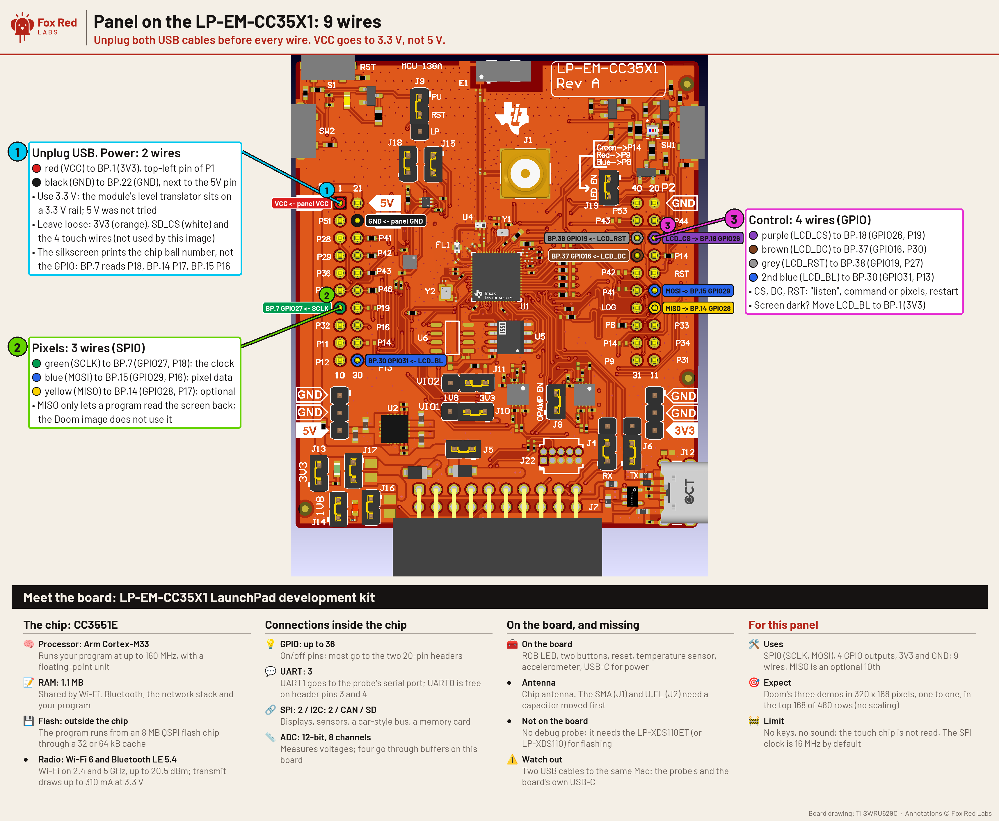

# Wiring the Waveshare 3.5 inch panel to the LP-EM-CC35X1 Doom image

Nine wires: two for power, three for the SPI bus, four for control. Everything goes to the BoosterPack header on the top of the board; the LP-XDS110ET probe uses the 20-pin connector on the bottom edge (J7) and the backchannel serial port on GPIO5 and GPIO6, which are not on the header. The pins below were checked on paper against the SDK board file and TI's LaunchPad drawing; no wire has been placed.

Terms: [vocab](../../../docs/vocab.md). **BP.n** is pin n of the 40-pin BoosterPack header (pin 1 is 3V3, top left of the drawing; pins 1 to 10 and 21 to 30 are the left two columns, 11 to 20 and 31 to 40 the right two). The silkscreen prints the chip's ball number next to each pin, not the GPIO: BP.7 reads P18. Checked 2026-10-21 against SimpleLink Wi-Fi SDK 10.20.00.39 (`source/ti/boards/.meta/LP_EM_CC35X1.syscfg.json`) and the LaunchPad user guide SWRU629C (Figure 2-1).



## Wire list

| Wire | Panel pin | LP-EM-CC35X1 header pin | GPIO and ball | Role |
|---|---|---|---|---|
| red | VCC | BP.1 (3V3) | n/a | 3.3 V supply, about 63 mA (Waveshare) |
| black | GND | BP.22 (GND) | n/a | ground |
| green | SCLK | BP.7 | GPIO27, ball 18, silkscreen P18 | SPI0 clock |
| blue | MOSI (SDI) | BP.15 | GPIO29, ball 16, P16 | SPI0 pixel data |
| yellow | MISO (SDO) | BP.14 | GPIO28, ball 17, P17 | SPI0 read-back, optional, unused by the image |
| purple | LCD_CS | BP.18 | GPIO26, ball 19, P19 | chip select, driven as a plain GPIO |
| brown | LCD_DC | BP.37 | GPIO16, ball 30, P30 | command or pixel data |
| gray | LCD_RST | BP.38 | GPIO19, ball 27, P27 | panel reset |
| 2nd blue | LCD_BL | BP.30 | GPIO31, ball 13, P13 | backlight, driven high by the image |

Leave loose: the panel's 3V3 pin, SD_CS (the module pulls it up), and the four touch pins TP_SDA, TP_SCL, TP_INT and TP_RST. The touch chip (FT6336U) is on I2C, so there is no touch chip select; this image does not read it. If the touch pins are wanted later, the free I2C0 pair is TP_SDA to BP.10 (GPIO32, P12) and TP_SCL to BP.9 (GPIO33, P11), with TP_RST to BP.8 (GPIO14, P32) and TP_INT to BP.11 (GPIO15, P31).

If the screen stays dark with every wire right, move the LCD_BL wire from BP.30 to BP.1 (3V3): the backlight is then always on.

## Why these pins

SPI0 on BP.7, BP.14 and BP.15 is the bus the SDK's `LP_SPI0_BUS` names (the same pins its `spicontroller` example uses), so SysConfig solves it without a manual pin choice. The panel is a 3.3 V part: wire VCC to 3V3, never to the 5V pin.

No collision with what is already on the board, checked against the generated pin list of the PANEL build and the SDK files of the DNS ad blocker (the `mqtt_client` demo it is built in):

| In use | Pins | Header? |
|---|---|---|
| Probe backchannel serial port (both images) | GPIO5, GPIO6 | no, inside the board |
| Red, green, blue LED | GPIO34 (BP.31), GPIO30 (BP.17), GPIO35 (BP.36) | yes, none used here |
| Buttons | GPIO2 (BP.19), GPIO36 (BP.40) | yes, none used here |
| Ad blocker: I2C1 to the sensors | GPIO10, GPIO11 (BP.5, BP.6) | yes, none used here |
| Ad blocker: second serial port | GPIO17, GPIO18 (BP.4, BP.3) | yes, none used here |
| Probe cable | J7 20-pin connector, bottom edge | not on the BoosterPack header |

The pins this panel uses are BP.7, 14, 15, 18, 30, 37 and 38 plus 3V3 and GND. The ad blocker image does not use any of them, so the same wiring could stay in place while it runs; the panel is simply not driven by it.

## Build and check

```bash
PANEL=1 ports/doom/target-cc35x1-whx/build.sh 31
```

`PANEL=1` adds the driver (`panel_cc35x1.c`) and the SPI and GPIO set-up; without it the image is byte for byte what it was. The zone is 31 kB with the panel: the 128 kB fast RAM is full to the last 5 bytes, and the demos peak at 29.6 kB of zone. `PANEL_HZ=<hz>` sets the SPI clock (default 16 MHz; the panel is rated about 15 MHz and the same module ran 40 MHz on the LP-MSPM0G3519).

Expected on the first run: the console prints `PANEL up, 16000000 Hz SPI, 320x480`, the screen goes black, then Doom's title and the three demos draw at the top of the screen, one source pixel per panel pixel. A blue and red swap (the marine's armor reads blue instead of green) would mean the panel's color-order bit needs changing (command 0x36, value 0x48 now).
