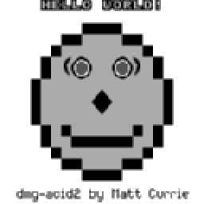
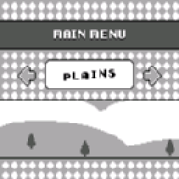
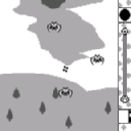
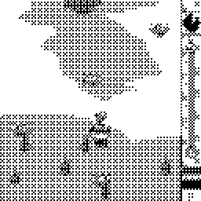

# Peanut-GB Game Boy emulator on MSPM0 and MSPM33 LaunchPad kits

On the Mac it runs a freely licensed Game Boy game with scripted buttons at about 4,200 frames per second with the emulator alone (70 times the Game Boy's 59.7), and about 1,700 with the 160 x 144 to 128 x 128 scaling and a display write. For the boards it links for the LP-MSPM0G3519 and the LP-MSPM33C321A with a 256 kB ROM inside flash; the LP-MSPM0G3507 and LP-MSPM0G5187 can link the emulator but have 0.7 to 1 kB of RAM left, and the 256 kB ROM does not fit their 128 kB flash. The first board image (LP-MSPM33C321A with the EDUMKII screen, 32 MHz default clock) ran at about 6.7 frames per second, 8 to 13 percent of the console's speed; [Speed on the M33](#speed-on-the-m33) lists what raised it. With those steps (160 MHz, table scaler, DMA rows, one frame in two drawn) the board plays at the console's own speed: 0 late frames in 8,167 ([measured on the board](#measured-on-the-board-lp-mspm33c321a--edumkii-2026-10-21)).

Terms: [vocab](../../docs/vocab.md). 1 kB = 1,024 bytes. **Peanut-GB** is a single-header Game Boy (DMG) emulator, MIT licensed. **ROM** is a game's image file. **EDUMKII** is the Education BoosterPack MKII; **Sharp** is the BOOSTXL-SHARP128 one-bit screen. Checked 2026-10-20 on macOS (Intel, Core i7-8750H) with Apple clang for the host and TI Arm Clang 5.1.1.LTS for the boards. Contents: [What is here](#what-is-here), [Expectation, then result](#expectation-then-result), [Run it](#run-it), [Speed on the M33](#speed-on-the-m33), [If you see this](#if-you-see-this), [Measured on the board](#measured-on-the-board-lp-mspm33c321a--edumkii-2026-10-21).

   

## What is here

- `third-party/peanut-gb/`: `peanut_gb.h` 1.3.0 at commit `d0bcca7`, byte for byte as published (hashes in `SHA256SUMS`).
- `src/pgb_frontend.c`: the front end over `ports/arduboy/include/frl/abstract.h`, the same display, input and clock interface the Arduboy2 layer uses. It keeps the picture as 2-bit shades packed four to a byte (5.6 kB instead of 23 kB), scales it to 128 x 128 by averaging the source pixels each output pixel covers (a 4 x 4 dither for one-bit panels), and maps the stick to the D-pad, the first button to A and the second to B. Pressing both buttons together is Start; both with the stick held down is Select.
- `host/pgb_host.cpp`: the headless Mac runner (scripted input, PNG frames, benchmark).
- `target/main_pgb.cpp`: the null-display entry point used for board sizes.

## Patch for two ROM-controlled out-of-bounds bugs

`peanut_gb.h` as published indexes arrays with values a ROM controls: the MBC3 clock register (`cart_ram_bank - 0x08`, bank values above 0x0C run past a 5-byte array) and the ROM-size and RAM-size header bytes (tables of 9 and 6 entries, no range check). `third-party/peanut-gb/` stays unmodified. Every build script copies it to `out/peanut-gb-patched/` and applies `patches/0001-bounds-checks.patch` (`patches/apply.sh`). The front end also checks both header bytes first (`pgb_check_rom`) and refuses the ROM with a one-line message, for example `ROM refused: ROM size code in the header (0x148) is not 0 to 8`.

```bash
bash tests/run_tests.sh      # crafted ROMs under -fsanitize=address,undefined
```

The test passes on the patched copy (six bad headers refused two ways, a 64-byte file refused, ROMs selecting RAM bank 0x0D, 0x0E, 0x0F and 0xFF run five frames) and fails on the unpatched copy with `index 9 out of bounds for type 'const uint16_t[9]'` and `index 5 out of bounds for type 'const uint8_t[5]'`.

## Roms

Two freely licensed ROMs, fetched and hash-checked, never committed (`roms/` is git-ignored):

| ROM | License | Used for |
|---|---|---|
| Tobu Tobu Girl by Tangram Games (256 kB) | code MIT, graphics, text, sound and music CC BY 4.0, per its repository; the Homebrew Hub entry also lists MIT | boot, input, speed |
| dmg-acid2 by Matt Currie (32 kB) | MIT | a rendering check |

No commercial ROM is used or stored. `bash fetch_roms.sh` downloads both and stops on a hash mismatch.

## Expectation, then result

The expectation was written before the first run.

| Expected | Measured |
|---|---|
| Emulator alone 30 to 70 times real time | 4,180 frames per second, 70 times (CPU time, median of three runs of three; 3,934 to 4,241 across three sets at Mac load 93 to 110; a later set at lower load read 5,753 emulator alone and 2,619 with scaling) |
| Scaling costs under 40 percent of the frame time | 57 to 60 percent: the averaging touches every output pixel (16,384) and the source it covers, more than the guess allowed |
| Tobu Tobu Girl shows its title within 3 seconds of game time | No: its logos and intro run first, the title appears near frame 1,700 (28 seconds of game time) |
| The game reacts to Start | Yes: A and B together reach the main menu, A starts a game, the stick moves the character (4 frame-difference checks passed) |
| RAM about 32 kB | 30.8 kB (`.data` plus `.bss`) |
| Code 25 to 40 kB | 12.5 kB with `-Os`, well under the guess |

Conditions for the speed numbers: the Mac load average was 93 to 110 (other work running), so the run uses process CPU time, not wall time, and repeated three times (`bash prove_host.sh` prints the last set). The frame rate on a board is the first number to take once a screen driver exists; the guess on file for an 80 MHz Cortex-M0+ is a few frames per second.

## Run it

```bash
bash fetch_roms.sh          # downloads the two ROMs into roms/
bash prove_host.sh          # builds, runs dmg-acid2 and Tobu Tobu Girl with scripted input, writes PNGs to out/frames, runs the benchmark
```

Board sizes, one board at a time:

```bash
bash build_target.sh mspm0g3519 rom      # board: mspm0g3507 | mspm0g3519 | mspm0g5187 | mspm33c321a; rom, acid or nothing
```

The fit table is in `ports/arduboy/FIT.md`; `bash ../arduboy/fit_all.sh` rebuilds all of it.

| Build | LP-MSPM0G3507 | LP-MSPM0G3519 | LP-MSPM0G5187 | LP-MSPM33C321A |
|---|---|---|---|---|
| Front end alone | 12.5 kB flash, 30.8 kB RAM, 0.7 kB left | same code, 128 kB RAM | 12.5 kB flash, 30.8 kB RAM, 1.0 kB left | 13.0 kB flash, 30.8 kB RAM |
| With Tobu Tobu Girl (256 kB) | does not fit, 140.4 kB short | 268.5 kB flash, fits | does not fit, 140.4 kB short | 269.0 kB flash, fits |

## Speed on the M33

The first board image ran Tobu Tobu Girl at 126 to 215 ms a frame (4.7 to 7.9 frames a second) on the LP-MSPM33C321A with the EDUMKII screen. That image ran the CPU at the 32 MHz SysConfig default (`CPUCLK_FREQ 32000000` in its generated header), not at 160 MHz. Everything below is a host or emulator measurement plus arithmetic; the faster images are built and not flashed, so the board column is an expectation.

**Where the time went.** A Cortex-M33 model (Unicorn, `speed/emu_pgb.py`) runs the same ARM code as the board with the null display and counts instructions per frame, split by function (frames 3,051 to 3,150 of the scripted Tobu run, in play):

| Part | Instructions per frame | Share |
|---|---|---|
| Averaging scaler (`frl_present_shades2`) | 1,977,000 | 69 percent |
| Peanut-GB's line renderer (`__gb_draw_line`) | 513,000 | 18 percent |
| Game Boy CPU and bus | 230,000 | 8 percent |
| Other, of which 110,000 is the C library clearing the 160-byte line buffer one byte at a time | 134,000 | 5 percent |
| Total | 2,854,000 | |

**Steps, each added to the one before.** Instructions are counted, not cycles; two windows are shown because the intro logos (frames 31 to 130) cost less than play.

| Step | What changed | Instructions per frame, play | Intro | Mac frames per second | Expected, 32 MHz | Expected, 160 MHz |
|---|---|---|---|---|---|---|
| base | the first board image: `-Os`, averaging scaler, sprite sorting on | 2,854,000 | 2,734,000 | 3,701 | 5.7 fps (9.5 percent) | not run |
| acc0 | `PEANUT_GB_HIGH_LCD_ACCURACY` off (`PGB_HIGH_LCD_ACCURACY=0`, now the default) | 2,853,000 | 2,735,000 | 3,453 (noise) | 5.7 | not run |
| lut | table scaler inside `draw_line`: 5 source pixels make 4 with weights in eighths, rows blended in eighths, one table lookup per output pixel, rows streamed by DMA while the next line renders | 1,193,000 | 1,087,000 | 7,369 | 13.4 fps | 42 fps (SPI-bound) |
| o2 | front end and Peanut-GB at `-O2` | 1,036,000 | 921,000 | n/a | 15.4 | 42 |
| zero | patch `0002-pixel-clear.patch`: zero the line buffer a word at a time | 934,000 | 816,000 | 7,492 | 17.1 fps (29 percent) | 42 fps (70 percent) |
| skip | `PGB_FRAME_SKIP`: the game runs every frame, a picture is built and sent every other one | 593,000 | 488,000 | 9,551 | 27 fps (45 percent) | 84 fps, 141 percent; the paced image holds 59.7 (100 percent) |

Total: 4.8 times fewer instructions in play, 5.6 times in the intro, 2.6 times faster on the Mac. The 160 MHz column also needs the clock change below; a step at 160 MHz is limited by the screen, 32 KB at 13.33 MHz.

**Tried and not worth it.** `-O3` counts 2.4 percent more instructions than `-O2` and adds 38.7 kB of flash (318.9 against 280.2 kB). Turning sprite sorting off changes no instruction count here; Tobu Tobu Girl's frames 1990, 2250, 2550, 2900, 3150 and 3500 are pixel for pixel the same either way, and dmg-acid2 shows a stray pixel beside the nose with sorting off (`PGB_HIGH_LCD_ACCURACY=1` brings the clean picture back). Moving the emulator core to SRAM (`PGB_RAMFUNC`, built and run in the model to prove the boot code copies it) leaves the instruction count unchanged and frees 14.5 kB of flash; whether SRAM fetches are faster than cached flash on this chip was not measured, so it is a separate image to compare.

**Clock.** `EDU_CLK160=1` in `portability/boosterpacks/edumkii/build.sh` sets the SysConfig clock tree to 160 MHz (32 MHz oscillator times the PLL, no divider after it: `EXTDIVMCLK` divide value 1). The generated init then sets 2 flash wait states and the caches, and the EDUMKII SPI input clock is 80 MHz, so the generated divider gives 13.33 MHz (the panel's rating is 15 MHz; the 32 MHz image ran it at 16 MHz).

**How the expected numbers are made** (`speed/model.py`, arithmetic and not a measurement): 1.64 cycles per instruction at 32 MHz, from the first board run (146.6 to 194.5 ms a frame minus 29.6 ms of screen) against 2.75 million counted instructions a frame, with a spread of 1.36 to 1.92; times 1.29 at 160 MHz, from CoreMark per MHz falling from 4.38 to 3.40 with 2 wait states; screen at 19.5 ms for a 32 KB frame at 16 MHz and 23.4 ms at 13.33 MHz, plus 0.4 ms for 128 row starts; the CPU 22 percent slower while the DMA holds the bus.

**Images** (`APP=gameboy`, each build also prints its flash and RAM):

| Image | Build | Flash | RAM |
|---|---|---|---|
| `mspm33c321a-gameboy-160-skip`, paced at 59.7 frames a second (the one to try) | `EDU_CLK160=1 GB_FLAGS=-DPGB_FRAME_SKIP EDU_TAG=skip ./build.sh mspm33c321a` | 291.4 kB | 33.6 kB |
| `-160-full`, every frame drawn, paced | `EDU_CLK160=1 EDU_TAG=full` | 291.4 kB | 33.6 kB |
| `-160-skip-ram`, emulator core in SRAM | `GB_FLAGS=-DPGB_FRAME_SKIP@-DPGB_RAMFUNC EDU_CLK160=1 EDU_TAG=skip-ram` | 292.4 kB | 49.1 kB |
| `-160-skip-unpaced`, `-160-full-unpaced`, `-full-32-unpaced` | add `GB_UNPACED=1` | 291.2 / 291.2 / 289.9 kB | 33.6 kB |

Run from `portability/boosterpacks/edumkii/` with `APP=gameboy`. The paced images wait until 16.742 ms of game time have passed per frame, so the game plays at the console's speed; the unpaced ones run flat out, which is how the top speed is read from the frame counters (`snk` and `gb_late_frames` in RAM). On a skip image `snk.frame_cyc_*` covers two game frames.

Flash the `.out` image with DSLite, wait 8 seconds, then read `snk` and `gb_late_frames` from RAM over the probe.

Reproduce the counts: `pip install unicorn`, then `PY=<that python> bash speed/run_steps.sh 100 30` (intro window) or `SCRIPT=scripts/tobu.txt OUTD=out/speed-play bash speed/run_steps.sh 100 3050` (play window), then `python3 speed/model.py out/speed-play`. The streaming path is proved on the Mac by `bash prove_host.sh` (`--stream` gives the same picture as the line path, byte for byte).

## If you see this

- `program will not fit into available memory ... section ".rodata" size 0x401d9`: the 256 kB ROM is bigger than the chip's flash. Use a smaller ROM or a chip with more flash.
- `hash mismatch for tobu.gb`: the download changed or failed; delete `roms/` and run `fetch_roms.sh` again.
- The picture looks stretched: 160 x 144 is scaled to 128 x 128, so it is 20 percent narrower and 11 percent shorter; the aspect ratio is not kept.

## Not done

- The faster images on the LP-MSPM33C321A: frames a second from the counters for each image in the table above, then the Sharp panel and the LP-MSPM0G3519.
- Peanut-GB's own line renderer is now the largest share (about 45 percent of a drawn frame).
- Sound: Peanut-GB's audio is off in this build (`ENABLE_SOUND 0`).
- Saving cartridge RAM (Tobu Tobu Girl's high scores) to flash.
- ROMs larger than flash on the LP-MSPM33C321A, read from its 8 MB QSPI flash.

## Where these facts come from

Peanut-GB: `third-party/peanut-gb/SOURCE.md`. Assistant file: [AGENTS.md](AGENTS.md).

## Porting lessons

- The published header indexes arrays with values the ROM controls: the MBC3 clock register and the ROM and RAM size bytes. Patch a build copy, check the header bytes first, and test with crafted ROMs under UBSan; AddressSanitizer misses overflows inside a struct.
- Keep the picture as 2-bit shades packed four to a byte (5.6 kB, against 23 kB unpacked). Work out the scaling column ranges once, because the Cortex-M0+ has no divide instruction.
- Scaling 160 x 144 to 128 x 128 took 57 to 60 percent of the frame time on the Mac, more than the guess of 40 percent.
- Benchmark in process CPU time. At a Mac load average of 80 to 110, wall-clock runs ranged from 291 to 1,808 frames per second.
- A 256 kB ROM linked into flash does not fit 128 kB parts (140.4 kB short); only the LP-MSPM0G3519 and LP-MSPM33C321A hold it.
- Two buttons cannot give Start and Select without a chord, and a game that uses A and B together breaks under it.
- The default SysConfig clock of an MSPM33 LaunchPad project is 32 MHz. Check `CPUCLK_FREQ` in the generated header before reading a frame rate; 160 MHz needs the PLL and `EXTDIVMCLK` divide value 1.
- Count instructions per function in an emulator before optimising. The averaging scaler was 69 percent of the frame, and the single worst surprise was `uint8_t pixels[160] = {0}` in the line renderer: the Arm Clang C library clears it one byte per pass, 110k instructions a frame.
- Scale while the line is drawn, not after the frame: no 5.7 kB frame copy is needed, and the screen DMA overlaps the next line's work.
- `-O3` did not beat `-O2` on instruction count and cost 38.7 kB; sprite sorting off cost nothing on Tobu Tobu Girl and one pixel on dmg-acid2.
- The model counts instructions and not cycles. Flash wait states and bus stalls come from a calibration against one board run, so every frame rate on this page is an expectation until the board reads it.

### Measured on the board (LP-MSPM33C321A + EDUMKII, 2026-10-21)

Image `mspm33c321a-gameboy-160-skip` (160 MHz, table scaler, DMA line streaming, frame skip, paced to the console's 59.7 frames a second), Tobu Tobu Girl, read over the probe about two minutes after boot:

| Measure | Result |
|---|---|
| CPU clock reported by the firmware | 160 MHz |
| Emulated frames / frames sent to the screen | 8,167 / 3,897 (one in two drawn) |
| Frames that finished after their due time | 0 |
| Time between screen frames | 33.8 ms last, 29.8 ms shortest (the 921 ms longest is the boot) |

The game now runs at the console's own speed with no late frames, against 8 to 13 percent of real speed for the first image (32 MHz, averaging scaler). The screen shows every second frame, about 30 a second.
