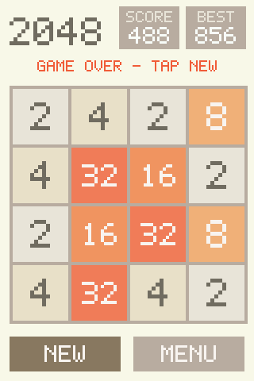
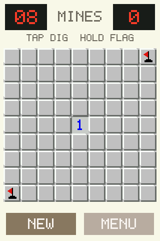

# Touch games: 2048 and Minesweeper on the LP-MSPM0G3519 and a small SPI touch screen

Two phone-style touch games run on the LP-MSPM0G3519 with the Waveshare 3.5 inch display: 2048 (swipe) and Minesweeper (tap to dig, long press to flag). Both draw through two display calls and read one touch call, so they port to another board by writing eight small functions. The pictures below are drawn by the same game code into a memory frame buffer on a Mac; the board's own screen has not been photographed.

 

Terms: [vocab](../../docs/vocab.md). 1 kB = 1,024 bytes. **Swipe**, **tap** and **long press** are the three touch gestures the games use. **Redraw** is sending pixels to the screen; the controller keeps the picture, so only changed parts are sent.

## What it does

| Part | What | Source |
|---|---|---|
| Gesture layer | Tap, long press (500 ms held still, fires while held), swipe left, right, up or down (fires as the finger passes 36 px). Portable C, no hardware, no allocation | `src/gesture.c` |
| 2048 | 4 x 4, merge rules, score, best, game over, tile colors, only changed tiles redrawn | `src/game2048.c` |
| Minesweeper | 9 x 9 with 10 mines, safe first dig, flood open, flags with a counter, number chord (tap a number whose flags match), timer, win and loss pictures | `src/mines.c` |
| Drawing | Rectangles and a 5 x 7 pixel font at any whole-number scale, built in one 3 kB scratch buffer | `src/gfx.c`, `src/font5x7.c` |
| Launcher and measurement | Two-button menu; a scripted run at boot that times the same code path a finger uses and prints the numbers on the serial console | `src/app.c` |
| Board layer | The eight functions in `src/hal.h`: `hal_init`, `hal_lcd_fill`, `hal_lcd_blit`, `hal_touch`, `hal_ms`, `hal_us`, `hal_log`, `hal_idle` (plus `hal_stack_used`) | `src/hal_mspm0.c` |

## Run it on the Mac (no board)

```bash
bash ports/touch-games/host/run_host.sh     # 215 checks on gestures, 2048 rules, minesweeper rules; rewrites proof/*.png
```

## Build and flash for the LP-MSPM0G3519

```bash
bash ports/touch-games/build.sh g3519       # TI Arm Clang; output in the build folder the script prints (`touch-games-g3519.out`)
BOOT_GAME=1 BENCH=0 bash ports/touch-games/build.sh g3519   # start straight in 2048, skip the boot measurement
```

Flash the `.out` with UniFlash's DSLite or OpenOCD, the way the board's `AGENTS.md` says. The display wires are the pins in `boards/board_g3519.h`; the wiring picture and table for the same display are in [the display test](../../mspm0g3507/display-test/README.md). The serial console (115200 baud) needs jumpers J12 and J13 on the XDS side.

## Results

All numbers are from one LP-MSPM0G3519, 80 MHz CPU, code in flash, display wired as in the display test. Three runs gave the same line to the microsecond; the scripted input makes a run repeatable. Times are firmware timestamps, not a camera. Rows are in `RESULTS-ROWS.csv`.

| What | 40 MHz SPI | 20 MHz SPI |
|---|---|---|
| Solid fill of the whole screen (153,600 px) | 67.2 ms | 134.4 ms |
| Full redraw of the 2048 screen (clear and draw everything) | 165.6 ms | 324.7 ms |
| Full redraw of the Minesweeper screen | 206.9 ms | 331.9 ms |
| Full redraw of the menu | 103.5 ms | 201.7 ms |
| One 2048 swipe, mean of 60 on a board that fills up (66,459 px sent on average) | 32.6 ms (max 47.5) | 61.6 ms (max 89.6) |
| One 2048 swipe, first 10 (51,319 px on average) | 24.9 ms | 47.3 ms |
| Minesweeper dig that redraws one cell (35 taps) | 1.09 ms | 1.60 ms |
| Minesweeper first dig of a board, which may open a region (8 boards) | 21.7 ms mean, 67.9 max | 32.5 ms mean, 102.2 max |
| Minesweeper long press, plant a flag | 4.9 ms | 8.4 ms |
| One read of the touch chip (5 bytes, software I2C) | 0.89 ms | 0.89 ms |

The 40 MHz setting is above the panel's rated clock of about 15 MHz; the LVGL demo ran at 40 MHz on this board and was seen on the screen on 2026-10-09 (`data/results/mspm0g3519.csv`). 2048 was played on the panel with touch on 2026-10-24 (the clip on the home and arcade pages); Minesweeper has not been looked at on the screen, and `RESULTS-ROWS.csv` holds no screen row for either game.

### Touch to pixel, an estimate

The loop polls the touch chip every 10 ms. A tap or swipe is therefore noticed 0 to 10 ms (mean 5 ms) after it happens, plus the 0.89 ms read, plus the redraw above. At 40 MHz: a tap on a closed Minesweeper cell is about 7 ms from touch to finished pixels (5 + 0.9 + 1.1); a first dig about 28 ms; a 2048 swipe about 31 to 39 ms from the moment the finger passes 36 px. The chip's own report delay is not measured, and no finger touched the board in these runs (the `touches` counter read 0 after 222 polls), so these are sums of measured parts, not a measured delay. Real touches are timed by the firmware (`lat_last_us`, `lat_max_us` in the `tg_stats` structure at the start of RAM, 0x20200C00 on the G3519); the first person to play can read them with a debugger.

### Size and fit

| Board | Flash | RAM (data and bss, stack included) | Of the chip | State |
|---|---|---|---|---|
| LP-MSPM0G3519 | 9.7 kB (play build); 11.0 kB with the boot measurement | 5.4 kB (3 kB draw buffer, 2 kB stack reserved) | 1.9 % of 512 kB flash, 4.2 % of 128 kB RAM | built, flashed, ran |
| LP-MSPM0G3507 | 10.8 kB with the boot measurement | 5.3 kB | 8.5 % of 128 kB flash, 16.6 % of 32 kB RAM | built only |
| LP-MSPM33C321A | 8.1 kB with the boot measurement | 4.3 kB (1 kB stack) | under 1 % of 1 MB flash | built only, with a stub screen (no touch display on this board) |

Stack use after the measurement was 592 B (painted-stack check). The G3507 line needs the same display wired to its own pins (`boards/board_g3507.h`); nothing about the games changes. Code size by file on the G3519 (bytes): app 1,933, mines 2,562, 2048 1,392, hal 1,394, gfx 910, SysConfig output 942, font 403, gesture 244, startup 198, ui 128.

## Limits

- No slide animation in 2048 and no spawn effect; a move shows the finished board.
- Touch orientation is untested: the code assumes the touch chip's x runs along the 320 px side, y along the 480 px side, as the display demo did. `TOUCH_SWAP_XY`, `TOUCH_FLIP_X` and `TOUCH_FLIP_Y` flip it at build time.
- Best score is kept in RAM only.
- Sound, haptics and vibration are not present.

## Fit of other phone-style games on the LP-MSPM0G3519

The first row is measured. The other rows are estimates from sizes and operation counts, not builds; each says what would change it.

| Game | Fits the G3519? | Why (estimate unless marked) |
|---|---|---|
| Swipe game (2048) | Yes, measured | 9.7 kB flash, 5.4 kB RAM, 25 to 33 ms a move at 40 MHz SPI (this folder) |
| Slingshot game with a small physics engine | Yes with a purpose-written engine; a general C++ engine is a poor fit | About 20 circles and boxes, fixed-point numbers, 30 steps a second. The core has no floating-point unit, so each float operation costs tens of cycles (not measured here); 190 body pairs at about 100 operations each would take roughly 14 ms a step in float and a few ms in fixed point, inside a 33 ms frame. Bodies at about 100 B each are 2 kB of RAM. The screen is the limit: a full-screen background image is 300 kB of the 512 kB flash, so use flat colors or tiles, and redraw only moved sprites (a 40 x 40 sprite and the strip it uncovers is about 3,000 px, 2.3 ms at 40 MHz) |
| Word game (five-letter guesses) | Yes | The two public word lists (about 2,300 answers and 13,000 guesses) as sorted five-letter words packed at 25 bits each are about 50 kB, less with delta coding; the grid and keyboard are taps. Needs a license check on the list used |
| Sudoku | Yes | Generator and solver by backtracking are a few kB of code and under 1 kB of RAM; the board is a 9 x 9 grid of the same cell drawing Minesweeper uses; digits pick by tap. Nothing here is near a limit |

## Files

| Path | Purpose |
|---|---|
| `src/` | The games, gestures, drawing, launcher, measurement and the MSPM0 hal |
| `boards/` | Pin lists for the G3519 and G3507, the screenless stub for the M33 build |
| `syscfg/` | SysConfig files (clock 80 MHz, SPI1, UART0, the display and touch pins) |
| `host/` | Memory-frame-buffer hal, 215 checks, picture maker |
| `build.sh` | Builds `g3519`, `g3507`, `m33` |
| `tools/g3519_lock_run.py` | Flash under the probe lock, read memory, capture the console |
| `proof/` | The two host-drawn pictures |

## Porting lessons

- The SPI block ignores a frame-size change while enabled: disable, change, enable for every window. Chip select needs a 10 us gap after it goes high or the screen drops commands.
- A full RGB565 frame for 320 x 480 is 300 kB, more than any MSPM0 here has. Redraw dirty tiles through one 3 kB scratch buffer, since the screen controller keeps the picture.
- On these boards the chip's I2C block got no answer from the touch chip, and bit-banged I2C on the same pins with the chip's pull-ups did. Keep the last finger state when a read fails, or a swipe breaks into a tap.
- Fire a swipe when the finger passes the distance, not at lift, and suppress the tap after a long press or a swipe.
- Polled 16-bit sending reached the same 67.2 ms full-screen fill as DMA at a 40 MHz clock. The panel's rated clock is about 15 MHz.
