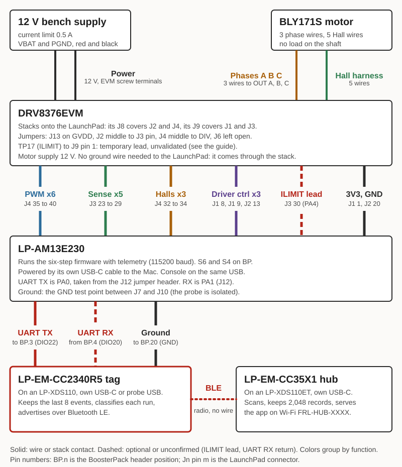

# Wiring the motor demo: AM13 motor controller, Bluetooth tag, site hub

The LP-AM13E230 runs a brushless motor through the DRV8376EVM, counts run events and driver faults, and sends them over a UART to the LP-EM-CC2340R5 tag. The tag advertises them over Bluetooth LE, and the LP-EM-CC35X1 hub collects them and serves them to a phone.

Terms: [vocab](../docs/vocab.md). The telemetry formats are in [PROTOCOL.md](PROTOCOL.md), the rest of the system in [README.md](README.md) and [GETTING-STARTED.md](GETTING-STARTED.md). The motor bench itself is in [am13e230/bldc-drv8376/README.md](../am13e230/bldc-drv8376/README.md).

## Read this first: what has run and what has not

- **The tag and hub path with the AM13 as the tool ran, over USB.** Lock, unlock and a driver fault reached the tag and the hub with the Mac copying lines between the two boards (`sim/bridge.py`). No jumper wire between the boards has run. The UART wire below replaces that Mac copy, and its AM13 end is unconfirmed.
- **Only the six-step image carries telemetry.** It is `am13e230/bldc-drv8376` with `tool/am13e230/tt_tool.inc` added. The guarded TI FOC image (`am13e230/foc-drv8376`, the one the motor console drives) sends no telemetry lines: it talks TI's MotorVision protocol at 9.2 Mbaud on the same pins, which a 115200 tag cannot read.
- **The motor did not spin as the tool in this setup.** On 2026-10-17 the six-step image's Hall learn tripped the DRV8376 fault at once, twice. The likely cause, not verified, is the undriven ILIMIT pin (PA4); the FOC image fixed the same fault by driving PA4 before enable. Until that is settled, treat the fault reports as the part of this demo that works. Spinning as the tool does not work.
- The hub in this repository is the LP-EM-CC35X1. The LP-EM-CC2755P10 builds as a second tag, not as a hub.

## Parts

| Part | Qty | Notes |
|---|---|---|
| LP-AM13E230 LaunchPad (Rev E2) | 1 | The motor controller. S6 and S4 slide to BP. Rev E1 has different pins; stop if yours is E1 |
| DRV8376EVM | 1 | Plugs onto the LaunchPad kit's J1 to J4, screw terminals away from the USB-C connector |
| Anaheim BLY171S-24V-4000 motor with its Hall harness | 1 | Eight poles, 24 V rated, run here at 12 V with nothing on the shaft |
| 12 V DC bench supply or adapter | 1 | Proven with a 12 V, 0.5 A adapter. Set a bench supply's current limit to 0.5 A. The EVM takes 4.5 to 65 V and is reverse-polarity protected, but this bench stays at 12 V |
| LP-EM-CC2340R5 on an LP-XDS110 | 1 | The tag. Built and flashed with `tool-telemetry/tag/build.sh` and `flash.sh` |
| LP-EM-CC35X1 on an LP-XDS110ET | 1 | The hub, with its own USB-C cable. Activated once ([cc35x1/README.md](../cc35x1/README.md)) |
| USB cables | 4 | AM13 USB-C, tag probe USB, hub probe USB, hub USB-C |
| Female-to-female jumper wires | 3 | UART TX, UART RX (optional), ground. Plus one more for the ILIMIT lead if your EVM has it fitted |
| A phone, and a Mac to build and flash | | |

## Setup before any wire

1. EVM jumper J13 on GVDD (5 V for the Halls). EVM J2: one link from the middle pin to the separate pin above it (J3). EVM J4: one link from the middle pin to DIV. J6 stays open: fitting it turns current limiting off. This is the state recorded on 2026-10-16 (BENCH.md); it is recorded there, not independently measured.
2. LaunchPad S6 and S4 to BP, so Hall B and C reach the headers instead of the CAN transceiver.
3. Build and flash the AM13 with telemetry: `tool-telemetry/tool/am13e230/build.sh --flash` (the probe serial in that script is the bench board's; use `tool/am13e230/build.sh` and your own flasher if yours differs).
4. Build and flash the tag and the hub ([GETTING-STARTED.md](GETTING-STARTED.md)).
5. Power everything off, then wire in the order below. USB-C to the AM13 last, then the 12 V supply.

## Wiring

"Stack" means the contact is made by pushing the EVM onto the LaunchPad; no wire is added. LaunchPad connector pins follow the board silkscreen: J1 (pins 1 to 10) and J3 (21 to 30) on the left, J4 (31 to 40) and J2 (11 to 20) on the right, pin 1, 21, 40 and 20 at the top. Tag header positions are BoosterPack BP.1 to BP.40 from TI's LP-EM-CC2340R5 board file.

### Power

| From | To | Why |
|---|---|---|
| 12 V supply + | DRV8376EVM VBAT screw terminal | Motor supply |
| 12 V supply - | DRV8376EVM PGND screw terminal | Return |
| EVM J9 pin 20 (3.3 V), stack | LP-AM13E230 J1 pin 1 (3V3) | The EVM's logic reference comes from the LaunchPad |
| LP-AM13E230 USB-C | Mac | Powers the AM13 and carries the console (115200) |
| LP-XDS110 USB (tag) | Mac | Powers the tag |
| LP-XDS110ET USB-C (hub) | Mac or a USB charger | Powers the hub. Its own cable, not the probe's |

### AM13 to DRV8376EVM (all by stack)

| Signal | LaunchPad pin | EVM side | Source |
|---|---|---|---|
| INHA | J4 pin 40 (PB3), MCPWM4 1A | high-side input A | `bldc.syscfg` |
| INLA | J4 pin 39 (PA7), MCPWM4 1B | low-side input A | `bldc.syscfg` |
| INHB | J4 pin 38 (PB1), MCPWM4 2A | high-side input B | `bldc.syscfg` |
| INLB | J4 pin 37 (PA2), MCPWM4 2B | low-side input B | `bldc.syscfg` |
| INHC | J4 pin 36 (PB2), MCPWM4 3A | high-side input C | `bldc.syscfg` |
| INLC | J4 pin 35 (PA25), MCPWM4 3B | low-side input C | `bldc.syscfg` |
| Hall A | J4 pin 34 (PB7) | Hall block, 10 k pull-up to 3.3 V on the EVM | `bldc.syscfg` |
| Hall B | J4 pin 33 (PB6) | Hall block | `bldc.syscfg` |
| Hall C | J4 pin 32 (PA12) | Hall block | `bldc.syscfg` |
| nSLEEP | J1 pin 9 (PA23), output, high = awake | nSLEEP | `bldc.syscfg` |
| nFAULT | J1 pin 8 (PB4), input, low = fault | EVM J9 pin 6 | `bldc.syscfg`, firmware reads PB4 |
| DRVOFF | J2 pin 13 (PB18), output, high = outputs off | DRVOFF | `bldc.syscfg` |
| nFAULT, old route | J1 pin 10 (PA22) | EVM J9 pin 2 | Not used by the fault logic: R25 reads as absent, PA22 stays high in a fault |
| VSENA | J3 pin 26 (PA17) | phase A voltage sense | `bldc.syscfg` |
| VSENVM | J3 pin 23 (PA16) | bus voltage divider (143 k over 6.04 k), reported as `vb` | `bldc.syscfg`, `counts_to_mv` in `main.c` |
| Phase current sense outputs | J3 pins 27, 28, 29 (PA27, PA30, PA29) | ISENA, ISENB, ISENC | Pin numbers from the LaunchPad silkscreen. Which EVM label goes to which pin is **unconfirmed**: TI's guide table and its schematic disagree on A and C (FAULT-ISOLATION.md). The telemetry sends `ipk=0` anyway, so the demo does not depend on it |
| VSENB, VSENC | J3 pin 25 (PA28), J3 pin 24 (PA18) | phase B and C voltage sense | Pins from the silkscreen picture and `bldc.syscfg`; EVM side **unconfirmed** (listed "not recorded" in the FOC README) |
| MCU LED | J2 pin 11 (PB11) | none | On while the program runs |
| ILIMIT lead | LaunchPad J3 pin 30 (PA4) through EVM J9 pin 1 (`C_TAP/ILIM_DAC`) | EVM test post TP17 (ILIMIT, red post left of J4) | A temporary lead from TP17 to J9 pin 1 is fitted on the bench. It has never passed a known-voltage check. In the six-step image PA4 is an ADC input; any image that drives PA4 as a DAC (the FOC guard does) needs this lead removed first, with power off |

### Motor to DRV8376EVM

| Wire | From | To |
|---|---|---|
| Phase | motor yellow | EVM OUT A |
| Phase | motor red | EVM OUT B |
| Phase | motor black | EVM OUT C |
| Hall power | harness red | Hall block, PWR (5 V from J13 on GVDD) |
| Hall ground | harness black | Hall block, GND |
| Hall A | harness blue | Hall block, A |
| Hall B | harness green | Hall block, B |
| Hall C | harness white | Hall block, C |

Phase order does not matter: the firmware learns the Hall table (`l`).

### AM13 UART to the CC2340R5 tag

Both ends run 115200, 8N1. The AM13 prints `$TS`, `$TE` and `$TP` lines on the same UART as its console (the tag ignores anything that does not start with `$`), and the tag answers with `$TC` command lines the other way ([PROTOCOL.md](PROTOCOL.md) sections 1 and 7).

| Wire | From | To | Status |
|---|---|---|---|
| UART TX, required | LP-AM13E230 J12, the position labelled `TX>` (PA0, UC4) | LP-EM-CC2340R5 BP.3 (DIO22, the tag's UART RX) | Pins on the tag are from TI's board file and the tag build (`ti_drivers_config.h`: TX DIO20, RX DIO22). **Unconfirmed:** that `TX>` on J12 is the MCU's transmit side, and the numbering of the J12 positions (the silkscreen shows eight: BSL INV, TDI, TDO, TCK, TMS, nRST, TX>, RX<). Check the AM13 user's guide (SLVUDH9) or listen: with the wire on, the tag's `rx_ok` count must rise |
| UART RX, optional | LP-EM-CC2340R5 BP.4 (DIO20, the tag's UART TX) | LP-AM13E230 J12, the position labelled `RX<` (PA1) | Needed only for lock, unlock and stop commands from the hub. Same unconfirmed J12 note. Pull the wire if you want a telemetry-only demo |
| Ground | LP-AM13E230 GND test point (the two round pads labelled GND between J7 and J10) | LP-EM-CC2340R5 BP.20 (GND) or BP.22 (GND) | Required. The AM13's USB probe is isolated, so the two boards share no ground through the Mac. Pad position is from the silkscreen picture |

Two things to settle with the tag's probe in place:

- The LP-XDS110 also drives the tag's DIO22 for its USB serial port. [README.md](README.md) says to remove "the tag's RXD jumper to its probe" first. Which jumper that is on the LP-XDS110 is **unconfirmed** (not in this repository's files): check its user's guide. Until it is out, the probe's transmitter and the AM13's TX share one line.
- J12 also feeds the AM13's own USB console, so the Mac still sees the AM13's prints while the wire is on.

### Tag to hub

No wire. The tag advertises; the hub scans. Keep them within a few metres. The hub's access point is `FRL-HUB-XXXX`, address 10.0.0.3, and its Wi-Fi password is in `<scratch>/secrets/tool-telemetry-hub.env`.

### Common ground, in one place

| Boards | How ground is shared |
|---|---|
| EVM and LaunchPad | Through the stacked headers (J2 pin 20 and J3 pin 22 are GND on the LaunchPad). Whether the EVM ties PGND to its logic ground was not checked in the files: **unconfirmed**, check with a meter between PGND and the LaunchPad GND test point with the supply off |
| AM13 and tag | The wire above. Required, because the AM13 probe is isolated |
| Tag and hub | Not needed: they talk by radio |

## Running it

1. Power on: USB to the AM13, tag and hub, then the 12 V supply.
2. Open a terminal on the AM13 console at 115200 (`am13e230/tools/uart_cmd.py`). You should see the help line and `mode check: ... 6x PWM mode`. The tag prints `@TAG boot ...`, and its `rx_ok` counts rise about every 10 s (the idle status line).
3. Join the hub's Wi-Fi, open `http://10.0.0.3`. The tool `BLDC-01` appears within seconds, state idle.
4. On the AM13 console: `l` (learn, shaft free), `2` (20 percent duty), `g` (run), then `s`. Each go-to-stop is one run event (`trig` is the run-event count in the lines). The hub shows run time and the run-event count rise.

## Fault injection

Rules for all of these: 12 V only, supply current limit 0.5 A, duty at 20 percent or less (the firmware caps at 40), nothing on the shaft, one person with a hand on the supply switch. Do each with the motor stopped first. Everything marked "expected" is read from the code and has **not** been run; the two marked "seen" ran on 2026-10-17.

What the firmware (`tt_tool.inc` on `main.c`) detects and reports over UART, so it can reach the hub:

| Firmware condition | Line sent | Hub sees |
|---|---|---|
| Driver fault: PB4 nFAULT low | `$TE ev=flt v=1`, then `$TS` with `st=2` | `flt` count +1, tool state Fault, flags bit 1 |
| Stall: running, no Hall edge for 1.5 s | `$TE ev=oc v=0`, motor stopped | `oc` count +1. The app calls it an overcurrent trip; here it is a stall trip, not a measured current |
| A run ends | `$TE ev=trig v=<ms>` | Run-event count +1, run time |
| MCU reset | `$TE ev=boot` | Boot event, counters back to 0 (they are not stored in flash) |
| Signed lock from the hub | `st=3` in `$TS` | State Locked, `go` refused |

| # | Fault | How to cause it, bounded | Reaches BLE | What you should see |
|---|---|---|---|---|
| 1 | Driver fault | Seen, not caused on purpose: the Hall learn at 20 percent tripped nFAULT at 1.04 s, twice. There is no safe, repeatable way to force the DRV8376's own protections, and this demo does not try | Yes (seen) | Console: `DRIVER FAULT (PB4 nFAULT low)`. Tag: `$TE ev=flt`, `flt=1`, `st=2`. Hub: Fault state and flt count. Clear it with `c` on the console |
| 2 | Stall | Load the built-in table (`T`), set 20 percent, `g`, then hold the shaft with a gloved hand for 2 s and let go. Or: remove one Hall wire as in row 3 | Yes (expected) | Console: `no Hall edge for 1.5 s: stopped`. Hub: `oc` +1, run ends, state back to Idle. A hard hold can instead trip nFAULT (row 1) |
| 3 | Missing Hall wire | Supply off, USB off, remove the blue Hall A wire at the Hall block, power on, `T`, `2`, `g` | Yes, as a stall (expected) | The rotor does not follow the field, no Hall edges, stall after 1.5 s. If you press `l` instead, the console says `learn failed ...` and nothing is sent for it. Do not pull the wire with power on |
| 4 | UART link loss | Unplug the UART TX wire while the hub is watching | Yes, as a loss of data (expected) | The tag's `link` counter rises, flags bit 3 (tool link alive) clears after 15 s, and the hub's `/api/tags` shows `link` growing and `rxok` flat. The tag then falls back to its button demo only if you press a button |
| 5 | Tool reset | Press S1 (reset) on the LaunchPad | Yes (expected) | `$TE ev=boot` appears in Events, totals restart at 0 |
| 6 | Remote lock | `homebase/sendcmd.py --hub http://<hub> --tag <addr> lock` | Yes (seen, 3.6 to 5 s) | `st=3`, console: `locked by the fleet`. Needs the optional RX wire. `unlock` clears it |
| 7 | Low bus voltage | Lower the supply to about 8 V while idle | Voltage only, no event | `vb` in the live values drops. The six-step firmware has no under-voltage check, so no event is raised. Whether the DRV8376 itself raises nFAULT at its undervoltage lockout was not checked |

Faults the firmware does **not** report over BLE, and why:

- **The guard's current limit, host-lost, run cap, bus-window and background-stall stops** (`frl_guard.c`) exist only in the FOC image. They set `frlGuard.reason` in the MotorVision table, which the motor console reads. That image prints no `$T` lines and no tag is listening at 9.2 Mbaud, so none of these reach the tag. Lowering the guard's limit (`limit_A`) is a console experiment, not a demo of this path.
- **DRVOFF held high.** The six-step firmware never reads DRVOFF; it is an MCU output (PB18), so forcing it from outside fights the pin. Do not try. If the outputs go off by any other route, the symptom is a stall (row 2).
- **Measured overcurrent.** The six-step image sends `ipk=0` because the EVM's current sense is not validated, so an overcurrent is never measured. Only the stall trip stands in for it.
- **Fault code.** `$TE ev=flt` always carries `v=1`; the DRV8376 has no fault-code pin the firmware reads.

## If something is silent

| Symptom | Check |
|---|---|
| Console prints nothing | Both USB cables; 115200; the AM13 probe port is the second one for that serial |
| Tag `rx_ok` stays 0 | TX and RX swapped or the wrong J12 position, ground wire missing, or the probe's RXD jumper still fitted |
| Hub shows the tag but no tool name | The tag is in button demo mode: no line has arrived for 15 s |
| `DRIVER FAULT` the moment you press `l` | The open ILIMIT question above. Do not keep retrying; stop and read am13e230/foc-drv8376/FAULT-ISOLATION.md |
